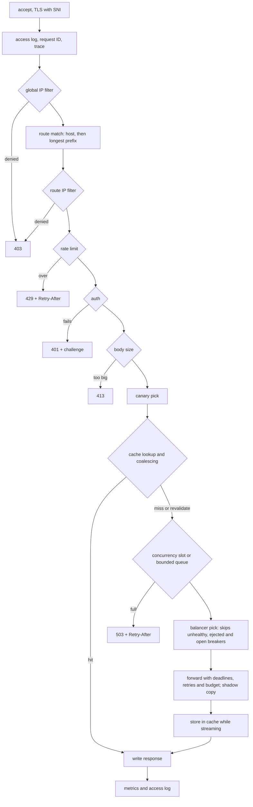
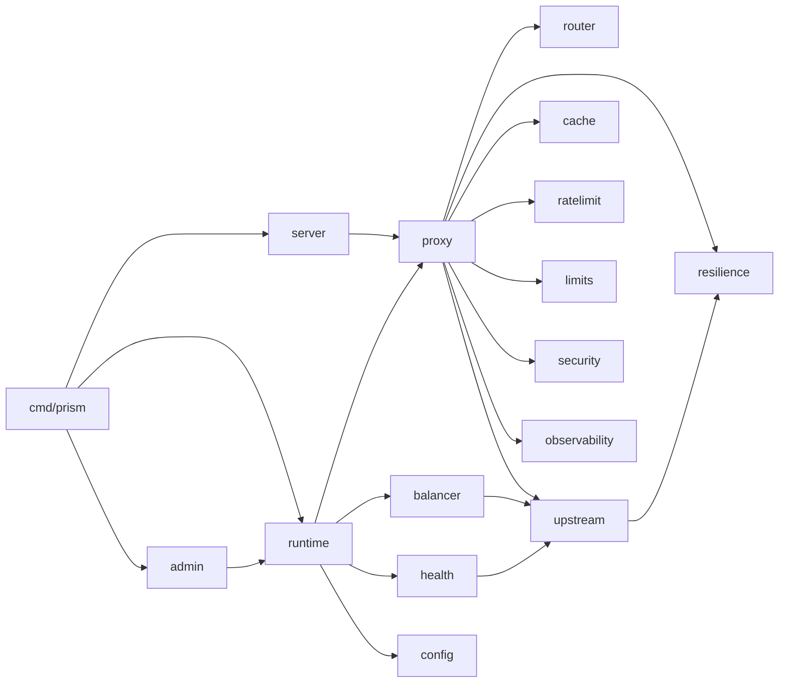
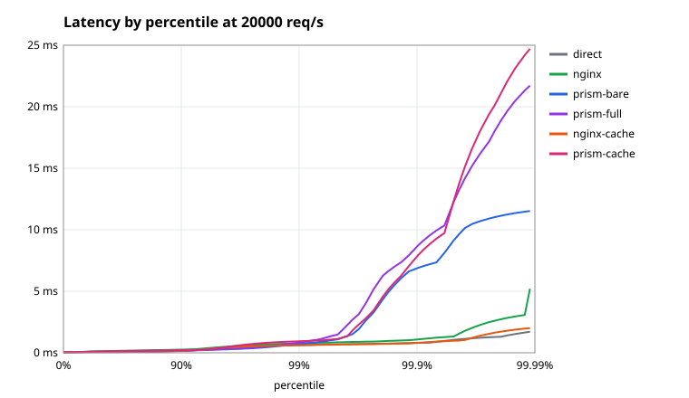

# Prism

Prism is an nginx-style HTTP reverse proxy written in Go. It uses `net/http` for the server and `http.Transport` for the client, and writes the rest by hand: the forwarding layer (hop-by-hop headers, forwarded headers, streaming, cancellation, error mapping, retries, WebSocket upgrades), the load balancers, the rate limiter, the circuit breaker, the response cache and its request coalescing. It does not use `httputil.ReverseProxy`. Libraries are used only for YAML, Prometheus and bcrypt.

## Features

- **Core proxy:** host and longest-prefix routing, TLS with SNI certificate selection, prefix stripping, request and response header rules, X-Forwarded-* and RFC 7239 `Forwarded` with a trusted-proxy list, streaming in both directions with flushing and trailers, client cancellation passed through to the backend, and graceful shutdown with a drain delay.
- **Traffic management:** round robin, smooth weighted round robin, least connections (power of two choices) and consistent-hash `ip_hash`; per-IP GCRA rate limits; per-route concurrency caps with a bounded queue; request body limits; retries that only go to an untried backend.
- **Resilience:** a circuit breaker per backend, outlier ejection, active health checks, and a per-route retry budget with full-jitter backoff.
- **Caching:** an RFC 9111 response cache with a hand-written `Cache-Control` parser, Vary, revalidation with ETag and Last-Modified, `stale-if-error`, request coalescing with a lock timeout and hit-for-pass, and purging through the admin API.
- **Operations:** Prometheus metrics, JSON or text access logs, `X-Request-Id`, and an admin API (`/routes`, `/upstreams`, `/config`, `/metrics`, `/reload`, `/cache/stats`, `/cache/purge`, and optionally `/debug/pprof/`). SIGHUP reloads the config without dropping a request, and it keeps health, breakers, pooled connections, limiters and the cache when their settings are unchanged.
- **Routing and security:** IP allow and deny lists, Basic auth with bcrypt and API keys, sticky canary splits, shadow traffic, WebSockets, HTTP/2 on TLS and h2c, and W3C `traceparent` propagation.

## Quickstart

Prism needs Go 1.27.

```sh
make build                                        # bin/prism
./bin/prism -config examples/prism.yaml -validate # check a config
./bin/prism -config examples/prism.yaml -log-format json
kill -HUP $(pgrep prism)                          # reload the config
```

The flags are `-config` (default `prism.yaml`), `-validate`, `-log-level` (`debug`, `info`, `warn` or `error`), `-log-format` (`text` or `json`) and `-version`.

[`examples/prism.yaml`](examples/prism.yaml) uses every feature and explains each setting in its comments. A minimal config:

```yaml
listeners:
  - addr: ":8080"

upstreams:
  api:
    balancer: least_conn
    backends:
      - { url: "http://10.0.0.1:8080" }
      - { url: "http://10.0.0.2:8080" }
    health: { path: /healthz, interval: 5s }
    circuit_breaker: { failure_ratio: 0.5, min_requests: 20, open_for: 30s }

routes:
  - match: { path_prefix: "/api/" }
    upstream: api
    rate_limit: { per_ip: "100/s", burst: 50 }
    retry: { attempts: 2, on: [connect_error, timeout] }

admin: { listen: "127.0.0.1:9901" }
```

Other make targets:

| target | what it does |
| --- | --- |
| `make lint test` | `go vet`, staticcheck, gofmt, and every test with `-race` |
| `make fuzz` | nine fuzz targets, 30 s each |
| `make bench` | the Go benchmarks, with allocations |
| `make chaos` | the two chaos scenarios, with graphs (about 90 s) |
| `make reload` | a SIGHUP every 0.25 s under load, failing on any error |
| `make bench-compare` | the comparison with nginx (about 25 minutes; needs Docker) |

## Architecture

### Request pipeline

Most of the design work was choosing the order of these steps. Every request loads the current `Runtime` snapshot once and keeps it until it finishes, so a reload can't break a request in flight and the hot path takes no lock.



The cache lookup comes before the concurrency limit. Hits, and requests waiting on a coalesced fetch, never hold a slot; only the request that goes to a backend takes one. Otherwise cheap hits, and hundreds of waiters on one cold key, would starve real work.

### Packages



| package | role |
| --- | --- |
| `config` | schema, parsing with unknown keys refused, defaults, validation |
| `runtime` | the immutable snapshot built from a config, swapped atomically on reload, and what a reload carries over |
| `server` | listeners, TLS and SNI, h2c, the access log, graceful shutdown, hijacked-connection tracking |
| `router` | host and path-prefix matching |
| `proxy` | forwarding, header rules, streaming, error mapping, retries, the cache path, canary, shadow, WebSockets, tracing |
| `upstream` | backends, pools and one `http.Transport` per backend |
| `balancer` | round robin, weighted, least connections, ip_hash |
| `ratelimit` | GCRA in sharded maps |
| `limits` | the concurrency semaphore with a bounded queue |
| `resilience` | breaker, outlier detection, retry budget, backoff |
| `health` | active health checks |
| `cache` | `Cache-Control` parsing, freshness, the LRU store, coalescing, revalidation |
| `security` | IP filter, Basic auth, API keys |
| `observability` | logger and Prometheus metrics |
| `admin` | the admin API, on its own listener |

## Design decisions and tradeoffs

The full reasoning is in the handoff notes, [`docs/m1-handoff.md`](docs/m1-handoff.md) through [`docs/m7-handoff.md`](docs/m7-handoff.md).

**Forwarding**

- **`net/http` and `http.Transport`, with no `httputil.ReverseProxy`.** Writing an HTTP parser would take months before any interesting feature, and wrapping `ReverseProxy` would leave the forwarding to the library. Prism owns everything between the two.
- **One `http.Transport` per backend.** TLS `server_name` and the CA are per backend. The cost is one connection pool per backend.
- **HTTP/1.1 to backends only.** One request per connection is what least-connections assumes, and it keeps upgrades simple. Clients can still use HTTP/2.
- **No whole-request read or write timeout on listeners**, only `read_header` and `idle`. A whole-request timeout would kill large uploads and server-sent events.
- **Plain string path prefixes, as nginx does.** `/api` also matches `/apiv2`; end a prefix with `/` to match whole segments.

**Traffic and resilience**

- **Least connections uses power of two choices** on `(inflight+1)/weight`. It is O(1), and it doesn't send every concurrent request to the same idle backend, as Envoy's least_request also avoids.
- **`ip_hash` is a ketama-style ring with unseeded hashes.** Adding a backend moves about 1/N of clients, and all instances agree. With 160 points per weight, spread across 10 backends is about ±17%.
- **The rate limit is GCRA**: one integer per key, an exact token bucket, in 64 sharded maps with lazy eviction and no background goroutine.
- **Retries go only to an untried backend.** `connect_error` is retried for any method, but only when no body bytes were sent; timeouts and 5xx only for idempotent methods. A retry never duplicates a non-idempotent request.
- **A Finagle-style retry budget per route.** Retries are capped at a ratio of requests over a 10 s window, so an outage can't multiply load. Once the budget is spent, retries come back in a burst every 10 s; a token bucket would smooth that, but it would lose the exact per-window bound.
- **One breaker per backend**, so one bad backend doesn't open the breaker for the whole pool. A client cancel, a 4xx or a local rejection never counts as a failure, so a client can't get healthy backends ejected.
- **Outlier ejection never empties a pool** (`max_ejection_percent`), and its expiry is lazy, so it runs no timers.

**Caching**

- **No heuristic freshness.** A response without `s-maxage`, `max-age` or `Expires` is not cached, because guessing a lifetime is how stale pages get served.
- **Coalescing follows nginx's `proxy_cache_lock` and Varnish's hit-for-pass.** One leader fetches while the others wait up to `lock_timeout`; an uncacheable answer marks the key for 10 s so later requests don't queue behind it. The leader keeps filling the cache after its own client leaves, because the waiters depend on it.
- **One mutex over a byte-bounded LRU of immutable entries.** Hits write to the client without holding the lock.
- **Authenticated responses are shared only when they are `public`, `s-maxage` or `must-revalidate`**, for both `Authorization` and Prism's own auth.

**Operations**

- **Metric handles are resolved per route and backend when the config is built**, and the `code` label is the status class. Recording a request indexes an array instead of hashing labels behind a lock. The access log keeps the exact status.
- **A reload keeps state by identity.** A backend's health, inflight count, breaker and transport, a route's limiter, semaphore and retry budget, and the cache each carry over while their settings are unchanged. Listener, admin and shutdown settings need a restart, and a reload warns about changes to them.
- **`X-Request-Id` is trusted only from trusted peers**, so a client can't choose the ID its requests are logged under. `traceparent` is accepted from anyone, because it decides nothing inside Prism and joining a browser's trace is the point.

**Routing and security**

- **The rate limit runs before auth**, so it also caps password guessing. bcrypt runs at most GOMAXPROCS at a time, unknown users are checked against a dummy hash, and verified passwords are remembered for five minutes.
- **Canary assignment is sticky by client IP over 10,000 buckets.** Raising the percent only adds clients, and a header or cookie set to `always` or `never` overrides it for one request. Canary requests skip the cache.
- **Shadow copies never delay the real request.** A copy runs on its own goroutine with its own timeout, a full semaphore drops it, and a body that is too large or of unknown length is not copied.
- **A WebSocket holds its route's concurrency slot for its whole life**, so the cap bounds open connections too.
- **One span per incoming request.** Every request Prism sends for it names that span as the parent. With no span exporter, a span per attempt would point at parents that appear nowhere.

## Benchmarks

The full results, with the machine and settings, are in [`docs/bench/results.md`](docs/bench/results.md). They come from one laptop (Intel i7-13620H, on AC power, `performance` governor), with [vegeta](https://github.com/tsenart/vegeta) on CPUs 0–3, the proxy on 4–7 and the backends on 8–11. The backend is `test/faultserver` returning a 1 KiB body. nginx 1.28 runs in Docker with host networking, set up to do what Prism does: keep-alive to the backend, the X-Forwarded-* and X-Request-Id headers, one access-log line per request, and as many workers as Prism has threads. Each figure is the median of three runs: 30 s at a fixed rate, or 15 s closed loop with 64 workers.

- `prism-bare`: one route, round robin over one backend.
- `prism-full`: least_conn over two backends, a breaker, outlier detection, header rules, a rate limit that never refuses, a body limit, a concurrency cap, and retries with a budget.
- `*-cache`: every request is a cache hit.

| scenario | closed-loop req/s | added p50 / p99 at 5k req/s | added p50 / p99 at 20k req/s | CPU per request | allocs per request |
| --- | --: | --: | --: | --: | --: |
| direct | 114,526 | | | | |
| nginx | 98,666 | +41 µs / +51 µs | +40 µs / +136 µs | 18.8 µs | |
| prism-bare | 68,822 | +84 µs / +256 µs | −24 µs / +68 µs | 45.1 µs | 82 |
| prism-full | 66,145 | +84 µs / +240 µs | −21 µs / +202 µs | 48.3 µs | 86 |
| nginx-cache | 100,830 | −5 µs / −5 µs | +4 µs / −20 µs | 17.5 µs | |
| prism-cache | 99,234 | +12 µs / +96 µs | +14 µs / +307 µs | 22.1 µs | 31 |

Added latency is a scenario's latency minus the direct backend's at the same rate. CPU per request is from the closed-loop runs.



What the numbers say:

- **Throughput:** Prism forwards about 70% of nginx's requests per second, and enabling every feature costs another 4%. On cache hits the two are level.
- **CPU:** Prism uses about 2.4 times nginx's CPU per proxied request, and 1.3 times per cache hit. Under load, about 21% of Prism's CPU goes to syscalls, 15% to allocation and GC assist, and 10% to the access log.
- **Added latency:** at 5,000 req/s Prism adds 84 µs at the median and about 250 µs at p99, against 41 and 51 µs for nginx. At 20,000 req/s Prism's median is *below* the direct backend's. Prism isn't faster; its pooled keep-alive connections to the backend do better at that rate than vegeta's own connections to it.
- **The tail:** Prism's maximum latency is 13–28 ms, against 5 ms or less for nginx, and it shows in the graph above the 99.9th percentile. GC pauses and assists are the likely cause, but that hasn't been confirmed.

Caveats:

- Everything runs on one machine. At around 100,000 req/s the direct backend may be limited by vegeta on four cores rather than by the backend itself.
- CPU per request at the fixed rates is inflated for Prism, because Go's scheduler spins on idle threads and `/proc` counts in 10 ms ticks. The closed-loop figures are the fairer comparison.
- nginx's CPU comes from its container's cgroup, which also counts the master process. That adds very little.

### Allocations

`BenchmarkPipeline` (in `internal/server`) measures Prism's own cost per request without sockets. Profiling under load showed the biggest allocation sources, and three fixes removed them without changing behavior ([`docs/bench/benchstat.txt`](docs/bench/benchstat.txt)):

- `http.ParseTime("")` allocated three parse errors for every missing date header on the cache path.
- The forwarding headers now share one backing array.
- The traceparent is formatted once and reused for the access log's IDs.

| benchmark | allocs/op | time |
| --- | --: | --: |
| `Pipeline/bare` | 26 → 21 | −1.7% |
| `Pipeline/full` | 27 → 22 | −4.0% |
| `Pipeline/cache_hit` | 13 → 9 | −6.1% |
| `CacheHit` (proxy only) | 11 → 9 | −10.9% |

Of the 82 allocations per request under load, about 20 are Prism's own; the rest belong to `net/http`'s server and client.

To reproduce, run `make bench-compare` (`QUICK=1` for a one-minute trial). It needs Docker for nginx, and it gives steady numbers only on AC power with the `performance` governor. Results go to `bin/bench/`. Set `admin: {pprof: true}` to profile the real binary under load.

## Failure demos

`make chaos` runs three [fault servers](test/faultserver) behind Prism at 300 req/s and draws each run with [`test/chaosplot`](test/chaosplot):

- **[A backend killed and restarted](docs/m3-chaos/kill-backend.svg):** 12,001 requests with no errors. The breaker opened 0.4 s after the kill, health checks marked the backend down at 1.3 s, and after the restart half-open probes closed the breaker.
- **[All backends returning 503 for 20 s](docs/m3-chaos/outage.svg):** with 2 retries per request, the retry budget held load amplification at 1.12 overall. Without the budget it would be 3.0.

## Testing

- **Unit tests** are table-driven: routing, header rewriting, balancers, freshness math, breaker transitions, auth and the rest. Time-based logic takes an injectable clock, and its tests run on a fake one.
- **Fuzzing:** nine targets, each against a simple reference: the config parser, route matching, client IP, path validation, `traceparent`, GCRA, the breaker window, the retry budget and `Cache-Control`.
- **End-to-end tests** in [`test/e2e`](test/e2e) start the real stack from YAML with real backends and check what the backend saw: headers, connection reuse, cancellation, a backend dying under load, 1,000 concurrent requests coalescing into one, reloads under load, the canary split, the shadow adding no latency, an auth matrix, WebSockets and HTTP/2.
- **Everything runs with `-race`.** Concurrency bugs are the main risk in a proxy.
- **Every hot-path function has a benchmark** with `ReportAllocs`.
- **Chaos and reload scripts** run against the real binary: `make chaos` and `make reload`.

## What's not supported

- **HTTP/2 or HTTP/3 to backends.** Backends are reached over HTTP/1.1. HTTP/3 isn't supported on either side.
- **WebSockets over HTTP/2** (RFC 8441, extended CONNECT). Only HTTP/1.1 clients can upgrade. Prism sends no close frame at shutdown; it closes the TCP connection at the deadline.
- **`stale-while-revalidate`** is parsed but not acted on. There is no heuristic freshness, no disk cache, and HEAD misses are not cached.
- **Admin authentication.** The admin API has none, and Prism warns at startup when it listens beyond loopback. `/config` hides hashes, key digests and URL passwords, but it shows user and key names.
- **A separate limiter for failed logins.** Password guessing is limited only by the route's rate limit; Build warns about a Basic auth route without one.
- **ACME, adaptive concurrency limits, OpenTelemetry export and readiness on the admin port.** Readiness is a `ready_path` on the main listeners.
- **Known limits:**
  - After its client leaves, the cache leader's drain of the backend body has no deadline.
  - Health check streaks restart on every reload.
  - The rate limiter holds at most about 262,000 keys per route.
  - `ip_hash` spread is about ±17% across 10 backends.

## Project history

Prism was built in eight milestones, from a skeleton to these benchmarks. The plan and its status are in [`docs/project-plan.md`](docs/project-plan.md), and each milestone's decisions are in its handoff note in [`docs/`](docs/).
