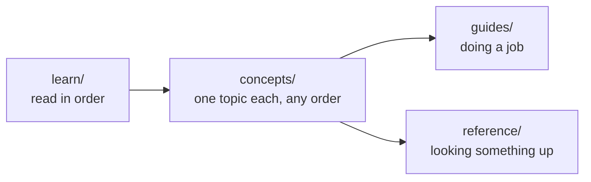

# Prism documentation

Prism is a reverse proxy in the style of nginx, written in Go. These docs explain how it works, and along the way how real backend infrastructure works: load balancing, rate limiting, retries, circuit breakers, HTTP caching, hot reloads and more.

You should already know how to program and be able to read Go. You don't need to know anything about networking or proxies. Terms are defined in the [glossary](glossary.md).

## Start here

Read these in order. Together they take about two hours, and you finish knowing what every part of the codebase is for.

1. [What is a reverse proxy?](learn/01-what-is-a-reverse-proxy.md) The problem Prism solves, and the idea it is built on.
2. [HTTP for proxies](learn/02-http-for-proxies.md) The parts of HTTP that matter once something sits between client and server.
3. [Run it](learn/03-run-it.md) Start Prism on your machine, then break things and watch what happens.
4. [Codebase tour](learn/04-codebase-tour.md) The packages, the core types, and what happens at startup.
5. [Life of a request](learn/05-life-of-a-request.md) One request followed through the code, from the socket and back.

## How the docs are organized

| section | what it is for | status |
| --- | --- | --- |
| `learn/` | building a mental model, start to finish | done |
| `concepts/` | one subsystem at a time: the problem, the idea, Prism's code, an experiment, the tradeoffs | done |
| `guides/` | adding a feature, testing, running Prism in production | done |
| `reference/` | every config key, admin endpoint, metric and status code | done |

## Concepts

Each page stands alone, and most include an experiment using [`scripts/lab-backends.sh`](../scripts/lab-backends.sh) and a small config in [`examples/labs/`](../examples/labs/).

- [Routing](concepts/routing.md): choosing a route by host and path.
- [Forwarding and streaming](concepts/forwarding-and-streaming.md): moving requests and responses without holding them in memory.
- [Load balancing](concepts/load-balancing.md): four ways to pick a backend, and when to use each.
- [Rate limits and overload](concepts/rate-limits-and-overload.md): GCRA, concurrency limits and load shedding.
- [Timeouts and retries](concepts/timeouts-and-retries.md): when to give up, and when trying again is safe.
- [Detecting failure](concepts/detecting-failure.md): health checks, circuit breakers and outlier ejection.
- [HTTP caching](concepts/http-caching.md): what may be stored, for how long, and how to confirm it's still good.
- [Inside the cache](concepts/inside-the-cache.md): stampedes, serving stale, and the store.
- [Security](concepts/security.md): trust boundaries, passwords, API keys and the admin API.
- [Canary, shadow and WebSockets](concepts/canary-shadow-websockets.md): shipping safely, and two-way connections.
- [Hot reload and shutdown](concepts/hot-reload-and-shutdown.md): changing and stopping a live proxy.
- [Observability](concepts/observability.md): logs, metrics, traces and profiling.
- [Performance](concepts/performance.md): reading benchmarks, and the patterns on the hot path.

## Guides

- [Add a feature](guides/add-a-feature.md): a new load balancer, from the interface to the docs, with the mistakes along the way.
- [Testing](guides/testing.md): unit, fuzz, end-to-end, chaos and benchmark tests, and when to run each.
- [Operating Prism](guides/operating-prism.md): deploying, changing config safely, tuning, and what to alert on.

## Reference

- [Config](reference/config.md): every setting, its default and its rules, plus the command-line flags and signals.
- [Admin API](reference/admin-api.md): every endpoint, with real requests and responses.
- [Metrics](reference/metrics.md): every Prometheus metric and its labels.
- [Status codes](reference/status-codes.md): the statuses Prism makes itself, the error kinds, and the headers it adds.

The commented [`examples/prism.yaml`](../examples/prism.yaml) shows a full config in one file.

The [benchmark results](bench/results.md) compare Prism with nginx, with every percentile and the exact setup.
