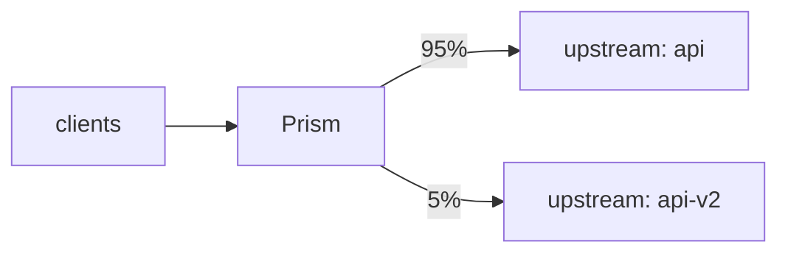
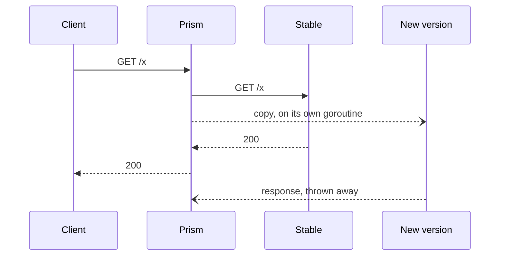
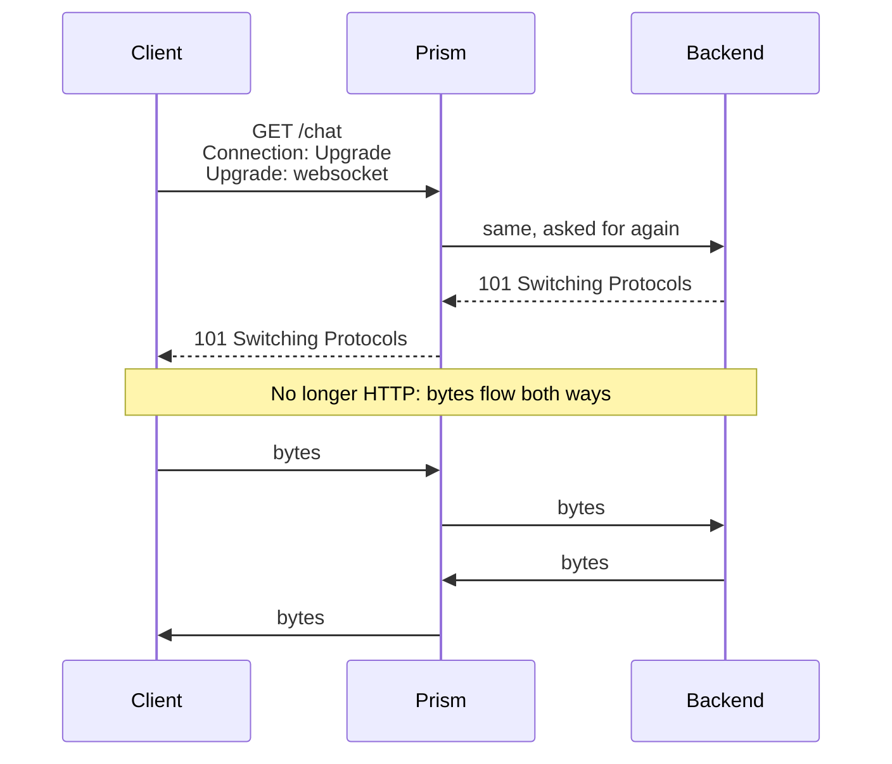

# Canary, shadow and WebSockets

These three go beyond plain request and response. Canary and shadow help you ship new versions safely. WebSockets turn HTTP into a long-lived two-way connection.

## Shipping safely

### The problem

You've built version 2. Tests pass. But tests aren't production: real traffic has inputs and load you never thought of. If you switch everyone over at once and it's broken, everyone is affected.

### The naive fix

Deploy to one server out of ten, and let round robin send it 10% of requests. It works, but a user bounces between versions on each request, which breaks anything stateful, and you can't choose the percentage or test it yourself.

### Canary: real traffic, a few users

A **canary** sends a small share of real traffic to the new version. (The name comes from canaries that miners took underground as an early warning.) If it's bad, only those users suffer, and you can back out by changing one number.



### Shadow: real traffic, no users

**Shadow traffic** goes further. Every user gets the normal response. A *copy* of the request goes to the new version, and its response is thrown away. You learn how v2 behaves under real load, with no user affected even if it crashes.



| | canary | shadow |
| --- | --- | --- |
| users see the new version | yes, a few | no |
| tests | real behavior, end to end | load, crashes, errors |
| risk | a few users | almost none |
| danger | a bug affects those users | copies with side effects run twice |

### In Prism: canary

`Canary.pick` (`internal/proxy/canary.go`) runs in the pipeline before the cache.

**Sticky by design.** The client IP hashes into one of 10,000 buckets, and buckets below `percent × 100` go to the canary. So a client stays on one side. And raising the share only *adds* clients: nobody moves back and forth while you roll out.

**Overrides.** A header or cookie set to `always` or `never` decides for one request, so you can test the canary yourself, or keep your team on it.

**Every route hashes the same way**, so a client in the canary of one route is in the canary of every route with at least the same share. A user sees one consistent version across the site. That's why there's no per-route split.

**A salted hash.** `ip_hash` balancing uses the same addresses. Without `canarySalt`, the canary's clients would all come from a few of the primary's backends, skewing both.

**Canary requests skip the cache.** Otherwise a canary response could be stored and served to everyone, or vice versa.

Metrics are labeled by upstream, so you can compare error rates and latency between the two sides. That comparison is how you decide to continue.

### In Prism: shadow

The hard requirement is that **a copy must never slow the real request**. `Shadow` (`internal/proxy/shadow.go`) is built around that:

- **Its own goroutine and its own timeout.** It's detached from the client with `context.WithoutCancel`.
- **Drop, don't queue.** `Slots` caps copies in flight, and `TryAcquire` either gets a slot or gives up, counting `busy`.
- **Bodies are never waited for.** A small body already in memory is reused. A streamed body is captured as it goes through to the real backend, and if the backend answers before reading all of it, the copy is skipped (`body_skipped`), because waiting would delay the response. Bodies too large or of unknown length are skipped up front.
- **One copy per request**, not per retry.

Copies carry `X-Prism-Shadow: 1`, so the new version can skip side effects like sending emails. **That's on you**: a shadow `POST` really runs. Shadow is safest for reads, or with a shadow environment that has its own database.

`percent` samples at random, and `prism_shadow_requests_total` counts each result.

## WebSockets

### The problem

HTTP is request and response: the client asks, the server answers. A chat app wants the server to push messages at any time. **WebSocket** starts as HTTP, then turns the connection into a two-way pipe.



The tricky part is that `Connection` and `Upgrade` are [hop-by-hop headers](../learn/02-http-for-proxies.md#hop-by-hop-headers), which proxies must strip. So a proxy has to know about upgrades and ask for one explicitly on the next hop.

### In Prism

WebSockets are **off unless a route has a `websocket` block**. Otherwise the upgrade headers are dropped like any others, and the backend sees a normal request.

The flow is in `internal/proxy/websocket.go`:

1. `isWebSocket` recognizes the request. Only HTTP/1.1 can upgrade this way.
2. `outgoing` adds `Connection: Upgrade` and `Upgrade: websocket` back, the one hop-by-hop exception.
3. `fetch` gets a `101`. A `101` nobody asked for is the backend's fault, and becomes a `502`.
4. `tunnel` **hijacks** the client connection: it takes the raw socket from `net/http`, writes the `101` by hand, and starts copying.

From here on, it's two goroutines copying bytes, one for each direction. **Prism doesn't parse WebSocket frames**, it just moves bytes. When either direction ends, both connections close.

A few details:

- **Buffered bytes.** A client may send frames right behind its request, so they may already be in `net/http`'s read buffer. `tunnel` drains those first.
- **The idle timer.** A connection nobody uses should eventually close. `idle_timeout` (default 5 minutes) covers both directions. Resetting a timer on every read would be costly, so `touch` just stores the time in an atomic, and when the timer fires, it checks and goes back to sleep if needed.
- **Slots.** A WebSocket holds its concurrency slot for its whole life, so `max_concurrency` also caps open connections.
- **Shutdown.** `net/http` knows nothing about hijacked connections, so `TrackHijacked` registers them with the server, which waits for them and closes them at the deadline.
- **Metrics.** Tunnel time is subtracted from the request duration. A chat connection open for an hour would otherwise wreck the latency histogram.

## Try it

```sh
scripts/lab-backends.sh
```

```sh
./bin/prism -config examples/labs/traffic.yaml
```

### Canary

The route sends 20% to `next` (backend `b`). Play 500 different clients, using `X-Forwarded-For` as the lab trusts it:

```console
$ for i in $(seq 1 500); do curl -si -H "X-Forwarded-For: 203.0.$((i/250)).$((i%250+1))" 127.0.0.1:8080/canary/x | grep -i '^x-backend' | tr -d '\r'; done | sort | uniq -c
    404 X-Backend: a
     96 X-Backend: b
```

That's 19.2%. One client always lands on the same side:

```console
$ for i in 1 2 3; do curl -si -H 'X-Forwarded-For: 203.0.113.7' 127.0.0.1:8080/canary/x | grep -i '^x-backend'; done
X-Backend: a
X-Backend: a
X-Backend: a
```

And you can force it:

```console
$ curl -si -H 'X-Canary: always' 127.0.0.1:8080/canary/x | grep -i '^x-backend'
X-Backend: b
$ curl -si -H 'X-Canary: never' 127.0.0.1:8080/canary/x | grep -i '^x-backend'
X-Backend: a
```

### Shadow

Five requests to `/shadow/` reach the mirror (backend `c`) as well:

```console
$ for i in 1 2 3 4 5; do curl -s -o /dev/null 127.0.0.1:8080/shadow/x; done
$ curl -s 127.0.0.1:9103/_stats
{"name":"c","requests":5}
```

Now the real test. Make the mirror slow, and then make it fail. Clients shouldn't notice:

```console
$ curl -s '127.0.0.1:9103/_fault?latency=2s' >/dev/null
$ curl -s -o /dev/null -w '%{http_code} %{time_total}s\n' 127.0.0.1:8080/shadow/x
200 0.002599s
$ curl -s '127.0.0.1:9103/_fault?latency=0s&error_rate=1' >/dev/null
$ curl -s -o /dev/null -w '%{http_code} %{time_total}s\n' 127.0.0.1:8080/shadow/x
200 0.001375s
```

Two-millisecond answers from the real backend, whatever the mirror does. Reset it with `curl -s '127.0.0.1:9103/_fault?error_rate=0'`, and check the counters:

```console
$ curl -s 127.0.0.1:9901/metrics | grep '^prism_shadow_requests'
prism_shadow_requests_total{result="body_skipped",route="/shadow/"} 0
prism_shadow_requests_total{result="busy",route="/shadow/"} 0
prism_shadow_requests_total{result="error",route="/shadow/"} 0
prism_shadow_requests_total{result="sent",route="/shadow/"} 7
```

### WebSockets

Start the small echo server, and connect through Prism. The lab sets a 2-second `idle_timeout`:

```sh
python3 examples/labs/ws-echo.py server
```

```console
$ python3 examples/labs/ws-echo.py client /ws/chat
HTTP/1.1 101 Switching Protocols
echo: hello
echo: world
now silent, waiting for the connection to close...
closed after 2.0s of silence
```

The script sends plain bytes instead of real WebSocket frames, and they pass through fine, since Prism doesn't look at them. The access log shows the connection:

```text
level=INFO msg=request ... path=/ws/chat proto=HTTP/1.1 status=101 ... websocket=true ...
```

On a route with no `websocket` block, the upgrade is dropped, and backend `a` answers as usual:

```console
$ curl -si -H 'Connection: Upgrade' -H 'Upgrade: websocket' -H 'Sec-WebSocket-Version: 13' -H 'Sec-WebSocket-Key: dGhlIHNhbXBsZSBub25jZQ==' 127.0.0.1:8080/plain/chat | head -1
HTTP/1.1 200 OK
```

## Tradeoffs

- **Canary by IP is approximate.** Users on mobile networks change address, and a whole office shares one. A cookie override gives you exact control when it matters.
- **Shadow doubles some load.** Size the mirror for `percent` of production.
- **No per-route canary split,** on purpose, so that a client sees one version.
- **No WebSockets over HTTP/2** (RFC 8441). Only HTTP/1.1 clients can upgrade.
- **No close frame at shutdown.** Prism doesn't parse frames, so at the deadline it closes the TCP connection without sending "going away".

## Check yourself

1. Raising a canary from 5% to 10% moves clients in which direction only? Why does that matter?
2. Why must canary responses skip the cache?
3. Why does a shadow copy use `TryAcquire`, rather than waiting for a slot?
4. What's dangerous about shadowing a `POST /payments`?
5. Why does Prism have to treat `Upgrade` specially, when it's on the hop-by-hop list?

Next: [Hot reload and shutdown](hot-reload-and-shutdown.md).
