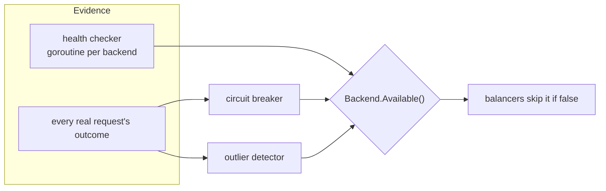
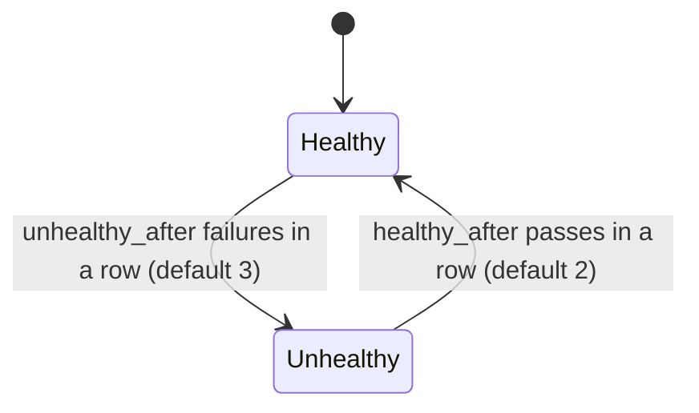
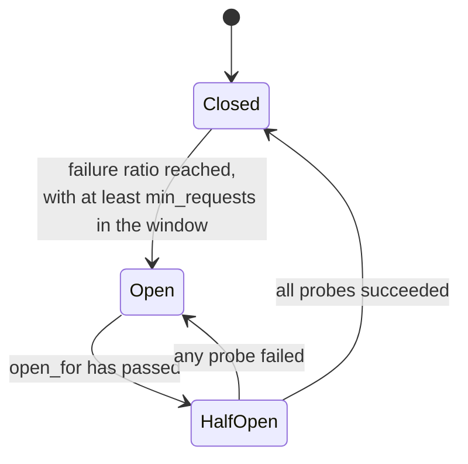
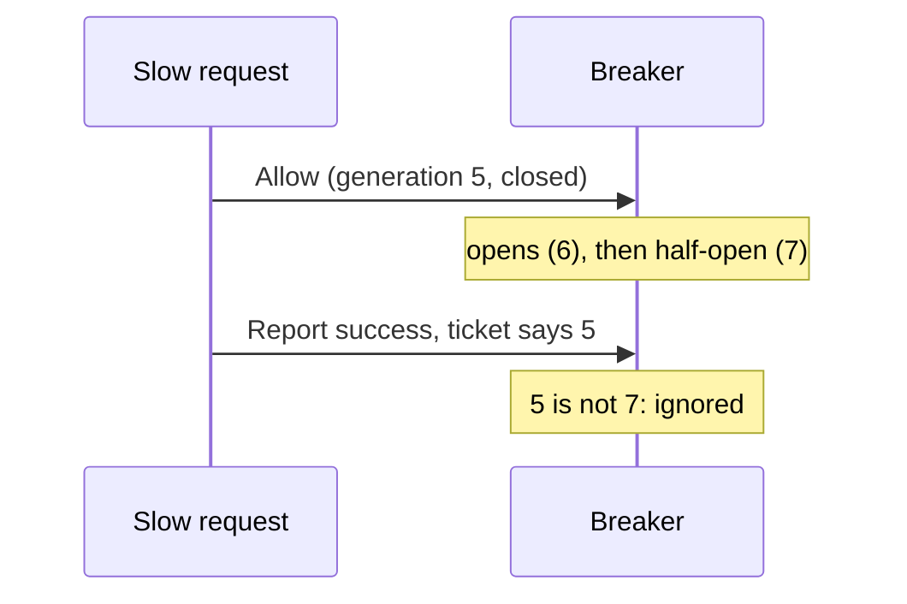
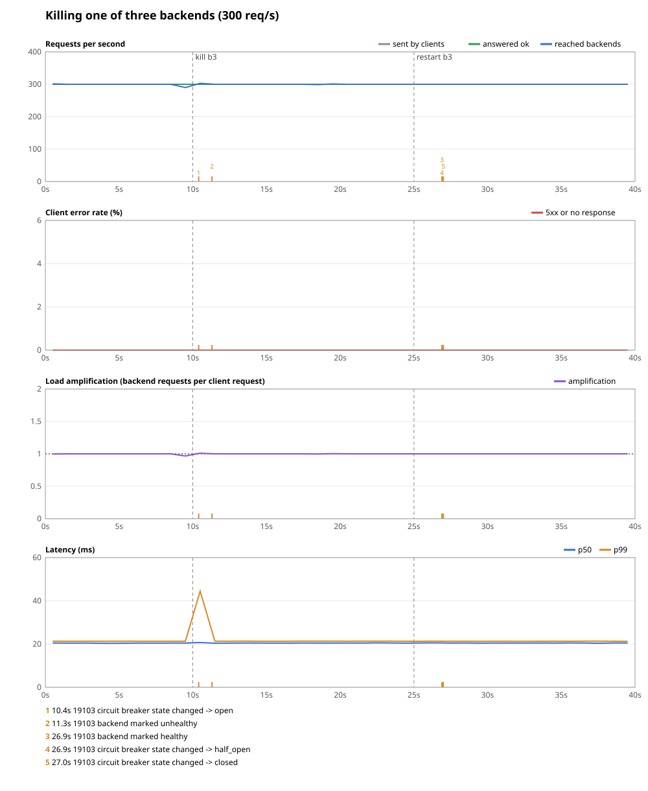
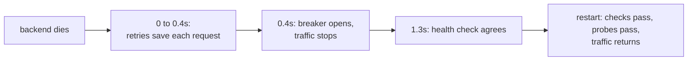

# Detecting failure

## The problem

Retries rescue a single request. But if a backend is broken, you don't want to keep finding that out one request at a time. Every request that tries it wastes time, burns retry budget, and adds load to a server that needs less of it. Prism needs to learn that a backend is bad, stop sending it traffic, and notice when it recovers, all without a human.

## The naive fix

Ping each backend every few seconds, and remove it when a ping fails.

That helps, but it's not enough:

- **It's slow.** With a 10-second interval and three failures needed, a dead backend gets traffic for 30 seconds.
- **It tests the wrong thing.** A `/healthz` handler can answer 200 while every real request fails, because the database behind them is down.
- **It flaps.** One lost packet takes a healthy backend out.

## The idea: three detectors

Prism combines three detectors that work differently. Two of them are **passive**: they watch real traffic and cost nothing extra. One is **active**: it sends its own requests, so it works even with no traffic.

| | health check | circuit breaker | outlier ejection |
| --- | --- | --- | --- |
| kind | active | passive | passive |
| watches | a test request | failure *rate* of real requests | failures *in a row* in real requests |
| good at catching | dead hosts, also when idle | a backend that's partly failing | a backend that's plainly failing |
| comes back when | enough checks pass | test requests succeed | time runs out |
| config | `health` | `circuit_breaker` | `outlier` |

They're all per backend, and all feed one question, `Backend.Available()` (`internal/upstream/upstream.go`):

```go
return !b.state.unhealthy.Load() &&
    (b.breaker == nil || b.breaker.Ready()) &&
    (b.outlier == nil || !b.outlier.Ejected(b.index))
```

Balancers call this on every pick, so everything in it is an atomic read, with no lock.



### What counts as a failure?

Before any of this, `outcome` (`internal/proxy/proxy.go`) sorts each attempt into one of three results:

- **Failure:** a connection error, a timeout, or a 5xx status.
- **Success:** anything else, including 4xx. A 404 means the backend is working fine.
- **Neutral:** the client left, or its request body broke. This says nothing about the backend.

Neutral is what stops clients from getting healthy backends ejected by disconnecting. There's one more case: a backend can send good headers and then die mid-body. It was reported as a success, so `Overturn` corrects the record.

## Health checks

`internal/health/health.go` runs one goroutine per backend. Each sends a `GET` to `health.path` using the backend's own transport, so the same TLS settings apply. Any 2xx or 3xx passes.

To avoid flapping, the state only flips after a **streak** of disagreeing results:



A few details repay attention:

- **New backends start healthy**, so a fresh Prism serves traffic before its first round of checks.
- **Checks are spread out.** The first check waits a random part of the interval, and each later one waits the interval ±10%. If a hundred proxies all checked at once, a backend would see a spike every few seconds.
- **State survives a reload.** The streak and next due time live in the backend's shared state, so frequent reloads can't keep putting checks off.

## Circuit breakers

The name comes from electrical breakers, which cut the power before wires overheat. A software breaker cuts off traffic to a failing backend, gives it time to recover, and then carefully tests it.



- **Closed** is normal. Requests flow, and outcomes are counted over a sliding `window`.
- **Open** refuses everything for `open_for`. The backend gets no traffic, which is often what it needs in order to recover.
- **Half-open** lets `half_open_probes` real requests through as a test. They all have to succeed. A single failure reopens the breaker.

The defaults are a 50% `failure_ratio`, `min_requests` of 20, a 10-second `window`, `open_for` of 30 seconds, and 3 probes. `min_requests` is what stops one failure out of one request from being read as a 100% failure rate.

### In Prism

`Breaker` is in `internal/resilience/breaker.go`. It's worth reading for the concurrency alone.

**Sliding window.** `Window` (`window.go`) splits the span into 10 buckets with a running sum. Moving forward clears the old buckets. It's O(1) per event, and the memory is fixed.

**Fast path.** `Ready` and a closed `Allow` are lock-free atomic reads. Only `Report` takes the mutex.

**Tickets.** Requests can outlive state changes. Suppose a slow request is admitted while the breaker is closed, and finishes after the breaker has gone half-open. Its result shouldn't count as a probe, because it doesn't tell you about the backend's current state. So every state change increments a generation number. `Allow` gives each request a `Ticket` holding the current generation, and `Report` ignores tickets from an older one.



**Two-step admission.** `Backend.Available` asks the breaker `Ready`, which is only a hint. `Admit` calls `Allow`, which takes the real decision, since probes may race for the last slot. That's why `pick` in `proxy.go` is a loop.

## Outlier ejection

A simpler detector: if a backend fails `consecutive_failures` times in a row, eject it for a while. One success resets the count. It reacts fast to a backend that's plainly broken, without needing `min_requests` of traffic.

The interesting parts are in `internal/resilience/outlier.go`:

- **Repeat offenders stay out longer.** The n-th ejection lasts `base_ejection × n`, up to `max_ejection`. The count falls by one for every `base_ejection` spent back in the pool, so a backend that has recovered is forgiven.
- **It can't empty the pool.** `max_ejection_percent` (default 50) limits how much of a pool can be out at once. With the default, a pool of one is never ejected, and a pool of two keeps a member. If a shared dependency fails and every backend looks bad, it's usually better to keep trying than to refuse everything.
- **Expiry is lazy.** An ejection is just a timestamp. `Ejected` compares it to the clock, so no timers are needed.

## Try it

The lab uses small numbers so that everything happens quickly:

```sh
scripts/lab-backends.sh
```

```sh
./bin/prism -config examples/labs/failure.yaml
```

Two helpers: one sends `n` requests and prints which backend answered and with what status, and one prints the live state of backends:

```sh
send() { for i in $(seq 1 $2); do curl -s -o /dev/null -D - 127.0.0.1:8080/$1/x | awk 'NR==1{s=$2} tolower($1)=="x-backend:"{b=$2} END{printf "%s%s ", b, s}' | tr -d '\r'; done; echo; }
state() { curl -s 127.0.0.1:9901/upstreams | python3 -m json.tool | grep -E '"url"|breaker|ejected'; }
```

### The breaker opens

Make `a` fail everything. The breaker needs 10 requests in its window, and round robin sends `a` every second one:

```console
$ curl -s '127.0.0.1:9101/_fault?error_rate=1' >/dev/null
$ send breaker 26
a503 b200 a503 b200 a503 b200 a503 b200 a503 b200 a503 b200 a503 b200 a503 b200 a503 b200 a503 b200 b200 b200 b200 b200 b200 b200
```

Ten failures on `a`, and then it stops getting traffic. The Prism log shows the moment:

```text
level=WARN msg="circuit breaker state changed" upstream=breaker backend=http://127.0.0.1:9101 from=closed to=open
```

### Half-open, still broken

Wait 5 seconds for `open_for` to pass, with `a` still failing. The first request becomes a probe:

```console
$ sleep 5.2; for i in 1 2 3 4; do curl -s -o /dev/null -w '%{http_code} ' 127.0.0.1:8080/breaker/x; done; echo
503 200 200 200
```

```text
level=INFO msg="circuit breaker state changed" ... from=open to=half_open
level=WARN msg="circuit breaker state changed" ... from=half_open to=open
```

One client paid for that test with a 503. A retry on the route would have hidden it.

### Recovery

Fix the backend and wait again. The 2 probes succeed, and traffic returns:

```console
$ curl -s '127.0.0.1:9101/_fault?error_rate=0' >/dev/null
$ sleep 5.2; for i in 1 2 3 4 5 6; do curl -si 127.0.0.1:8080/breaker/x | grep -i ^x-backend | tr -d '\r' | cut -d' ' -f2 | tr '\n' ' '; done; echo
a b a b a b
```

```text
level=INFO msg="circuit breaker state changed" ... from=open to=half_open
level=INFO msg="circuit breaker state changed" ... from=half_open to=closed
```

### Outlier ejection

Now make `c` fail. It takes only three in a row:

```console
$ curl -s '127.0.0.1:9103/_fault?error_rate=1' >/dev/null
$ send outlier 12
c503 b200 c503 b200 c503 b200 b200 b200 b200 b200 b200 b200
```

```text
level=WARN msg="backend ejected after consecutive failures" upstream=outlier backend=http://127.0.0.1:9103 for=5s
```

Run `state` to see `"ejected": true`. After 5 seconds it's back by itself, with no test requests involved. If `c` were still broken, it would need three more failures, and the next ejection would last longer.

## All three, in a real failure

`make chaos` kills one of three backends under 300 requests a second, with retries, a breaker and health checks all on. In the run below, all 12,001 requests succeeded. The breaker opened 0.4 seconds after the kill, health checks marked the backend down at 1.3 seconds, and retries covered the gap.





## Tradeoffs

- **Breakers are per backend, not per upstream.** One bad backend doesn't cut off the whole pool.
- **Probes are real requests.** Half-open costs a real client an error if the backend is still broken, unless a retry covers it. Health checks don't have this problem, but they test less.
- **All backends unavailable means 503.** Envoy has a "panic threshold" that sends traffic to all backends anyway once too many look bad. Prism has only the outlier cap.
- **State is per instance.** Each Prism instance learns about a failure independently.
- **Open-source nginx has passive checks only** (`max_fails`). Active checks and slow-start are in its paid edition. HAProxy and Envoy have active checks too.

## Check yourself

1. A backend answers `/healthz` with 200, but 70% of real requests get a 500. Which detector catches it? Would outlier ejection catch it?
2. Why must a 404 count as a success?
3. What goes wrong without tickets, if a slow request admitted before the breaker opened reports success during half-open?
4. A pool of 4 backends with `max_ejection_percent: 50`. Two are ejected, and a third reaches its failure count. What happens?
5. Why does Prism need health checks at all, given the two passive detectors?

This is the end of the core concepts so far. Back to the [docs index](../README.md).
