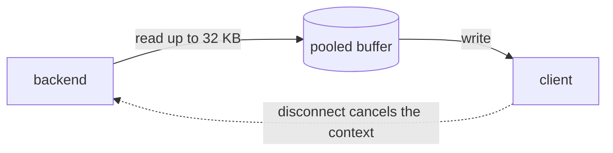
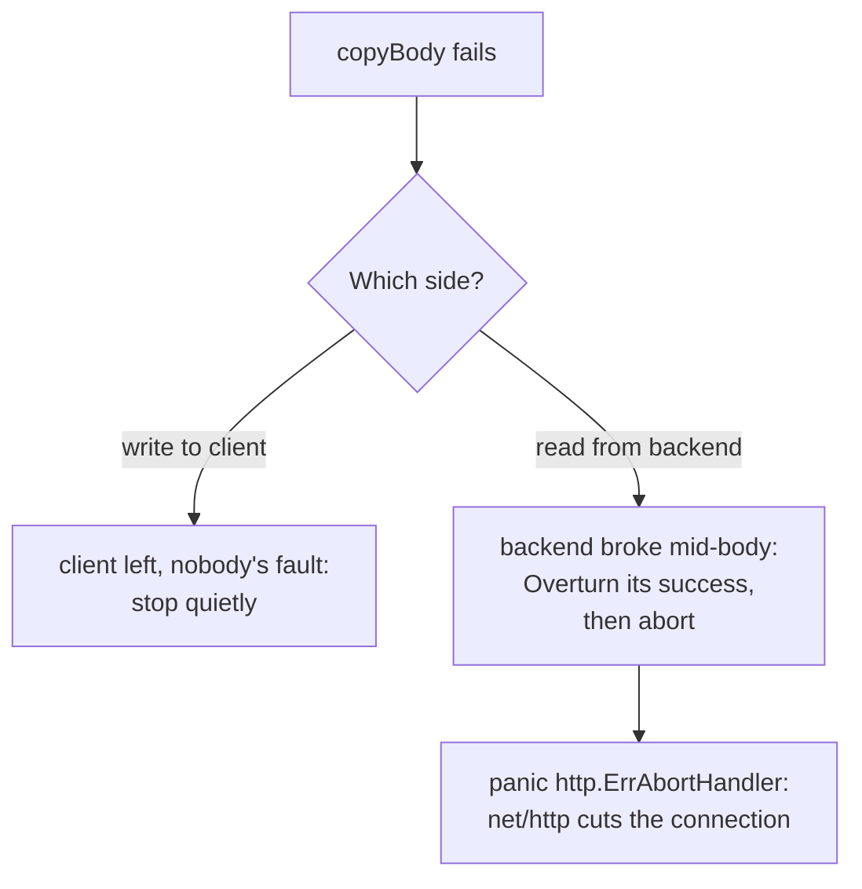

# Forwarding and streaming

Read [HTTP for proxies](../learn/02-http-for-proxies.md) first. This page covers what happens once a route and a backend are chosen.

## The problem

Forwarding sounds like the easy part: read the request, send it on, and copy back the answer. But a proxy has to do this for a 5 GB upload, for a live event feed that never ends, for thousands of requests at once, and when either side can vanish at any moment.

## The naive fix

```go
body, _ := io.ReadAll(r.Body)
resp, _ := http.Post(backendURL, contentType, bytes.NewReader(body))
respBody, _ := io.ReadAll(resp.Body)
w.Write(respBody)
```

This falls over in several ways:

- **Memory.** Every in-flight request holds its whole body. A hundred 100 MB uploads need 10 GB.
- **Latency.** The client gets nothing until the backend has finished. A live feed never finishes, so the client gets nothing at all.
- **Headers.** It drops them all. Copying them blindly would be just as wrong, because of hop-by-hop headers.
- **Disconnects.** If the client leaves, the backend keeps working for nobody.
- **Redirects.** `http.Client` follows them, while a proxy must pass them to the client.

## The idea

Data flows through in small pieces, and only one small buffer exists per direction, however big the body is.



And the two sides stay linked: the client's context is passed along, so when one side ends, so does the other.

## In Prism

### Building the request

`Handler.outgoing` (`internal/proxy/proxy.go`) creates a fresh `http.Request` for each attempt. [Life of a request](../learn/05-life-of-a-request.md#stage-6-building-the-outgoing-request) lists each step. A few details are worth a closer look:

- **`Host` lives outside the header map.** Go sends `Request.Host` and ignores `Header["Host"]`, so a `Host` rule in the config has to be moved across.
- **An empty `User-Agent` is set on purpose.** Otherwise, the transport would add `Go-http-client/1.1` to requests from clients that didn't send one. A proxy shouldn't invent headers.
- **`DisableCompression`** (`internal/upstream/transport.go`). Left on, the transport would ask for gzip, then decompress responses by itself. Prism passes compressed bodies through untouched.
- **`Proxy: nil`.** Prism never picks up `HTTP_PROXY` from the environment by accident.

### Header rules

A route can change headers in each direction. `HeaderOps` (`internal/proxy/headers.go`) removes first, and then sets. Names are canonicalized once, at build time, so applying the rules costs little per request.

```yaml
headers:
  request_set: { X-Env: lab }
  response_set: { X-Served-By: prism }
  response_remove: [X-Backend]
```

### Streaming the request body

The client's `r.Body` is handed to the transport, which reads from it as it sends. Nothing is stored, unless retries are on and the body is small. That case is covered in [Timeouts and retries](timeouts-and-retries.md).

### Streaming the response

`Handler.write` copies the headers, calls `WriteHeader`, then runs `copyBody`, a loop of read and write using a 32 KB buffer from a `sync.Pool`.

**When to flush.** `net/http` collects small writes in a buffer, which is good for throughput, but it would delay a live feed. So `write` flushes after every chunk in exactly two cases: the length is unknown (`ContentLength == -1`), or the type is `text/event-stream`.

**Why `copyBody` isn't `io.Copy`.** `io.Copy` returns one error, and Prism needs to know which side failed:



The abort matters. If Prism just returned, `net/http` would finish the response normally, and the client could take a truncated file for a complete one. Cutting the connection makes the failure visible.

### Trailers

HTTP allows headers *after* the body, called trailers. gRPC depends on them to report its status. Prism announces them before the body, then sets them using `http.TrailerPrefix` once the body is done. This is also why `TE: trailers` survives the hop-by-hop cleanup.

### Cancellation

`out.WithContext(r.Context())` ties the backend request to the client. When the client disconnects, `net/http` cancels that context, and the transport closes the backend connection. Prism logs a 499, and the backend's health isn't affected, because `outcome` returns `Neutral`.

## Try it

Start the backends and the forwarding lab:

```sh
scripts/lab-backends.sh
```

```sh
./bin/prism -config examples/labs/forwarding.yaml
```

### Header rules

```console
$ curl -si 127.0.0.1:8080/app/x
HTTP/1.1 200 OK
Content-Length: 64
Content-Type: text/plain; charset=utf-8
Date: Sat, 07 Nov 2026 19:25:09 GMT
X-Request-Id: abb0e6d499bf99f847c2e7aefdb4f885
X-Served-By: prism

xxxxxxxxxxxxxxxxxxxxxxxxxxxxxxxxxxxxxxxxxxxxxxxxxxxxxxxxxxxxxxxx
```

`X-Backend` is gone, and `X-Served-By` has appeared.

### Streaming

This fake backend on port 9104 sends one event per second, then exits:

```sh
python3 -c "
import socket, time
s = socket.create_server(('127.0.0.1', 9104))
c, _ = s.accept()
c.recv(4096)
c.sendall(b'HTTP/1.1 200 OK\r\nContent-Type: text/event-stream\r\nTransfer-Encoding: chunked\r\n\r\n')
for i in range(3):
    m = b'data: tick %d\n' % i
    c.sendall(b'%x\r\n%s\r\n' % (len(m), m))
    time.sleep(1)
c.sendall(b'0\r\n\r\n')
c.close()
"
```

Timestamp each line as it arrives. The `-N` tells curl not to buffer either.

```console
$ curl -sN 127.0.0.1:8080/stream/x | while read -r line; do echo "$(date +%T) $line"; done
00:55:10 data: tick 0
00:55:11 data: tick 1
00:55:12 data: tick 2
```

One line a second: each event went through Prism as soon as it was sent.

### A backend dies mid-body

Tell backend `a` to send a 1 MB body but die halfway:

```console
$ curl -s '127.0.0.1:9101/_fault?drop_rate=1&body_size=1000000' >/dev/null
$ curl -sS -o /dev/null -w 'status %{http_code}, %{size_download} bytes\n' 127.0.0.1:8080/app/x
curl: (18) end of response with 500000 bytes missing
status 200, 500000 bytes
```

The status says 200, because that was already sent. But curl knows the response is broken, because Prism cut the connection instead of ending it cleanly. Prism logs this:

```text
level=WARN msg="upstream response body failed" ... kind=upstream error="unexpected EOF"
```

With a very small body you'd get `Empty reply from server` instead. The status and the first bytes were still in `net/http`'s buffer when the connection was cut, so nothing reached the client at all.

### A client gives up

Make the backend slow, then have curl give up after a second:

```console
$ curl -s '127.0.0.1:9101/_fault?drop_rate=0&body_size=64&latency=3s' >/dev/null
$ curl -sS -m 1 127.0.0.1:8080/app/x
curl: (28) Operation timed out after 1000 milliseconds with 0 bytes received
```

```text
level=INFO msg=request ... path=/app/x proto=HTTP/1.1 status=499 bytes=0 duration=1.000870358s ... error=client_closed
```

The duration is one second, not three. Prism stopped as soon as the client left. Reset the backend afterwards with `curl -s '127.0.0.1:9101/_fault?latency=0s'`.

## Tradeoffs

- **No response buffering.** nginx by default reads a backend's response into its own buffers as fast as it can, even spilling to disk, which frees the backend from slow clients. Prism streams directly. It's simpler and uses less memory, but a slow client keeps a backend connection and a concurrency slot busy for as long as it takes.
- **HTTP/1.1 to backends only.** One request per connection is what least-connections assumes, and it keeps WebSocket upgrades simple. The cost is more connections than HTTP/2 would need.
- **A panic for control flow.** `http.ErrAbortHandler` is the documented way to abort a response, and `accessLog` still logs the request before passing the panic on.

## Check yourself

1. Why does the flush rule look at `ContentLength == -1`, rather than always flushing?
2. Prism gets a `Location: /login` redirect from a backend. What would `http.Client` have done, and why would that be wrong here?
3. A client downloads a large file at 10 KB/s. Which Prism resources does it hold, and for how long?

Next: [Load balancing](load-balancing.md).
