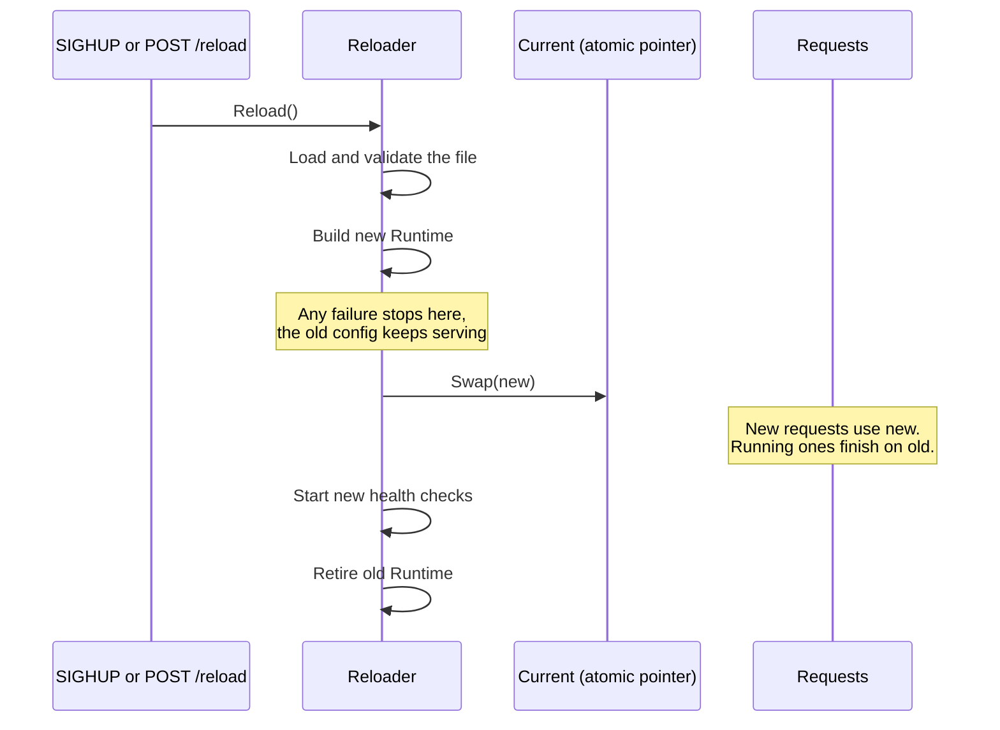
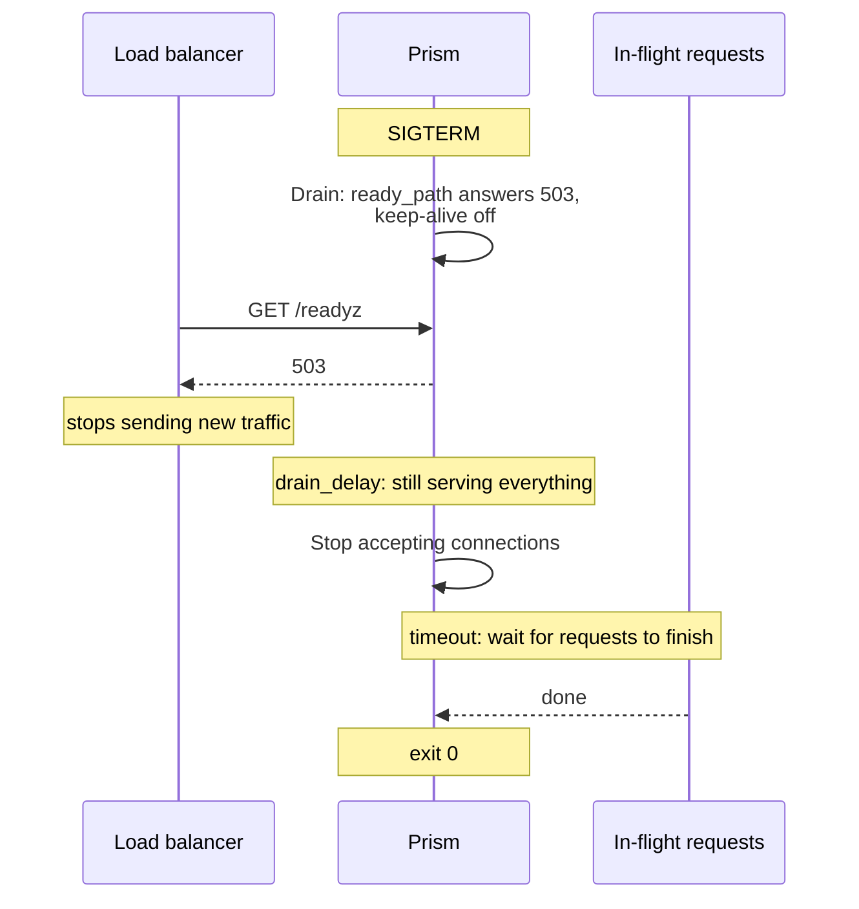

# Hot reload and shutdown

A proxy sits in the path of all your traffic. If it needs a restart to change a route, every change is an outage. So there are two moments that need care: changing the running config, and stopping.

## Hot reload

### The problem

You need to add a route while thousands of requests are in flight. You want zero failed requests, no brief inconsistency, and a safe outcome if the new config is broken.

### The naive fix

Guard the config with a read-write lock, and edit it in place.

- Every request takes the lock, so it's a contention point on the hot path.
- A request can see the old routes and the new upstreams, if it reads them at different times.
- A bad config discovered halfway leaves things half applied.

### The idea: build a new world, then swap one pointer

[The codebase tour](../learn/04-codebase-tour.md#the-big-design-idea-immutable-snapshots) introduced this: a running `Runtime` is never edited. A reload builds a complete new one, then swaps a single atomic pointer.



This gets you, for free:

- **No lock on the hot path.** A request does one atomic load.
- **Consistency.** A request sees one whole config.
- **All or nothing.** Nothing is touched until the last step that can fail has passed.

`Reloader.reload` (`internal/runtime/reloader.go`) is short and worth reading. Note the comment "Nothing can fail from here on": everything fallible comes first. A mutex means one reload at a time, and signals sent during a reload are coalesced into one more.

### The catch: state has to survive

If a reload rebuilt everything, it would cause real damage:

- Rate limits would reset, so spamming reloads would hand out fresh bursts.
- Concurrency caps would double while old requests finish.
- Circuit breakers would forget that a backend is down.
- Connection pools would close, and every request would pay for a new handshake.
- The cache would go cold.

So the snapshot is immutable, but it can **share** objects with the previous one. `runtime.Build` takes `Prev`, and it carries state over by identity whenever the settings are unchanged:

| what | matched by | kept while |
| --- | --- | --- |
| inflight count, health, check schedule | upstream and URL | the backend is still in the upstream |
| transport and pooled connections | upstream and URL | transport settings unchanged, including the CA's contents |
| circuit breaker | upstream and URL | `circuit_breaker` unchanged |
| outlier state | upstream | `outlier` and the backend list unchanged |
| rate limiter | route | `rate_limit` unchanged |
| concurrency semaphore | route | `max_concurrency` and `queue_size` unchanged |
| retry budget | route | budget settings unchanged |
| authenticator | route | `auth` unchanged |
| cache store, flights, stats | process | always, with a resize if `max_size` changed |

`Backend` shows how this works. Its mutable fields are in a separate `state` struct, and the new `Backend` shares that pointer. A request running on the old `Runtime` releases into the same inflight count that the new one reads.

A failed `Build` must not disturb the live config through what it shares. That's why `Pool.Commit` and the cache resize run last, and why `NewPool` separates building from committing.

Retiring is careful too: `Retire` stops the old health checkers and closes idle connections, except on transports the new `Runtime` carried over.

### What can't be reloaded

`listeners`, `admin`, `shutdown` and `ready_path` need a restart, since they're bound to sockets and startup. `keepRestartOnly` keeps the old values and logs a warning, so `GET /config` shows what's actually running. Certificates *do* reload, behind their own atomic pointer.

## Graceful shutdown

### The problem

You're deploying a new version of Prism, so you stop the old one. Killing it cuts off every in-flight request. And there's a subtler issue: the load balancer in front doesn't know you're stopping, so it keeps sending new connections for a few seconds after you close the port. Those fail.

### The idea: stop in stages

Say you're leaving, keep working while the news spreads, stop taking new work, finish what you have, and go.



`shutdown` in `cmd/prism/main.go` runs these stages:

1. **`srv.Drain()`** flips an atomic flag. `ready_path` now answers `503`, and HTTP/1 responses carry `Connection: close`, so clients with keep-alive connections reconnect elsewhere.
2. **`drain_delay`** waits while still serving everything. It's the time the load balancer needs to notice. Set it longer than your probe interval.
3. **`srv.Shutdown`** closes the listeners and waits up to `timeout` for active requests.
4. Whatever remains at the deadline gets closed.

A second signal skips the waiting and closes everything at once. This is why the signal channel has room for two.

**Readiness and liveness** are different questions, and it's a common mistake to mix them up:

| | means | during drain | if it fails, the orchestrator will |
| --- | --- | --- | --- |
| readiness (`ready_path`, admin `/ready`) | should I get traffic? | 503 | stop sending traffic |
| liveness (admin `/live`) | is the process OK? | 200 | restart it |

During a drain, Prism is working perfectly, and just doesn't want new traffic. If liveness also failed, it would be killed before finishing its requests.

**Hijacked connections.** `http.Server.Shutdown` neither waits for nor closes WebSockets, because they've left its control. `Server.TrackHijacked` keeps a set of them. `connSet.drain` waits for those, then closes them at the deadline.

## Try it

```sh
scripts/lab-backends.sh
```

```sh
./bin/prism -config examples/labs/lifecycle.yaml
```

### Reloading under load

Send 300 requests a second for 5 seconds, and reload about three times a second meanwhile:

```console
$ ./bin/loadgen -url http://127.0.0.1:8080/app/x -rate 300 -duration 5s -out /dev/null &
$ for i in $(seq 1 15); do pkill -HUP -x prism; sleep 0.3; done; wait
sent 1501, ok 1501, errors 0 (0.00%)
$ curl -s 127.0.0.1:9901/metrics | grep '^prism_config_reloads_total'
prism_config_reloads_total{result="failure"} 0
prism_config_reloads_total{result="success"} 15
```

Fifteen complete rebuilds, and no request noticed. `make reload` runs a harsher version that also changes the config each time.

### A restart-only setting

Change `drain_delay` in the lab config to `4s` and reload:

```text
level=WARN msg="setting changed, restart to apply it; the rest of the config is reloaded" setting=shutdown
```

Change it back afterwards.

### A graceful shutdown

This needs quick typing, so here it is as one script. It starts a request that takes 6 seconds, makes later requests fast, then stops Prism while watching each stage:

```sh
curl -s '127.0.0.1:9101/_fault?latency=6s' >/dev/null
curl -s '127.0.0.1:9102/_fault?latency=6s' >/dev/null
curl -s -o /dev/null -w 'in-flight: %{http_code} after %{time_total}s\n' 127.0.0.1:8080/app/slow &
sleep 0.3
curl -s '127.0.0.1:9101/_fault?latency=0s' >/dev/null
curl -s '127.0.0.1:9102/_fault?latency=0s' >/dev/null

pkill -TERM -x prism; sleep 0.2
for u in 8080/readyz 9901/ready 9901/live; do echo -n "$u: "; curl -si 127.0.0.1:$u | head -1; done
curl -si 127.0.0.1:8080/app/x | grep -iE '^HTTP|^connection'

sleep 3.2
curl -s -m 1 -o /dev/null 127.0.0.1:8080/app/x; echo "after drain_delay: curl exit $?"
wait
```

The output:

```text
8080/readyz: HTTP/1.1 503 Service Unavailable
9901/ready: HTTP/1.1 503 Service Unavailable
9901/live: HTTP/1.1 200 OK
HTTP/1.1 200 OK
Connection: close
after drain_delay: curl exit 7
in-flight: 200 after 6.003897s
```

Follow it through:

- **During `drain_delay`**, readiness says 503, liveness says 200, and real requests still work, each with `Connection: close`.
- **After it**, the port is closed (curl's exit code 7 means it couldn't connect).
- **The in-flight request** finished normally six seconds after it started, well after Prism stopped accepting connections.

Prism then exits with status 0.

## Tradeoffs

- **Old `Runtime`s linger.** One stays in memory for as long as requests are using it. Most of the heavy state, like the cache, is shared with the new one.
- **A WebSocket on an old config stays there** until it closes. It's the same rule as any request, just for longer.
- **Listeners need a restart.** nginx can change listeners on reload, and even upgrade its binary with no downtime, by passing sockets between processes. Prism doesn't.
- **Prism doesn't send a WebSocket close frame** at the deadline, as it doesn't parse frames.

## Check yourself

1. What would go wrong if rate limiters were rebuilt on every reload?
2. Why does a request load the `Runtime` pointer only once?
3. A reload fails during `Build`, after some pools were already built. Why is the running config unaffected?
4. Why is `drain_delay` needed, when Prism could just stop accepting connections right away?
5. What would happen if liveness returned 503 during a drain?

Next: [Observability](observability.md).
