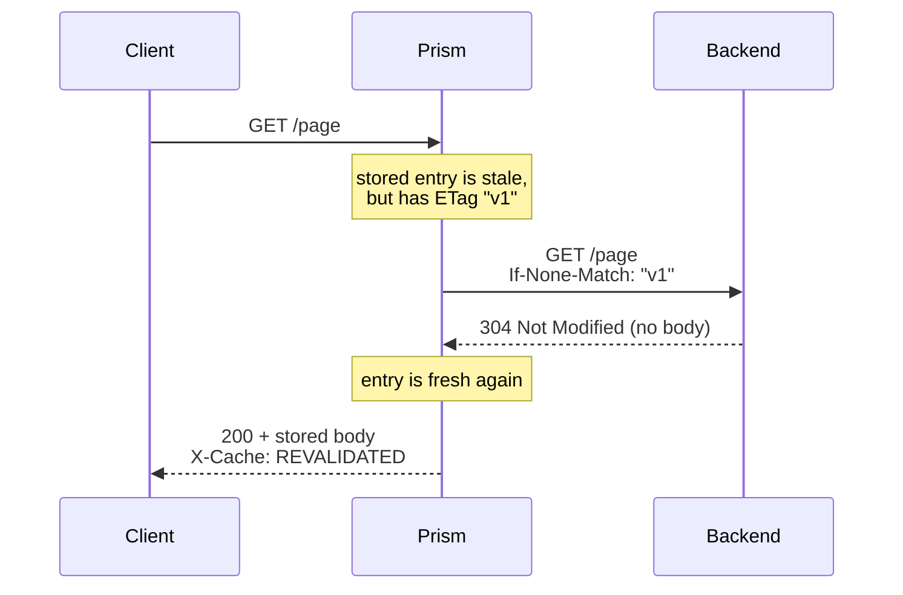
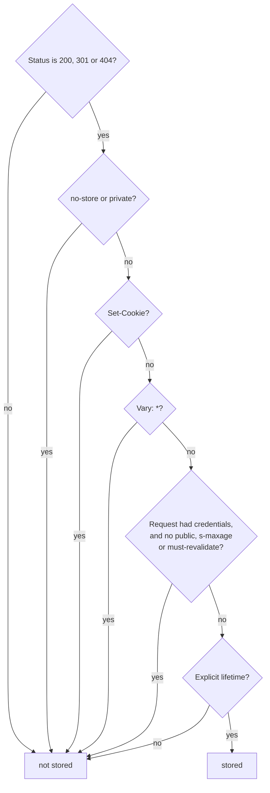

# HTTP caching

This page covers the rules: what may be stored, and for how long. [Inside the cache](inside-the-cache.md) covers how Prism implements them under load.

## The problem

Many responses are the same for everyone: a product page, a logo, a list of countries. Computing them again for each request wastes backend time and adds latency. If the proxy remembers the response, it can answer straight from memory.

That raises the hard part. Serve the wrong thing from a cache, and you've either shown stale data or, far worse, shown one user's private page to another.

## The naive fix

Store every `GET` response for 60 seconds, keyed by URL.

- `GET /account` now shows the first visitor's account to everyone.
- A page that changes every second is out of date.
- A page that never changes gets fetched every minute for no reason.
- A site with versions in English and French serves whichever was fetched first.

The proxy can't guess any of this. Only the backend knows what its responses mean, so **the backend has to say**.

## The idea: the backend declares, the cache obeys

HTTP has a shared language for this, defined in RFC 9111. The main tool is the `Cache-Control` response header.

| directive | meaning |
| --- | --- |
| `max-age=60` | fresh for 60 seconds |
| `s-maxage=60` | the same, for shared caches like Prism only; wins over `max-age` |
| `no-store` | never store this |
| `private` | only for one user's own browser, not a shared cache |
| `public` | may be shared, even for an authenticated request |
| `no-cache` | may be stored, but must be checked with the backend before each use |
| `must-revalidate` | never serve this once it's stale |

Prism is a **shared cache**: one cache serves many users. That's why `private` matters to it.

### Fresh and stale

A stored response is **fresh** while its age is below its lifetime. Fresh responses are served with no contact with the backend. Past that, it's **stale**. A stale response isn't deleted, since it may still be useful.

The `Age` response header tells the client how many seconds the response has been in caches. This is how a client knows that a `max-age=60` response with `Age: 50` has only ten seconds left.

### Revalidation: "has this changed?"

When a response goes stale, it hasn't necessarily changed. Rather than downloading it all again, the cache can ask, if the backend gave it a **validator**:

- `ETag: "v1"` is an opaque version label, sent back in `If-None-Match`.
- `Last-Modified: <date>` is a timestamp, sent back in `If-Modified-Since`.



A `304` has no body, so a page of any size costs a few hundred bytes to confirm. If it did change, the backend answers a normal `200`, which replaces the entry.

### Vary: one URL, several answers

Some URLs answer differently based on request headers, such as language or compression. The backend says so with `Vary: Accept-Language`, and the cache then keeps one copy per value.

## In Prism

The rules live in `internal/cache/`, which is pure logic with no networking. That's why it can be tested so thoroughly.

### Can this request use the cache?

`cacheable` (`internal/proxy/cache.go`) and `RequestCacheable` (`internal/cache/policy.go`) let through only `GET` and `HEAD`, and exclude:

- requests with a body, since the body could change the answer,
- `Range` requests, since partial responses aren't stored,
- `If-Match` and `If-Unmodified-Since`,
- requests with `Cache-Control: no-store`.

A client's `Cache-Control: no-cache` is deliberately ignored, as in nginx. Otherwise any client could force every request to reach the backend.

### May this response be stored?

`Storable` (`policy.go`) answers with a reason, or an empty string. With `-log-level debug`, Prism logs the reason.



Three rules deserve attention:

- **`Set-Cookie`.** A cookie set for one client must never be handed to another.
- **Credentials.** A response to an authenticated request is for that user, unless the backend explicitly says otherwise. This covers both `Authorization` and Prism's own auth.
- **No heuristics.** RFC 9111 lets a cache guess a lifetime for a response with no explicit freshness. Prism refuses, because guessing is how stale pages get served. There's one exception: a `no-cache` response with a validator is stored, with a lifetime of zero, so every use revalidates it.

Beyond this, `unstorable` in `proxy/cache.go` refuses responses larger than `max_object`, responses with trailers, and event streams.

### How long is it fresh?

`lifetime` (`policy.go`) uses `s-maxage`, then `max-age`, then `Expires` minus `Date`, and treats `no-cache` as zero.

Age isn't just "time since it arrived". A response might have spent time in another cache, or on the network. `initialAge` follows the formula in RFC 9111: the larger of what `Date` implies and what `Age` plus transit time implies. See the `Freshness` type.

### The cache key

`PrimaryKey` (`key.go`) builds `GET http://host/path?query`. The host is lowercased and loses its default port. `HEAD` shares `GET`'s key, because a `HEAD` can be answered from a stored `GET`. The query string is kept as sent, since reordering it might merge URLs that a backend treats differently.

With `Vary`, `VariantKey` adds the values of the named request headers.

### Parsing Cache-Control by hand

`ParseCacheControl` (`cachecontrol.go`) is hand-written and fuzzed, since it parses untrusted input from backends. When a directive repeats, the smallest value wins, as the most restrictive. An invalid value counts as zero, which makes the response stale. Failing toward "don't trust it" is the right default.

### Conditional requests from clients

A client can send `If-None-Match` to Prism too. `NotModified` (`conditional.go`) answers those from the stored entry, with a `304` and no trip to the backend.

### X-Cache

Every response from a caching route says what happened:

| value | meaning |
| --- | --- |
| `HIT` | served fresh from the cache |
| `MISS` | fetched from the backend |
| `REVALIDATED` | stale, and the backend confirmed it with a 304 |
| `STALE` | stale, and served because the backend failed |
| `UPDATING` | stale, served while a background request refreshes it |
| `BYPASS` | the route's `bypass_header` skipped the lookup |

`STALE` and `UPDATING` are explained in [Inside the cache](inside-the-cache.md).

## Try it

This lab uses a small backend that answers each path with different headers, and prints every request it gets. See [`echo-backend.py`](../../examples/labs/echo-backend.py).

```sh
python3 examples/labs/echo-backend.py
```

```sh
make build && ./bin/prism -config examples/labs/caching.yaml -log-level debug
```

```sh
c() { curl -si "$@" | grep -iE '^(HTTP|x-cache|age)' | tr -d '\r' | tr '\n' ' '; echo; }
```

### What gets stored

```console
$ c 127.0.0.1:8080/echo/max-age
HTTP/1.1 200 OK X-Cache: MISS
$ c 127.0.0.1:8080/echo/max-age
HTTP/1.1 200 OK Age: 0 X-Cache: HIT
$ sleep 3; c 127.0.0.1:8080/echo/max-age
HTTP/1.1 200 OK Age: 4 X-Cache: HIT
```

Now try `/echo/plain`, `/echo/no-store`, `/echo/private` and `/echo/cookie`, twice each. Every one stays a `MISS`, and the Prism log says why:

```text
msg="response not stored" ... path=/echo/plain route=/echo/ reason=no-freshness
msg="response not stored" ... path=/echo/no-store route=/echo/ reason=no-store
msg="response not stored" ... path=/echo/private route=/echo/ reason=private
msg="response not stored" ... path=/echo/cookie route=/echo/ reason=set-cookie
```

### Revalidation

`/echo/etag` has `max-age=2` and an `ETag`. Fetch it twice, wait, and fetch it twice more:

```console
$ c 127.0.0.1:8080/echo/etag
HTTP/1.1 200 OK X-Cache: MISS
$ c 127.0.0.1:8080/echo/etag
HTTP/1.1 200 OK Age: 0 X-Cache: HIT
$ sleep 2.2; c 127.0.0.1:8080/echo/etag
HTTP/1.1 200 OK Age: 0 X-Cache: REVALIDATED
$ c 127.0.0.1:8080/echo/etag
HTTP/1.1 200 OK Age: 0 X-Cache: HIT
```

The backend's terminal shows only two requests, and the second is the conditional one:

```text
--> GET /etag  answering 200
--> GET /etag  answering 304
    If-None-Match: "v1"
```

The client got a normal `200` with the body every time. A client that sends its own `If-None-Match` gets a `304` from Prism, with no backend involved:

```console
$ curl -si -H 'If-None-Match: "v1"' 127.0.0.1:8080/echo/etag
HTTP/1.1 304 Not Modified
Age: 0
Cache-Control: max-age=2
Date: Sat, 07 Nov 2026 19:34:07 GMT
Etag: "v1"
```

### Vary

```console
$ for l in en fr en; do curl -si -H "Accept-Language: $l" 127.0.0.1:8080/echo/vary | grep -iE '^x-cache|^language' | tr -d '\r' | tr '\n' ' '; echo; done
X-Cache: MISS language: en
X-Cache: MISS language: fr
X-Cache: HIT language: en
```

Two languages, two entries, and neither gets served for the other.

## Tradeoffs

- **Unsafe methods don't invalidate.** RFC 9111 section 4.4 says a successful `POST`, `PUT` or `DELETE` should invalidate the URL's stored response. Prism doesn't. An entry stays until it expires, or until you remove it with `/cache/purge`. Keep lifetimes short for data that changes.
- **Few statuses are stored.** Only 200, 301 and 404. RFC 9111 allows more, but these cover what a proxy cache is for.
- **`HEAD` misses aren't stored.** A `HEAD` that misses goes straight to the backend.
- **`private` with field names**, such as `private="Set-Cookie"`, is treated as private for the whole response. That's stricter than needed, and safe.
- **nginx can override headers** with `proxy_cache_valid` and `proxy_ignore_headers`. Prism trusts the backend, which is simpler, but a backend with poor headers gets poor caching.

## Check yourself

1. A backend sends `Cache-Control: max-age=60` and `Set-Cookie`. Does Prism store it? Why might that be surprising?
2. Why does Prism ignore `Cache-Control: no-cache` from a client, but obey `no-store`?
3. A response has `max-age=100` and `s-maxage=10`. How long is it fresh in Prism? In a browser?
4. What does a backend need to send so that a stale response can be confirmed cheaply?
5. Why must a cached response to an authenticated request be treated specially?

Next: [Inside the cache](inside-the-cache.md).
