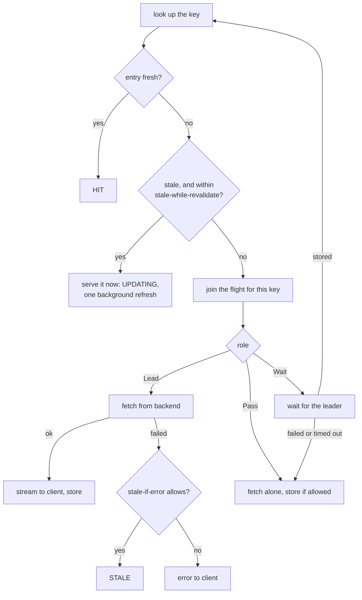
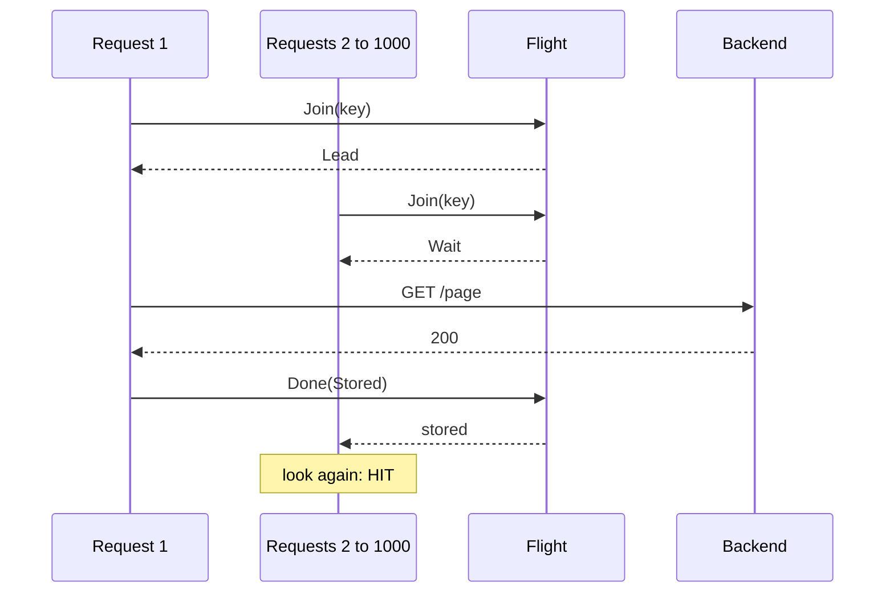
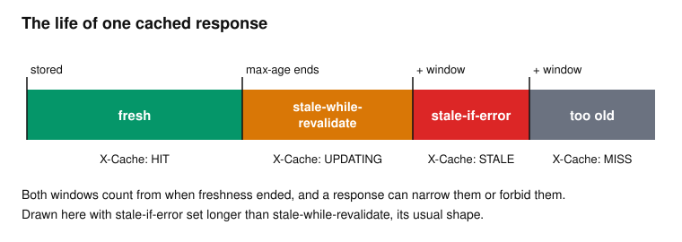

# Inside the cache

[HTTP caching](http-caching.md) covered the rules. This page is about what happens under real load, where the interesting problems are concurrency and failure.

## The problem

Three things go wrong with a simple "look up, else fetch and store" cache.

**The stampede.** A popular page expires. A thousand requests arrive in the same moment, all miss, and all go to the backend. A cache that normally absorbs 99% of the load suddenly passes 100% of it, at exactly the worst time. This is also called the thundering herd.

**The outage.** The backend goes down. The cache holds a perfectly good copy from a few seconds ago, but it's stale, so every request gets an error instead.

**The latency spike.** Every time an entry expires, one unlucky user waits for the backend while everyone else was getting instant responses.

## The path through the code

`Handler.serveCache` (`internal/proxy/cache.go`) is the entry point, and `fill` does the fetching. Here's the decision, simplified:



## Coalescing: solving the stampede

The idea is simple: when many requests want the same missing thing, **only one fetches it**. The first request becomes the **leader**, and the rest wait for it. nginx calls this `proxy_cache_lock`.



`Flight` (`internal/cache/flight.go`) is a mutex over a map of in-progress calls. A `Call` holds a channel that's closed when the leader finishes. That's the Go way to wake any number of waiters at once. The result is set before the channel closes, so everyone reads it safely.

Several details keep this from going wrong:

- **Waiters don't wait forever.** `lock_timeout` (default 5s) limits the wait. After that, they fetch for themselves, so a stuck backend can't hold everyone up indefinitely.
- **Waiters hold no concurrency slot.** Only a request that goes to a backend takes one, so 1,000 waiters don't use up the route's capacity.
- **A leader always releases its waiters.** `defer o.call.Done(cache.Failed)` runs even in a panic. `Done` only acts the first time, so the leader can report the real result earlier and leave this fallback in place.
- **The leader can outlive its client.** If the client that triggered the fetch disconnects, the waiters still want the response. `leaderContext` detaches the fetch from that client, but only for up to `lock_timeout`, so a stalled backend can't hold the goroutine and its slot for good.
- **Storing happens while streaming.** The leader's client doesn't wait for the store. `teeBody` passes the body through to the client while copying it into a buffer, up to `max_object`.

### Hit-for-pass

Coalescing has a trap. Suppose a URL turns out to be uncacheable. Requests queue behind the leader, the response can't be stored, so the next request leads, and the rest queue behind *it*. Requests that could all run in parallel now run one at a time.

The fix comes from Varnish: when a response can't be stored, mark the key for 10 seconds (`PassFor`). While that mark is on, requests for it get the role `Pass`, and go directly to the backend in parallel. The mark is just another entry in the `Flight` map, with no `done` channel.

## Serving stale: solving the outage and the spike

Two extensions from RFC 5861 use stale entries deliberately. Both are route settings, and a response's own directive can narrow them, but never widen them.



**`stale_if_error`** covers the outage. If the backend fails or returns a 5xx while revalidating, and the entry is within the window, serve it as `STALE`. Users see slightly old data rather than an error page. A failed leader also releases its waiters, and they use the stale entry too, instead of each hitting the failing backend.

**`stale_while_revalidate`** covers the latency spike. Within the window, the stale entry is served right away as `UPDATING`, while one background request refreshes it. Nobody waits. `revalidateLater` runs that fetch:

- It gets its own copies of the request, since the original ends the moment the client is answered.
- It takes a concurrency slot only if one is free. A background refresh must never queue ahead of real clients. If it can't run, a later request tries again.
- It has no client to serve, so `backgroundWriter` throws the output away.

`staleWithin` enforces the limits. `must-revalidate`, `no-cache` and `s-maxage` all forbid serving stale.

## The store

`Store` and `lru` (`internal/cache/store.go`, `lru.go`) form a classic LRU cache: a map for lookups plus a doubly linked list in order of use. Every operation is O(1), and it's bounded in **bytes**, not entries, since responses differ hugely in size. One store is shared by every caching route.

- **One mutex.** Lookups change the list order, so even reads need a lock, but the work inside it is tiny.
- **Immutable entries.** This is why one mutex is enough. An `Entry` never changes once stored, so a hit takes the lock only to find it, then writes the body to the client with no lock held. A slow client can't block anyone, and an evicted entry stays valid for whoever's still sending it. A revalidation builds a new `Entry` that shares the same body.
- **Sizes include overhead.** `Entry.Size` adds keys, headers and a flat 512 bytes, so a cache full of tiny responses stays near `max_size`.
- **Vary needs an index.** Before you can compute a variant's key, you need to know which headers vary. `Store.vary` maps each primary key to the names from its latest response, so a lookup is one index read and one LRU read, under one lock.

The cache also survives reloads: `runtime.Build` carries over the store, the in-progress flights and the counters.

## Purging

Sometimes you know that content has changed. The admin API can remove entries at once:

```sh
curl -X POST 127.0.0.1:9901/cache/purge -d '{"host":"example.com","path":"/news"}'
```

Add `"prefix": true` to remove everything under a path. `Store.Purge` walks the entire store, so it's not meant for frequent use.

## Try it

These use the `/app/` and `/swr/` routes in [`examples/labs/caching.yaml`](../../examples/labs/caching.yaml), with backend `a`. `/_fault?cache_control=...` changes the header that it sends.

```sh
scripts/lab-backends.sh
```

```sh
./bin/prism -config examples/labs/caching.yaml
```

```sh
c() { curl -si "$@" | grep -iE '^(HTTP|x-cache|age)' | tr -d '\r' | tr '\n' ' '; echo; }
```

### Coalescing

Make the backend slow and cacheable, then send 20 requests for a cold URL at once:

```console
$ curl -s '127.0.0.1:9101/_fault?cache_control=max-age%3D30&latency=1s' >/dev/null
$ (for i in $(seq 1 20); do curl -s -o /dev/null -D - 127.0.0.1:8080/app/cold | grep -i x-cache & done; wait) | tr -d '\r' | sort | uniq -c
     19 X-Cache: HIT
      1 X-Cache: MISS
```

The backend saw one request:

```console
$ curl -s 127.0.0.1:9101/_stats
{"name":"a","requests":1}
```

### Hit-for-pass

Make responses uncacheable, then send 3 parallel requests, twice, watching how long each takes:

```console
$ curl -s '127.0.0.1:9101/_fault?cache_control=no-store&latency=1s' >/dev/null
$ for r in 1 2; do echo round $r; for i in 1 2 3; do curl -s -o /dev/null -w '%{time_total}\n' 127.0.0.1:8080/app/uncacheable & done; wait; done
round 1
1.001901
2.003601
2.003044
round 2
1.002159
1.002274
1.002790
```

In the first round, nobody knew the URL was uncacheable, so two requests queued behind the leader and took two seconds. In the second, the key was marked, and all three ran in parallel.

### Stale if error

Cache for one second, let it expire, then break the backend:

```console
$ curl -s '127.0.0.1:9101/_fault?cache_control=max-age%3D1&latency=0s' >/dev/null
$ c 127.0.0.1:8080/app/page
HTTP/1.1 200 OK X-Cache: MISS
$ sleep 1.2
$ curl -s '127.0.0.1:9101/_fault?error_rate=1' >/dev/null
$ c 127.0.0.1:8080/app/page
HTTP/1.1 200 OK Age: 2 X-Cache: STALE
```

The backend is answering 503, and the client gets a `200`. The log records what happened:

```text
level=WARN msg="upstream returned an error, serving stale" ... path=/app/page ... status=503 kind=upstream error="status 503"
```

### Stale while revalidate

A 500 ms backend with `max-age=1`. Watch the response times:

```console
$ curl -s '127.0.0.1:9101/_fault?error_rate=0&cache_control=max-age%3D1&latency=500ms' >/dev/null
$ s() { curl -s -o /dev/null -D - -w '%{time_total}s\n' 127.0.0.1:8080/swr/page | grep -iE '^x-cache|^[0-9]' | tr -d '\r' | tr '\n' ' '; echo; }
$ s; s; sleep 1.2; s; s; sleep 0.6; s
X-Cache: MISS 0.502799s
X-Cache: HIT 0.000580s
X-Cache: UPDATING 0.000837s
X-Cache: UPDATING 0.000481s
X-Cache: HIT 0.000768s
```

Only the first request paid the 500 ms. After expiry, clients got instant answers while the refresh ran behind them, and then it was a normal `HIT` again.

### Purging and stats

```console
$ curl -s '127.0.0.1:9101/_fault?cache_control=max-age%3D60&latency=0s' >/dev/null
$ c 127.0.0.1:8080/app/news
HTTP/1.1 200 OK X-Cache: MISS
$ curl -s -X POST 127.0.0.1:9901/cache/purge -d '{"host":"127.0.0.1:8080","path":"/app/news"}'
{"purged":1}
$ curl -s 127.0.0.1:9901/cache/stats
{"entries":8,"bytes":6594,"max_bytes":67108864,"evictions":0,"waiting":0,"hit":29,"miss":24,"stale":2,"revalidated":1,"bypass":0,"updating":2}
```

## Tradeoffs

- **Memory only.** A restart empties the cache. nginx can cache to disk and hold far more. Memory is simpler and faster, but restarts send a burst of misses to backends.
- **One mutex.** Sharding the store, as the rate limiter does, would allow more parallelism. The critical sections are so small that it hasn't been needed, and an LRU across shards would be only approximate.
- **Bodies are buffered up to `max_object`.** A response that's too large gets passed through, and the memory is released.
- **The whole fill is one long function.** `fill` is the most complex function in Prism, because so many cases meet there. Its comments are the best guide.
- **Staleness is a choice.** `stale_if_error` trades correctness for availability. It's right for a product page, and wrong for an account balance, which is why it's off by default.

## Check yourself

1. In the stampede scenario, why is one `Flight` per key better than one global lock on misses?
2. What happens to the waiters if the leader's backend request fails? What if a stale entry is available?
3. Why does coalescing need hit-for-pass? What would happen without it?
4. Why can a cache hit write to a slow client without holding the store's lock?
5. Why does a `stale-while-revalidate` fetch use `TryAcquire` rather than waiting for a slot?

Next: [Security](security.md).
