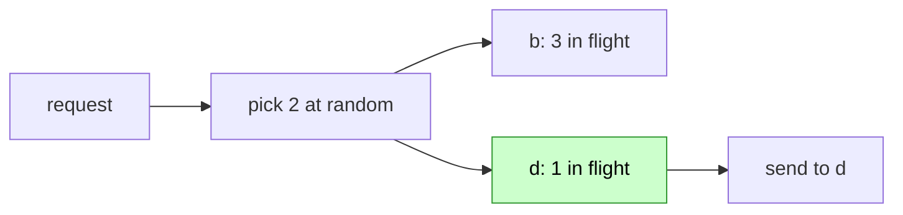
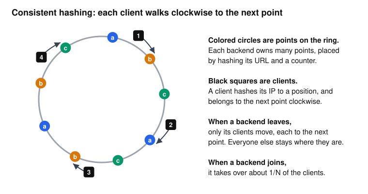
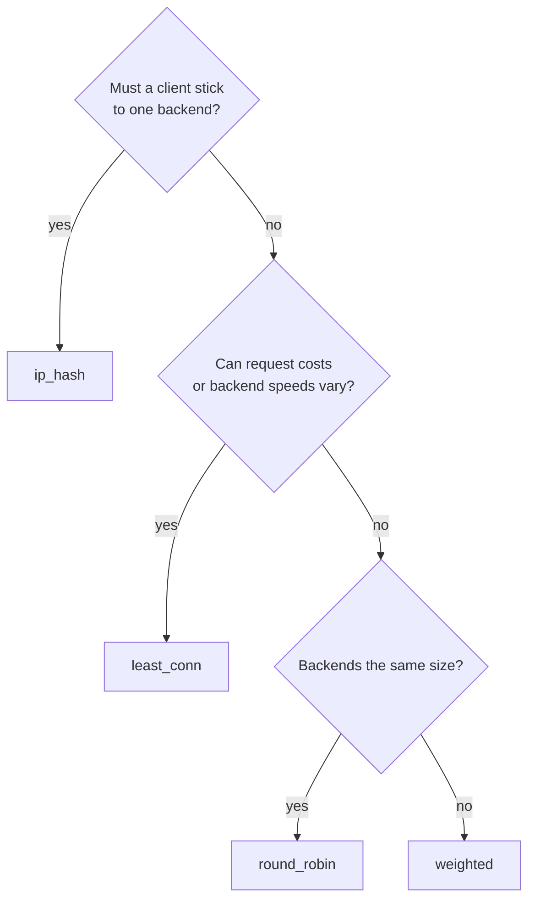

# Load balancing

## The problem

You have several identical backends. Each request has to go to one of them. The goal sounds simple, "spread the work evenly", but "evenly" has several meanings:

- Should each backend get the same number of requests?
- What if one backend is twice as powerful?
- What if requests vary, with some taking 1 ms and some taking 5 seconds?
- What if a client should keep hitting the same backend, because that backend has its data in memory?

There's no one answer, so Prism has four strategies. In the config, this is `balancer:` on an upstream.

## The naive fix

Pick at random. Over millions of requests, that evens out. Over a short period, randomness is lumpy: some backends get bad luck and pile up work, and nothing corrects it. And it ignores everything you might know about the backends.

## The interface

All four strategies implement one small interface (`internal/upstream/upstream.go`):

```go
type Balancer interface {
    Pick(c Choice) (*Backend, error)
}
```

`Choice` carries the client IP and the backends this request already tried. `c.Usable(b)` says whether a backend may be picked: it has to be available, and not tried yet. Every strategy must skip unusable backends, and return `ErrNoBackend` if none are left. So health, breakers and retries all work with any strategy.

The strategies live in `internal/balancer/`, and `balancer.New` picks one by name.

## Round robin

Backends take turns: a, b, c, a, b, c.

```go
start := rr.next.Add(1) - 1
for i := range n {
    if b := rr.bs[(start+i)%n]; c.Usable(b) {
        return b, nil
    }
}
```

One atomic counter, and no locks. If a backend is unusable, its turn passes to the next one. Round robin ignores `weight`.

**Good for:** identical backends and requests of similar cost. It's the default.

## Weighted round robin

Backends with more capacity get proportionally more requests. The naive version repeats a backend `weight` times: a a a a a b c. That sends bursts to `a`, which is what you were trying to avoid.

Prism uses **smooth weighted round robin**, from nginx. Each backend has a running score. On each pick:

1. Add each backend's weight to its score.
2. Pick the highest score.
3. Subtract the total weight from the winner.

With weights 5, 1 and 1, the total is 7:

| pick | scores after adding weights | winner | scores after subtracting 7 |
| --- | --- | --- | --- |
| 1 | a=5, b=1, c=1 | a | a=-2, b=1, c=1 |
| 2 | a=3, b=2, c=2 | a | a=-4, b=2, c=2 |
| 3 | a=1, b=3, c=3 | b | a=1, b=-4, c=3 |
| 4 | a=6, b=-3, c=4 | a | a=-1, b=-3, c=4 |
| 5 | a=4, b=-2, c=5 | c | a=4, b=-2, c=-2 |
| 6 | a=9, b=-1, c=-1 | a | a=2, b=-1, c=-1 |
| 7 | a=7, b=0, c=0 | a | a=0, b=0, c=0 |

The result is `a a b a c a a`. `a` got exactly 5 of 7, with `b` and `c` spread among them, and the scores are back at zero, so the cycle repeats. It's the one balancer with a mutex, since the update touches every score. See `Weighted.Pick` in `internal/balancer/weighted.go`.

**Good for:** backends of different sizes, or moving traffic slowly onto a new machine.

## Least connections

The strategies so far ignore what's actually happening. Suppose one backend is slow today, because of a noisy neighbor or a long garbage collection. Round robin keeps sending it a full share, and requests pile up.

A useful fact: **a slow backend has more requests in flight**, since each one stays longer. So counting in-flight requests measures slowness, with no latency tracking at all. Prism keeps this count in `Backend.Acquire` and `Release`.

The obvious approach is to scan all backends and take the lowest count. That has two problems. It's O(n) on every request. Worse, when many requests arrive at the same moment, they all see the same idle backend and all pick it. This is called the **herd effect**.

Prism uses the **power of two choices**: pick two backends at random, and use the less loaded one.



This sounds too simple to work, but it's a well-known result in the study of random allocation: comparing just two gets you almost all the benefit of checking every backend. It's O(1), and the randomness breaks up the herd. Envoy's `least_request` works the same way.

Weights count too. `lighter` compares `(inflight+1)/weight`, cross-multiplied to stay in integers. The `+1` counts the request being placed, so that between two idle backends, the heavier one wins. See `internal/balancer/leastconn.go`.

**Good for:** most real workloads, especially when request costs vary. If you're unsure, use this.

## ip_hash

Sometimes you want **stickiness**: the same client always reaches the same backend, because that backend has the client's session or a warm local cache.

The obvious way is `hash(ip) % N`. But then adding one backend changes N, and nearly every client moves. Going from 3 to 4 backends moves about 3 out of 4 clients, and every warm cache goes cold at once.

**Consistent hashing** fixes that. Imagine a ring of hash values. Each backend puts many points on it. A client hashes to a position, and belongs to the next point clockwise.



Adding a backend inserts new points, and only the clients just before those points move. That's about 1/N of them. If a client's backend goes down, the walk simply continues clockwise to the next usable one, and nobody else moves.

Details in `internal/balancer/iphash.go`:

- **The ring is a sorted slice**, searched with binary search, built once per `Runtime`.
- **4,096 points per unit of weight.** A backend's share varies by about 1/√points, so more points give a more even split. This keeps 10 equal backends within 5% of each other, at a cost of about 12 ns per lookup over the classic 160 points. The ring is capped at 65,536 points.
- **Hashes aren't seeded per process**, so every Prism instance with the same backends sends a client to the same place, with no coordination between them.

**Good for:** session affinity and backends with local caches. It's a poor fit when many users share one IP, such as a whole office behind one address, since they all land on one backend.

## Try it

Start the backends and the lab. Its upstreams share the same three backends, with weights 5, 1 and 1:

```sh
scripts/lab-backends.sh
```

```sh
./bin/prism -config examples/labs/balancing.yaml
```

This helper prints which backend answered 14 requests in a row:

```sh
seq14() { for i in $(seq 1 14); do curl -si 127.0.0.1:8080/$1/x | grep -i '^x-backend' | tr -d '\r' | cut -d' ' -f2 | tr '\n' ' '; done; echo; }
```

Round robin ignores weights, and weighted follows the table above:

```console
$ seq14 rr
a b c a b c a b c a b c a b
$ seq14 weighted
a a b a c a a a a b a c a a
```

For `ip_hash`, play six different clients. The lab's `trusted_proxies` lets `X-Forwarded-For` set the client address. Each client gets the same backend every time, and `a` gets most of them because of its weight:

```console
$ for ip in 203.0.113.1 203.0.113.2 203.0.113.3; do echo -n "$ip: "; for i in 1 2 3; do curl -si -H "X-Forwarded-For: $ip" 127.0.0.1:8080/hash/x | grep -i '^x-backend' | tr -d '\r' | cut -d' ' -f2 | tr '\n' ' '; done; echo; done
203.0.113.1: b b b
203.0.113.2: a a a
203.0.113.3: a a a
```

Now the interesting one. Make `a` much slower than the others, then send 100 requests a second for 5 seconds through each of round robin and least connections.

```sh
curl -s '127.0.0.1:9101/_fault?latency=200ms' >/dev/null
curl -s '127.0.0.1:9102/_fault?latency=5ms' >/dev/null
curl -s '127.0.0.1:9103/_fault?latency=5ms' >/dev/null
./bin/loadgen -url http://127.0.0.1:8080/rr/x -rate 100 -duration 5s -out /dev/null
for p in 9101 9102 9103; do curl -s 127.0.0.1:$p/_stats; done
```

Run it again with `/least/x`, and compare how many requests each backend received. `/_stats` counts are running totals, so subtract the previous numbers:

| backend | round robin | least connections |
| --- | --: | --: |
| a (200 ms, weight 5) | 167 | 110 |
| b (5 ms) | 166 | 195 |
| c (5 ms) | 167 | 195 |

Round robin kept feeding the slow backend a full third. Least connections moved traffic off it, even though `a` has five times the weight, just by watching in-flight counts.

## Choosing



## Tradeoffs

- **Each instance balances alone.** Two Prism instances don't share in-flight counts, so `least_conn` only sees its own share of the load. With power of two choices, that works well enough.
- **Round robin's counter is shared across requests, not clients.** It's even overall, not per client.
- **ip_hash stickiness is best effort.** A backend going down moves its clients, and changing the backend list moves about 1/N. Don't treat it as a guarantee: keep the source of truth for a session somewhere else.
- **State across reloads.** `least_conn` counts survive a reload, because the state lives in shared per-backend storage. A weighted balancer starts its scores from zero, since a new `Runtime` builds new balancers.

## Check yourself

1. Why does the herd effect affect scanning for the least-loaded backend, but much less so power of two choices?
2. A pool has 4 backends and uses `hash(ip) % N`. One dies. What share of clients move? What's the share with consistent hashing?
3. In `Weighted.Pick`, what stops `a` from taking all the early picks?
4. Why does counting in-flight requests detect a slow backend?

Next: [Rate limits and overload](rate-limits-and-overload.md).
