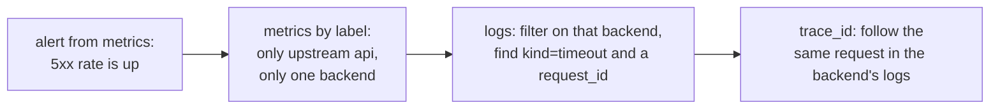

# Observability

## The problem

It's 3 AM and users are getting errors. Is it one backend or all of them? When did it start? Which route? Is it the proxy, or something behind it? A system you can't see into is one you can only guess about.

## The naive fix

Add `fmt.Println` where things might go wrong. That gives you a scroll of text that's hard to search, has no aggregate view, and at thousands of requests a second, slows the program it's describing.

## The idea: three kinds of signal

Each answers a different question.

| signal | answers | shape | in Prism |
| --- | --- | --- | --- |
| **logs** | what happened to *this* request? | one structured event each | access log, error log |
| **metrics** | how is the whole system doing? | numbers over time | Prometheus at `/metrics` |
| **traces** | where did the time go across services? | linked spans | W3C `traceparent` |

A typical investigation moves between them:



Two more tools sit alongside: the **admin API** shows live state, and **pprof** shows where CPU and memory go.

## Logs

### The access log

`logRequest` (`internal/server/accesslog.go`) writes one line per request, when it finishes. It uses Go's `slog`, so lines are structured key-value pairs, in text or JSON (`-log-format json`). That means you can filter on fields rather than grep sentences.

Fields come from `proxy.Annotations`, filled in along the [request's path](../learn/05-life-of-a-request.md):

| field | meaning |
| --- | --- |
| `request_id` | unique per request, also sent to the backend and the client |
| `trace_id`, `span_id`, `parent_id` | this request's place in a trace |
| `method`, `host`, `path`, `proto` | what was asked for |
| `status`, `bytes`, `duration` | how it ended |
| `client` | the real client IP, after trusted proxies |
| `route`, `upstream`, `backend`, `attempts` | where it went |
| `user` | who auth let in |
| `cache` | the `X-Cache` result |
| `error` | why it failed, from a fixed list |
| `retry_budget_exhausted`, `aborted`, `websocket` | set only when true |

### Error logs and flood safety

Failures that need attention get their own `WARN` line, with the same `request_id` so they connect to the access log. But refusals like a `429` deliberately don't: `reject` only annotates, so a flood of refused requests can't become a flood of log lines.

### The cost of logging

Writing a log line per request costs real CPU, about 10% of Prism's under load. By default each line is one `write` call. `-log-buffer 64KB` batches them, using two buffers so that writing one out doesn't stall requests filling the other (`observability.BufferedWriter`). The tradeoff is the same as nginx's `buffer=`: a crash can lose up to a second of lines.

## Metrics

### Why not just count log lines?

Metrics are pre-aggregated: a counter is one number, however many requests it counts. Scraping it costs the same at 10 or 100,000 requests a second, and a time-series database like Prometheus can graph and alert on it for years.

**Counters** only go up, and you graph their rate. **Gauges** go up and down. **Histograms** count values into buckets, which gives you percentiles.

### What Prism exports

| metric | type | use it for |
| --- | --- | --- |
| `prism_requests_total{route,upstream,code}` | counter | traffic and error rates |
| `prism_request_duration_seconds{route,upstream}` | histogram | latency as clients see it |
| `prism_upstream_response_seconds{upstream,backend}` | histogram | how fast each backend is |
| `prism_retries_total{route}` | counter | how much retrying is going on |
| `prism_retry_budget_exhausted_total{route}` | counter | retries refused |
| `prism_proxy_errors_total{route,kind}` | counter | why requests failed |
| `prism_backend_healthy`, `_ejected`, `_breaker_state`, `_inflight` | gauge | the state of each backend |
| `prism_upstream_available_backends{upstream}` | gauge | an alert when this gets low |
| `prism_route_concurrency_in_use`, `_limit`, `prism_route_queue_depth` | gauge | how close you are to shedding load |
| `prism_cache_requests_total{result}`, `prism_cache_bytes`, `prism_cache_evictions_total` | mixed | cache effectiveness |
| `prism_config_last_reload_successful` | gauge | an alert when a bad config was refused |
| `prism_ratelimit_evictions_total{route,limit}` | counter | the limiter's key cap is being hit |

There's also Go's own runtime and process metrics. `reference/` will have the complete list.

Some useful Prometheus queries:

```promql
# 5xx ratio per route
sum by (route) (rate(prism_requests_total{code="5xx"}[5m]))
  / sum by (route) (rate(prism_requests_total[5m]))

# p99 latency per route
histogram_quantile(0.99,
  sum by (route, le) (rate(prism_request_duration_seconds_bucket[5m])))

# cache hit ratio
sum(rate(prism_cache_requests_total{result="HIT"}[5m]))
  / sum(rate(prism_cache_requests_total[5m]))
```

### Keeping metrics cheap

Two ideas here apply to any metrics system.

**Beware of cardinality.** Each unique combination of labels is a separate series, stored forever. So labels must come from small, fixed sets. Prism's `code` label is the status class (`2xx`, `5xx`), rather than the exact status, and it never uses paths or client IPs as labels. The access log keeps the exact details.

**Look handles up once.** Normally, recording a metric means hashing its labels under a lock. Prism resolves handles when a route is built (`Metrics.Route`), so recording a request just indexes an array by status class. See `RouteMetrics` in `internal/observability/metrics.go`.

A reload keeps series going, since `Metrics` outlives any `Runtime`. And `Metrics.Prune` deletes series of routes and backends that no longer exist.

Live state, like the gauges above, isn't stored in metrics at all. The `collector` in `internal/admin/metrics.go` reads it at scrape time, from whichever `Runtime` is current.

## Traces

### The problem

One user request might cross five services. Each has logs, but what ties them together?

**Distributed tracing** gives the request a `trace_id` that every service passes on. Each service's piece of the work is a **span**, with its own ID and a parent. The W3C standard puts this in one header:

```text
traceparent: 00-0af7651916cd43dd8448eb211c80319c-b7ad6b7169203331-01
             │  │                                │                └ flags
             │  │                                └ parent span ID
             │  └ trace ID, the same across all services
             └ version
```

### In Prism

`internal/proxy/trace.go` joins the trace if the request has a valid `traceparent`, or starts a new one. Prism counts as one span, and sends its own span ID as the parent to the backend. Every attempt, including retries and shadow copies, names that same span.


Prism **propagates** traces and logs the IDs, but has no span exporter, so it sends nothing to Jaeger or Tempo. Backends that do export will show Prism's span ID as a parent with no matching span, and you can find it in Prism's access log instead.

## Live state: the admin API

Metrics show history, and the admin API shows now. It's on its own listener.

| endpoint | shows |
| --- | --- |
| `GET /routes` | the routes and their settings |
| `GET /upstreams` | each backend's health, inflight, breaker and ejection state |
| `GET /config` | the effective config, with URL passwords masked |
| `GET /cache/stats` | cache size and result counts |
| `GET /metrics` | everything for Prometheus |
| `POST /reload`, `POST /cache/purge` | actions |
| `GET /ready`, `GET /live` | probes, which skip auth |
| `/debug/pprof/` | Go's profiler, with `admin.pprof: true` |

## Try it

```sh
scripts/lab-backends.sh
```

```sh
python3 examples/labs/echo-backend.py
```

```sh
./bin/prism -config examples/labs/observability.yaml -log-format json
```

### Follow a trace

Join a trace, as if a browser had started one:

```sh
curl -s -o /dev/null -H 'traceparent: 00-0af7651916cd43dd8448eb211c80319c-b7ad6b7169203331-01' 127.0.0.1:8080/echo/x
```

Prism's log line, formatted:

```json
{
    "time": "2026-11-08T01:05:22.140689795+05:30",
    "level": "INFO",
    "msg": "request",
    "request_id": "f6c0edc42fdd8649a20cd09ee0d1c042",
    "trace_id": "0af7651916cd43dd8448eb211c80319c",
    "span_id": "3e444e8b03551c86",
    "parent_id": "b7ad6b7169203331",
    "method": "GET",
    "host": "127.0.0.1:8080",
    "path": "/echo/x",
    "proto": "HTTP/1.1",
    "status": 200,
    "bytes": 6,
    "duration": 1451041,
    "client": "127.0.0.1",
    "route": "/echo/",
    "upstream": "echo",
    "backend": "http://127.0.0.1:9104",
    "attempts": 1
}
```

`trace_id` is the one you sent, `parent_id` is your span, and `span_id` is Prism's new one. The `Traceparent` that the echo backend prints has your trace ID with Prism's span as the parent. Note that in JSON, `duration` is in nanoseconds.

### Read a histogram

Send some load and look at the buckets:

```console
$ ./bin/loadgen -url http://127.0.0.1:8080/app/x -rate 200 -duration 2s -out /dev/null
sent 400, ok 400, errors 0 (0.00%)
$ curl -s 127.0.0.1:9901/metrics | grep 'prism_request_duration_seconds.*route="/app/"' | head -3
prism_request_duration_seconds_bucket{route="/app/",upstream="app",le="0.001"} 377
prism_request_duration_seconds_bucket{route="/app/",upstream="app",le="0.0025"} 400
prism_request_duration_seconds_bucket{route="/app/",upstream="app",le="0.005"} 400
```

Buckets are cumulative: 377 of 400 requests took at most 1 ms, and all of them took at most 2.5 ms. That's how `histogram_quantile` estimates percentiles, and also why it's an estimate: you know p99 is somewhere in that bucket, not exactly where.

### Profile a live process

Send load, and take a 4-second CPU profile from the running process:

```console
$ ./bin/loadgen -url http://127.0.0.1:8080/app/x -rate 3000 -duration 7s -out /dev/null &
$ sleep 1; curl -s -o cpu.prof '127.0.0.1:9901/debug/pprof/profile?seconds=4'
$ go tool pprof -top -nodecount=5 bin/prism cpu.prof
Duration: 4s, Total samples = 4.24s (105.99%)
      flat  flat%   sum%        cum   cum%
     0.93s 21.93% 21.93%      0.93s 21.93%  internal/runtime/syscall/linux.Syscall6
     0.29s  6.84% 28.77%      0.29s  6.84%  runtime.futex
     ...
```

The biggest single item is system calls, which makes sense for something that spends its time moving bytes between sockets. See [Performance](performance.md).

## Tradeoffs

- **No span exporter.** Adding OpenTelemetry export would give full traces, at the price of a large dependency and more work per request.
- **One span per request, not per attempt.** With no exporter, a span per attempt would point at parents that appear nowhere.
- **The status class in metrics** loses detail: you can't graph 502 and 503 separately. `prism_proxy_errors_total{kind}` and the access log fill that in.
- **Logs are unbuffered by default,** which favors not losing lines over speed.

## Check yourself

1. Why is a client IP a bad metric label, but fine in a log line?
2. A histogram has buckets at 100 ms and 250 ms. Can you tell whether p99 is 110 ms or 240 ms?
3. Why doesn't a `429` get its own `WARN` log line?
4. The backend's trace shows a parent span that doesn't exist. Where would you look?
5. Where do you look first when `prism_upstream_available_backends` drops?

Next: [Performance](performance.md).
