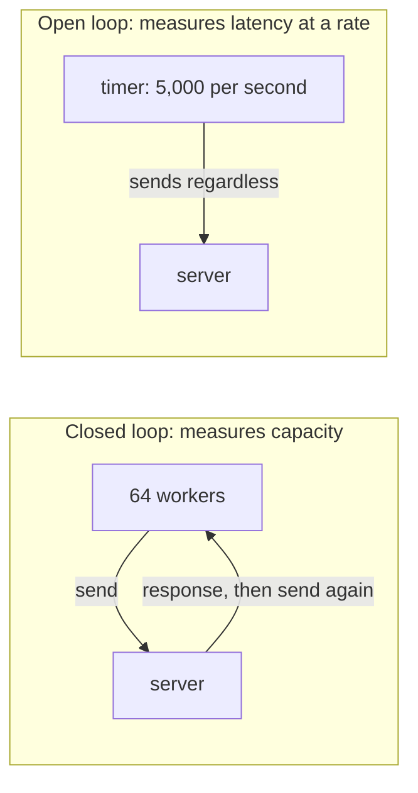
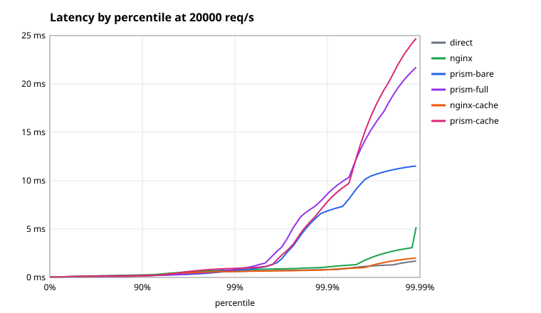

# Performance

## The problem

A proxy adds a hop to every request, so its cost is paid everywhere, all the time. How much does it add? Under what load? Compared to what? These questions are easy to answer badly. Most published benchmarks measure the wrong thing, or average away the part that hurts.

## The naive fix

Run a load tool for 10 seconds, and quote the requests per second and the average latency. Each of those misleads:

- **Averages hide pain.** If 99 requests take 1 ms and one takes a second, the average is 11 ms, which nobody experienced. Users notice the slow ones.
- **Maximum throughput isn't normal operation.** Nobody runs at 100% CPU on purpose. What matters is latency at realistic load.
- **Closed-loop tools flatter you.** A tool that waits for each response before sending the next slows down when the server does, so it hides queueing.

## The idea: how to read a benchmark

**Percentiles.** p50 is the median, and p99 is the latency that 99% of requests beat. A page that makes 100 requests will on average hit the p99 once, so the tail is what users feel.

**Open and closed loops.**



A closed loop finds the maximum throughput. An open loop sends at a fixed rate whether or not the server is keeping up, like real users, so slowness shows up as latency. Prism's benchmark uses both.

**Added latency.** To isolate the proxy's cost, measure the same backend directly and subtract.

**CPU per request.** Throughput depends on how many cores you allow. CPU time per request is a cleaner measure of how much work the code does.

## The results

`make bench-compare` (`bench/run.sh`) compares Prism with nginx, with `vegeta` as the load generator. The load, the proxy and the backends are pinned to separate CPUs. Full details are in [results.md](../bench/results.md).

**These numbers are from one laptop, and were taken before the last round of hardening.** Treat them as a rough picture rather than a spec, and rerun them before quoting them.

| scenario | closed-loop req/s | added p50 / p99 at 5k req/s | CPU per request | allocs per request |
| --- | --: | --: | --: | --: |
| direct | 114,526 | | | |
| nginx | 98,666 | +41 µs / +51 µs | 18.8 µs | |
| prism-bare | 68,822 | +84 µs / +256 µs | 45.1 µs | 82 |
| prism-full | 66,145 | +84 µs / +240 µs | 48.3 µs | 86 |
| nginx-cache | 100,830 | −5 µs / −5 µs | 17.5 µs | |
| prism-cache | 99,234 | +12 µs / +96 µs | 22.1 µs | 31 |

`prism-bare` is one route and one backend. `prism-full` adds least connections, a breaker, outlier detection, header rules, a rate limit, a body limit, a concurrency cap and retries. `*-cache` means every request is a cache hit.



What they say:

- **Prism uses about 2.4 times nginx's CPU per proxied request.** That's the fairest single number. nginx wasn't CPU-bound in these runs, so the throughput column understates the gap in efficiency.
- **Features are nearly free.** Going from bare to full costs about 4% of throughput. Most of the cost is in moving bytes, not deciding what to do with them.
- **On cache hits the two are nearly level,** at 1.3 times the CPU.
- **Prism's tail is worse.** Its maximum latency is 13–28 ms, against 5 ms or less for nginx. Garbage collection is the likely cause, but that hasn't been confirmed.
- **At 20,000 req/s, Prism's median is below direct.** It isn't faster than no proxy. Its pooled connections to the backend behave better at that rate than the load generator's own.

Why is nginx ahead? It's written in C with hand-managed memory, it has an event loop per worker with no garbage collector, and it's had twenty years of tuning. Prism uses `net/http`, which is built for convenience and safety, and allocates on each request. Of the 82 allocations per request under load, about 20 are Prism's own, and the rest belong to `net/http`.

## Where the time goes

Under load, about 21% of Prism's CPU goes to system calls, 15% to allocation and GC assist, and 10% to the access log. See [Observability](observability.md#profile-a-live-process) for how to take a profile.

The method is always the same: **measure, change one thing, measure again**. Guessing where the time goes is usually wrong.

Here's a real example. `BenchmarkPipeline` (`internal/server/bench_test.go`) runs a whole request through Prism's code without sockets. Profiling it showed three surprises, and fixing them changed no behavior:

| finding | fix |
| --- | --- |
| `http.ParseTime("")` allocated three parse errors for every missing date header | check for an empty string first (`parseTime` in `internal/cache/policy.go`) |
| each forwarding header got its own slice | one backing array for all of them (`Forwarding.Apply`) |
| `traceparent` was formatted twice | format once, reuse it for the access log |

| benchmark | allocs/op | time |
| --- | --: | --: |
| `Pipeline/bare` | 26 → 21 | −1.7% |
| `Pipeline/full` | 27 → 22 | −4.0% |
| `Pipeline/cache_hit` | 13 → 9 | −6.1% |

## Hot-path patterns in Prism

These are the reusable ideas. Each is an answer to "what must not happen on every request?"

**Do the work at build time.** Headers are canonicalized, routes sorted, hash rings built and metric handles looked up once, when a `Runtime` is built. Per-request code only reads the results.

**Avoid locks on read paths.** Atomics stand in for locks where possible: the `Runtime` pointer, `Backend.Available`, breaker state. An immutable snapshot needs no locking at all.

**Shard what must be locked.** The rate limiter splits its map into 64 shards, so requests rarely contend.

**Keep hot counters apart.** Two counters on one 64-byte cache line make CPUs fight over that line, even though the values are unrelated. That's called false sharing. `shard` in `internal/ratelimit` and `member` in `internal/resilience/outlier.go` have padding to prevent it.

**Read before writing.** `Outlier.Report` loads the failure count and writes only if it's non-zero. A shared cache line that's only read stays cheap.

**Reuse buffers.** `bufPool` hands out 32 KB buffers through a `sync.Pool`, rather than allocating one per request. It stores pointers, since putting a slice in a pool would itself allocate.

**Give the GC less to scan.** The rate limiter's map holds `[16]byte` keys and `int64` values, with no pointers, so the garbage collector can skip it.

**Share rather than copy.** Cache entries are immutable, so a hit needs no copy of the body.

**Be careful with closures.** A closure that captures a variable can force it onto the heap. A comment in `requestBody.attempt` points out one such case.

Not every path deserves this. Config loading can take as long as it likes. Optimize the hot path, and keep everything else simple.

## Tuning Go itself

Prism doesn't set these, but they're worth knowing about for deployment:

- **`GOGC`** sets how much the heap may grow between collections. The default is 100. A higher value means fewer collections and less CPU, at the cost of memory. For a proxy with little live data, that's often a good trade.
- **Cache entries are live heap.** A large cache plus a high `GOGC` can let the process grow to several times its live size. **`GOMEMLIMIT`** sets a soft ceiling on memory, and is the safer way to combine the two.

The effect of these on Prism's tail hasn't been measured, so test before relying on them.

## Try it

Run the allocation benchmark yourself:

```console
$ go test -run='^$' -bench=Pipeline -benchmem -benchtime=2000x ./internal/server
BenchmarkPipeline/stub-16         	    2000	       824.0 ns/op	     672 B/op	       6 allocs/op
BenchmarkPipeline/bare-16         	    2000	     15226 ns/op	    2599 B/op	      21 allocs/op
BenchmarkPipeline/full-16         	    2000	     14173 ns/op	    2617 B/op	      22 allocs/op
BenchmarkPipeline/cache_hit-16    	    2000	      9848 ns/op	     901 B/op	       9 allocs/op
```

`stub` is the test backend's own cost, so Prism's is the rest. Timings at 2,000 iterations are noisy (note `full` beating `bare`), but allocation counts are stable, which makes them a good regression signal.

To compare two versions properly, run each several times and use `benchstat`, which says whether a difference is real or noise:

```sh
go test -run='^$' -bench=Pipeline -benchmem -count=10 ./internal/server > old.txt
# make your change
go test -run='^$' -bench=Pipeline -benchmem -count=10 ./internal/server > new.txt
go tool benchstat old.txt new.txt
```

The full nginx comparison is `make bench-compare`, which needs Docker and takes about 25 minutes. Use `QUICK=1` for a trial run. It gives steady numbers only on AC power with the `performance` CPU governor.

## Tradeoffs

- **Go over C.** Prism uses more than twice nginx's CPU, and has a longer tail. In return, it's memory-safe and far smaller. For most deployments, the proxy isn't the bottleneck.
- **`net/http` over a custom parser.** A hand-written HTTP layer could remove most of those 60 allocations, at the cost of months of work and a long tail of security bugs.
- **Everything ran on one machine.** At around 100,000 req/s, the direct backend may be limited by the load generator. A real test would use separate hosts.

## Check yourself

1. Why is p99 more useful than the average?
2. A closed-loop test shows 50,000 req/s. Why doesn't that tell you the latency at 40,000 req/s?
3. Why is CPU per request a fairer comparison than maximum throughput here?
4. What's false sharing, and how does padding prevent it?
5. Why does a high `GOGC` suit a proxy without a cache better than one with a large cache?

Back to the [docs index](../README.md).
