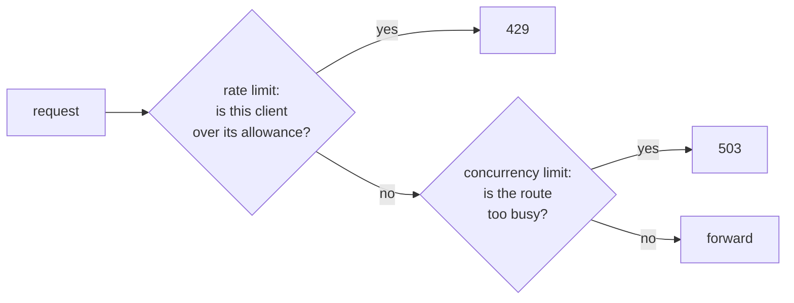
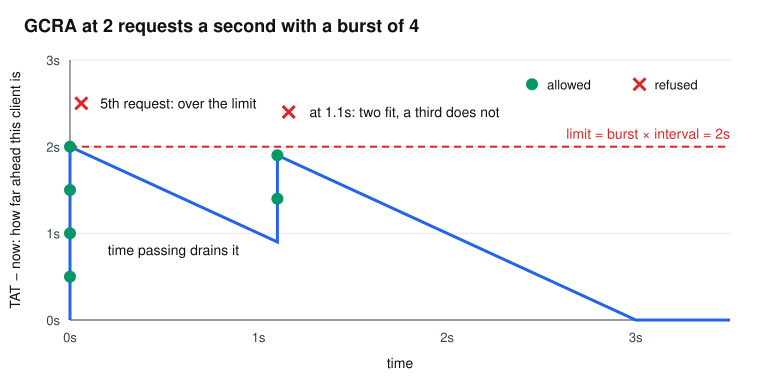
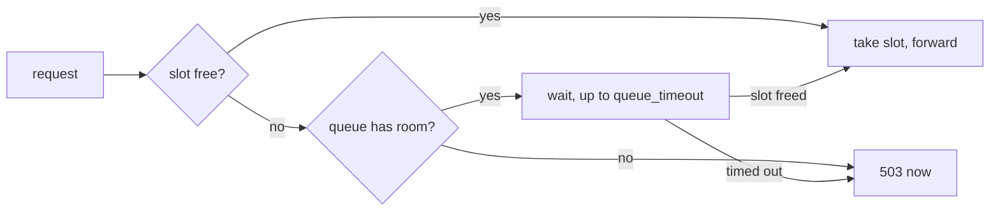

# Rate limits and overload

## The problem

These are two different problems, and it helps to keep them apart.

1. **One client is too greedy.** A buggy script hammers you with 10,000 requests a second, and other users suffer. The question is: *is this client over its allowance?* The tool is a **rate limit**.
2. **The system is too busy.** Traffic is legitimate, but there's more of it than backends can handle. The question is: *can we take on more work right now?* The tool is a **concurrency limit**.

A rate limit can't solve the second problem. A thousand well-behaved clients can overload you while each one stays within its allowance.



## Rate limiting

### The naive fix

Count requests per client per second, and reset the count on the second.

This has a hole at the boundary. With a limit of 100 per second, a client can send 100 requests at 0.99 s and another 100 at 1.01 s. That's 200 requests in 20 ms, and every one was allowed.

### The idea: a token bucket

Picture a bucket for each client. It holds up to `burst` tokens and refills at a steady rate. Each request takes a token, and an empty bucket means refusal.

This gives you two knobs that match what you really want: the long-run average (the refill rate), and how much short-term burstiness to forgive (the bucket's size). Real clients are bursty. A web page might fire 20 requests at once, then go quiet.

### The trick: GCRA

A plain token bucket stores a token count and a last-update time per client, and needs arithmetic on every request. The **Generic Cell Rate Algorithm** behaves exactly the same, but stores a single number: the **theoretical arrival time** (TAT), the moment at which this client's bucket would be full again.

With `T` as the interval between requests at the steady rate, on each request:

```text
next = max(TAT, now) + T
if next - now > burst * T:
    refuse, and tell the client to wait (next - now - burst * T)
else:
    TAT = next, allow
```

Think of TAT as "how far into the future this client has spent". Each request pushes it forward by `T`, and the passing of time drains it. If it would get too far ahead of now, that's a refusal.

Here's a limit of 2 per second (`T` = 0.5 s) with a burst of 4. The client sends a burst at time 0, and then a few more requests at 1.1 s:



A nice side effect: once TAT is in the past, the client is identical to one never seen. So idle clients can be forgotten at any time, with no bookkeeping.

### In Prism

`internal/ratelimit/ratelimit.go` is built around memory and contention, since it runs on the hot path and has to survive attacks:

- **64 shards.** Each client hashes to one of 64 maps, each with its own mutex, so requests rarely wait on each other. The hash is seeded per process, so an attacker can't pick addresses that all land in one shard.
- **Keys are `[16]byte`, values are `int64`.** A map with no pointers is one that the garbage collector doesn't need to scan.
- **Memory has a hard limit.** An attacker with many addresses (easy with IPv6) could otherwise fill your memory. Each shard holds at most 4,096 keys, which is about 262,000 keys in total. Beyond that, an arbitrary key is dropped. The worst that does is hand one client a fresh burst, and `prism_ratelimit_evictions_total` tells you it's happening.
- **Idle keys are swept lazily.** Every 1,024 new keys, a shard drops those with a TAT in the past. There's no background goroutine.
- **A refused request costs the client nothing.** It doesn't push TAT forward, so a client that backs off recovers on schedule.

The refusal is a `429` with `Retry-After` in whole seconds, rounded up so a client that waits that long will get in. The key is the real client IP, after [trusted proxies](../learn/02-http-for-proxies.md#who-is-the-client-really).

## Overload

### Why you can't just queue everything

A useful rule, called **Little's law**, says: requests in the system = arrival rate × time each takes. If a backend takes 100 ms and you send 1,000 requests a second, 100 are in flight at any time.

Now suppose traffic is more than the backends can handle. An unbounded queue just grows. Every request waits longer and longer. Clients time out and retry, which adds load. Eventually the server is spending all its time on requests whose clients have already given up. This is a classic way for a slowdown to become an outage.

The cure sounds wrong at first: **refuse some requests on purpose**, which is called **load shedding**. A fast "try again" is better than a slow failure, and it lets the requests you do accept finish quickly.

### The idea: slots and a short queue

Each route can have a fixed number of **slots**, plus a small, bounded waiting line for short spikes.



The queue absorbs small bursts, while its size and timeout put a hard ceiling on how long anyone waits.

### In Prism

`limits.Semaphore` (`internal/limits/limits.go`) is under 100 lines, because Go channels do the hard part. A slot is a value in a buffered channel, so taking a slot is a send:

```go
select {
case s.slots <- struct{}{}:   // got a slot
    return nil
case <-t.C:                   // queue_timeout passed
    return ErrQueueTimeout
case <-ctx.Done():            // the client left
    return ctx.Err()
}
```

Blocked senders are served in order, so the queue is first come, first served. If a client gives up while waiting, it leaves at once.

The route settings are `max_concurrency`, `queue_size` and `queue_timeout`. A refusal is a `503` with `Retry-After: 1`.

Where the slot is taken matters:

- **After the cache.** A cache hit costs a backend nothing, so it doesn't take a slot. See [Life of a request](../learn/05-life-of-a-request.md#stage-4-the-fork).
- **Held until the body is copied.** A slow download still occupies a backend.
- **Held for a WebSocket's whole life.** So the same cap bounds open connections.
- **Held during retry backoff.** A route that's retrying a lot takes on less new work, which is the pressure you want.

## Limiting body size

`max_body` is the third limit, and it protects both memory and backends. `Handler.ServeHTTP` handles two cases:

- **The client declared a `Content-Length` that's too big.** It's refused with `413` before reading anything. A client using `Expect: 100-continue` never gets the go-ahead to upload.
- **The length is unknown (chunked).** `http.MaxBytesReader` counts while streaming, and the upload fails with `413` at the limit.

After a 413 the rest of the body is still unread on the connection, so `closeAfter` closes it.

## Try it

Start the backends and the lab:

```sh
scripts/lab-backends.sh
```

```sh
./bin/prism -config examples/labs/limits.yaml
```

### The rate limit

`/rate/` allows 2 per second, with a burst of 4. Send 7 at once, wait 1.1 seconds, and send 4 more:

```console
$ for i in 1 2 3 4 5 6 7; do curl -s -o /dev/null -w '%{http_code} ' 127.0.0.1:8080/rate/x; done; echo
200 200 200 200 429 429 429
$ sleep 1.1
$ for i in 1 2 3 4; do curl -s -o /dev/null -w '%{http_code} ' 127.0.0.1:8080/rate/x; done; echo
200 200 429 429
```

That's the graph above, live. The burst of 4 passes, then 1.1 seconds refills about 2 tokens.

### The concurrency limit

`/slots/` allows 2 at once, and 2 more may wait. Make the backend take a second, then send 8 requests together:

```console
$ curl -s '127.0.0.1:9101/_fault?latency=1s' >/dev/null
$ for i in 1 2 3 4 5 6 7 8; do curl -s -o /dev/null -w "request $i: %{http_code} after %{time_total}s\n" 127.0.0.1:8080/slots/x & sleep 0.02; done; wait
request 5: 503 after 0.000688s
request 6: 503 after 0.001261s
request 7: 503 after 0.000638s
request 8: 503 after 0.000780s
request 1: 200 after 1.001928s
request 2: 200 after 1.003617s
request 3: 200 after 1.906643s
request 4: 200 after 1.910106s
```

Three groups, in the order they finished:

- **Requests 5 to 8** were refused in under 2 ms. They can immediately go elsewhere or try later.
- **Requests 1 and 2** took the slots and got a normal one-second answer.
- **Requests 3 and 4** waited in the queue, then took their turn. That's why they took about two seconds.

Without limits, all 8 would have hit the backend at once. Reset it afterwards with `curl -s '127.0.0.1:9101/_fault?latency=0s'`.

## Tradeoffs

- **Counters are per instance.** Two Prism instances each allow the full rate, so the effective limit doubles. A shared store like Redis would fix that, at the price of a network hop on every request and a new way to fail.
- **Per-IP keys are blunt.** An office behind one address shares a limit, while an attacker with many addresses gets many limits.
- **Fixed concurrency limits need tuning.** Set it too low and you waste capacity, too high and it won't protect anything. Adaptive limits, which adjust themselves from measured latency, are a known improvement, and Prism doesn't have them.
- **nginx's `limit_req`** uses a leaky bucket, a close relative, kept in a shared memory zone across its worker processes. Goroutines share memory anyway, so Prism needs no special zone.

## Check yourself

1. Why does a rate limit fail to protect you from a thousand well-behaved clients?
2. With a rate of 10 per second and a burst of 5, a client has been idle for a minute. How many requests can it send at once? What happens over the following second if it keeps sending as fast as it can?
3. Why is 429 the right status for a rate limit, while 503 is right for overload?
4. A route's backend takes 200 ms per request, and you want to allow 500 requests a second. What's a sensible `max_concurrency`, according to Little's law?

Next: [Timeouts and retries](timeouts-and-retries.md).
