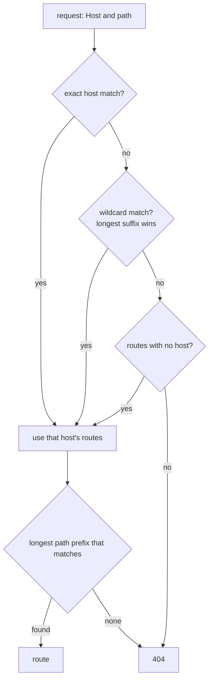

# Routing

## The problem

One proxy usually fronts many things. `api.example.com` is your API, `www.example.com` is your site, and `/static/` on the site is served from somewhere else again. When a request arrives, Prism has to pick exactly one route for it, quickly and predictably.

## The naive fix

Keep a list of rules, and take the first one that matches.

```yaml
- /api/       -> api
- /api/admin/ -> admin    # never reached
```

The second rule can never match, because `/api/` matches first. With first-match rules, order is a silent part of the config. Reordering can change behavior, and the bug only shows up for some URLs. Regular expressions make this worse: they're slow to scan, and it's hard to tell by reading which rule wins.

## The idea

Make the answer independent of the order of the config, by always choosing the **most specific** rule. Prism matches in two steps:



So `/api/admin/users` always goes to `/api/admin/` rather than `/api/`, wherever each appears in the file.

### No fallback between host groups

Look at the diagram again. Once a host group is picked, Prism never goes back to a less specific one. If `api.example.com` has a route for `/v1/` only, then `api.example.com/other` is a 404, even if a wildcard route could have served it. nginx server blocks and Envoy virtual hosts behave the same way. A host group is a closed world, so you can reason about a host by reading only its own routes.

### Prefixes are plain strings

`/api` matches `/api`, `/api/users`, and also `/apiv2`. If you only want whole path segments, end the prefix with a `/`. But `/docs/` doesn't match `/docs` without the slash. This is the same as nginx, and it's the most common routing surprise.

## In Prism

All of this is in `internal/router/router.go`, in about 170 lines.

- **`Compile`** runs when a config is built. It groups routes by host, refuses duplicates, and sorts each group with the longest prefix first. All the work happens here, so matching stays simple.
- **`Table[T]`** is generic. It stores a `*proxy.Route` in practice, but it knows nothing about proxying, which is why its tests are so simple.
- **`Match`** normalizes the host, finds the group, then walks the sorted routes. The first prefix that matches is the longest one, because of the sort.
- **`lookup`** tries the exact map, then wildcards from the longest suffix down, then the no-host group.
- **`normalizeHost`** strips the port, lowercases, and removes IPv6 brackets and a trailing dot, so `API.Example.com:8080` matches `api.example.com`.

The wildcard `*.example.com` matches subdomains at any depth, but not `example.com` itself.

### After matching: strip_prefix

With `strip_prefix: true`, the matched prefix is removed before forwarding, and the result always stays rooted at `/`. So route `/v1/` turns `/v1/users` into `/users`. This is `router.StripPrefix`, called from `targetURL` in `internal/proxy/proxy.go`.

### Why unsafe paths are refused first

The router matches the path as written. `validPath` (`internal/proxy/proxy.go`) rejects `.`, `..` and empty segments before matching, because a backend might normalize them differently. Otherwise `/public/../admin` would match `/public/`, and the backend would serve `/admin`, skipping any auth set on an `/admin/` route.

## Try it

In one terminal, start the backends. In another, start Prism with the routing lab:

```sh
scripts/lab-backends.sh
```

```sh
./bin/prism -config examples/labs/routing.yaml
```

Read [`examples/labs/routing.yaml`](../../examples/labs/routing.yaml) first, and predict each answer below. This helper prints the status and which backend answered:

```sh
who() { curl -si "$@" | grep -iE '^(HTTP|x-backend)' | tr -d '\r' | tr '\n' ' '; echo; }
```

The exact host, and then no fallback:

```console
$ who -H 'Host: api.example.com' 127.0.0.1:8080/v1/users
HTTP/1.1 200 OK X-Backend: a
$ who -H 'Host: api.example.com' 127.0.0.1:8080/other
HTTP/1.1 404 Not Found
```

A wildcard, and then a host that matches nothing, so it uses the no-host routes:

```console
$ who -H 'Host: shop.example.com' 127.0.0.1:8080/anything
HTTP/1.1 200 OK X-Backend: b
$ who -H 'Host: other.org' 127.0.0.1:8080/anything
HTTP/1.1 200 OK X-Backend: c
```

The two prefix surprises:

```console
$ who 127.0.0.1:8080/apiv2
HTTP/1.1 200 OK X-Backend: a
$ who 127.0.0.1:8080/docs/intro
HTTP/1.1 200 OK X-Backend: b
$ who 127.0.0.1:8080/docs
HTTP/1.1 200 OK X-Backend: c
```

`/apiv2` matched `/api`. And `/docs` didn't match `/docs/`, so it fell to `/`.

## Tradeoffs

- **No regular expressions.** nginx has them, and Envoy can match on headers too. Prefixes cover most real configs, stay fast, and can't conflict in confusing ways.
- **A linear scan within a host group.** Matching checks prefixes one at a time, longest first. A tree would scale better to thousands of routes, but a proxy config has tens of routes, and this version is trivially correct.
- **Rejecting odd paths.** A client that sends `//double//slashes` gets a 400. nginx normalizes such paths instead. Refusing is stricter, and could break a sloppy client, but it can't disagree with a backend about what a path means.

## Check yourself

1. Config has `*.example.com` with `/`, and no-host with `/health`. Where does `shop.example.com/health` go?
2. You want `/docs` and `/docs/intro` on the same backend, but not `/docsearch`. What routes do you write?
3. Why is the sort done in `Compile`, not in `Match`?

Next: [Forwarding and streaming](forwarding-and-streaming.md).
