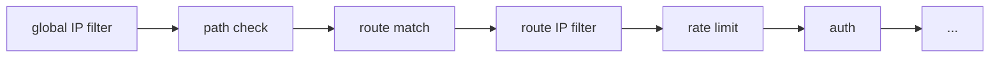
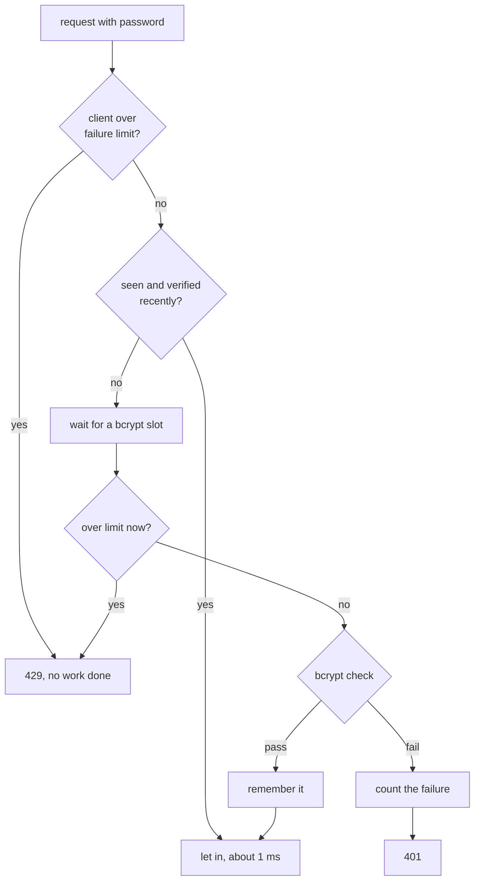

# Security

## The problem

A proxy faces the internet so that backends don't have to. Everything that arrives is untrusted: headers, paths, passwords, and even the claimed source address. A proxy also becomes a natural place to enforce who may reach what. And it's an attractive target, since it sees all the traffic.

## The naive fix

Check a password against a list, and trust headers that say who the client is. Each of those has a well-known way to go wrong:

- A password stored in plain text leaks all users at once.
- Comparing passwords quickly lets an attacker try millions.
- Answering "no such user" tells an attacker which accounts exist.
- Believing `X-Forwarded-For` lets anyone claim to be an internal address.
- Passing on an `X-User: admin` header from a client lets them be anyone.

The theme of this page is **never trust the client, and make attacks expensive**.

## Where the checks sit

Recall the pipeline from [Life of a request](../learn/05-life-of-a-request.md):



Cheap checks come first, and auth comes after the rate limit, so that the rate limit also caps password guessing.

## Trust boundaries

Everything rests on knowing who you're talking to, and that's [the trusted proxy rule](../learn/02-http-for-proxies.md#who-is-the-client-really): only the TCP peer can't be forged, so `X-Forwarded-For` counts only when the peer is in `trusted_proxies`.

The same rule covers other things a client might try to set:

- **`X-Request-Id`** is accepted only from trusted peers, so a client can't choose the ID its requests are logged under.
- **The identity header** (`identity_header` below) is always removed and set again by Prism. If it weren't, a client could send `X-Auth-User: admin` to a backend that trusts it.
- **`traceparent`** is accepted from anyone. That's safe because it decides nothing in Prism, and joining a trace started in a browser is the point.

Get `trusted_proxies` wrong in one direction, and per-IP limits become useless because all clients share the load balancer's address. Get it wrong in the other, by trusting too much, and clients can forge their address.

## IP filtering

`access` has `allow` and `deny` lists of CIDR ranges, globally and per route. `IPFilter.Allowed` (`internal/security/ipfilter.go`) is short: `deny` wins, and if `allow` is set, only those clients pass. A refusal is a `403`.

The lists are scanned in order, at about 4 ns a prefix. That suits tens of prefixes, while thousands would need a trie.

## Passwords: Basic auth

The config never holds passwords, only **bcrypt hashes**, such as those from `htpasswd -nbB user password`. A hash can be checked, but can't be reversed.

bcrypt is **slow on purpose**, taking tens of milliseconds or more per check. That barely matters for one login, and makes guessing millions of passwords from a stolen hash impractical. But for a proxy, it creates a new problem: at that cost per request, a few clients could use up all your CPU. `Authenticator` (`internal/security/auth.go`) has three defenses:

**A cache of verified passwords.** After one success, a SHA-256 of user and password is remembered for 5 minutes, so normal traffic pays for bcrypt only rarely. Entries are tied to the hash, so changing a password in the config invalidates them.

**A limit on concurrent checks.** At most `GOMAXPROCS` bcrypt checks run at once, using a buffered channel as a semaphore. The rest wait, and the wait ends if the client leaves.

**A limit on wrong guesses.** `failure_limit` (default `10/m`) counts wrong credentials per client. Over the limit, a client gets `429` before any password is checked, so a guessing attack costs almost nothing. Three details matter:

- It reuses the [GCRA limiter](rate-limits-and-overload.md), with `Peek` to check and `Allow` to charge only for real failures.
- Missing credentials don't count, since a browser's first request carries none.
- IPv6 clients count by their `/64`, the smallest block a site is usually given. Otherwise an attacker could use a new address for each guess.



The second limit check matters: guesses queued behind earlier failures stop as soon as those failures cross the limit.

### Timing attacks

If an unknown user answers instantly while a known user takes 100 ms, an attacker can list your users by timing. So for an unknown user, `checkPassword` runs bcrypt against a dummy hash at the same cost, and takes about as long.

## API keys

API keys are long random strings for programs, so slow hashing isn't needed: there's no point guessing a 256-bit random value. The config holds **SHA-256 digests**, such as `printf %s key | sha256sum`.

A check is one hash and one map lookup. Comparing secrets naively can leak them through timing, byte by byte, but here the comparison is on the digest, which reveals nothing useful about a valid key.

## After auth

`Authenticator.Prepare` edits the request going to the backend:

- It **removes the credentials**, unless `forward_credentials` is set. A backend that doesn't need passwords shouldn't see them, or log them by accident.
- It **sets `identity_header`** to the user or key that got in, so backends know who's calling.

Caching interacts with this. A response to an authenticated request is stored only if the backend says it may be shared. See [HTTP caching](http-caching.md#may-this-response-be-stored).

## Path safety

`validPath` refuses `.`, `..` and empty segments, including encoded forms like `%2e%2e`. See [Routing](routing.md#why-unsafe-paths-are-refused-first). This blocks a whole family of attacks where the proxy and the backend disagree about what a path means.

## Header injection

Header names and values in the config are validated at load time (`validateHeaders` in `internal/config/validate.go`). Values containing CR, LF or NUL are refused, since those could split a request in two. Hop-by-hop names and `Host` in `request_remove` are refused too.

## TLS

Listeners use TLS 1.2 or later. `certStore` (`internal/server/certs.go`) picks a certificate by SNI name, exact names first, then wildcards, and the first certificate is the fallback. Certificates reload with the config, behind an atomic pointer.

Connections to `https://` backends verify the backend's certificate against the system roots, or only against `ca_file` if it's set. `server_name` overrides the checked name, which is needed when a backend URL is an IP address.

## The admin API

The admin API can reload config, purge the cache, and read the running config, so it's a serious target. Three protections apply:

- It has its own listener, so it's never reachable through client routes.
- `admin.auth` takes the same blocks as a route. A non-loopback `admin.listen` without auth is a **validation error**, so a mistake here stops startup instead of exposing the API.
- `GET /config` masks passwords in URLs.

`/ready` and `/live` skip auth, because load balancers and orchestrators need them, and they reveal almost nothing.

## Resource limits are security too

Several limits covered elsewhere are also defenses:

- `read_header` stops slowloris, where a client sends headers one byte at a time to hold connections open.
- `max_body` stops memory and bandwidth exhaustion.
- The rate limiter's key cap stops memory exhaustion from many addresses.

## Try it

```sh
python3 examples/labs/echo-backend.py
```

```sh
make build && ./bin/prism -config examples/labs/security.yaml
```

The password of `alice` is `s3cret`, and the API key is `key-one`. These appear only as hashes in [`examples/labs/security.yaml`](../../examples/labs/security.yaml).

### Authentication

With no credentials, you get a challenge:

```console
$ curl -si 127.0.0.1:8080/private/x | grep -iE '^HTTP|^www-auth'
HTTP/1.1 401 Unauthorized
Www-Authenticate: Basic realm="lab", charset="UTF-8"
```

With a password, see what remembering a verified password saves:

```console
$ for i in 1 2 3; do curl -s -o /dev/null -w '%{http_code} %{time_total}s\n' -u alice:s3cret 127.0.0.1:8080/private/x; done
200 0.152814s
200 0.001917s
200 0.002531s
```

The first request paid for bcrypt, and the others didn't.

### What the backend sees

Send an API key along with a forged identity:

```sh
curl -s -o /dev/null -H 'X-API-Key: key-one' -H 'X-Auth-User: root' 127.0.0.1:8080/private/x
```

The backend's terminal prints:

```text
--> GET /x  answering 200
    Host: 127.0.0.1:9104
    User-Agent: curl/8.23.0
    Accept: */*
    Traceparent: 00-4cfdcbba05e0c7207a6644953fc1097b-6c450e4559c22592-01
    X-Auth-User: ci
    X-Forwarded-For: 127.0.0.1
    X-Forwarded-Host: 127.0.0.1:8080
    X-Forwarded-Proto: http
    X-Request-Id: c24f1bb5cbec4ac6c3afce03106477e0
```

`X-API-Key` is gone, and `X-Auth-User` is `ci`, the name of the key, not the `root` you sent.

### IP filtering

```console
$ curl -s -o /dev/null -w '%{http_code}\n' 127.0.0.1:8080/internal/x
403
```

### Timing and guessing

Restart Prism for a fresh failure count. This lab allows 3 failures a minute:

```console
$ curl -s -o /dev/null -w 'known user:   %{http_code} %{time_total}s\n' -u alice:nope 127.0.0.1:8080/private/x
known user:   401 0.139413s
$ curl -s -o /dev/null -w 'unknown user: %{http_code} %{time_total}s\n' -u mallory:nope 127.0.0.1:8080/private/x
unknown user: 401 0.323872s
$ curl -s -o /dev/null -w 'unknown user: %{http_code} %{time_total}s\n' -u mallory:nope2 127.0.0.1:8080/private/x
unknown user: 401 0.169868s
```

The first unknown user took longer because Prism built its dummy hash then, once per process. After that, known and unknown users take about the same.

That was three failures. Now you're locked out:

```console
$ curl -si -u alice:nope 127.0.0.1:8080/private/x | grep -iE '^HTTP|^retry'
HTTP/1.1 429 Too Many Requests
Retry-After: 20
$ curl -s -o /dev/null -w '%{http_code} %{time_total}s\n' -u alice:nope 127.0.0.1:8080/private/x
429 0.000532s
$ curl -si -u alice:s3cret 127.0.0.1:8080/private/x | head -1
HTTP/1.1 429 Too Many Requests
```

A refusal now takes half a millisecond instead of 150, so guessing costs Prism almost nothing. But notice the last line: the *correct* password is refused too. That's the tradeoff below.

## Tradeoffs

- **Lockouts are per client, and can hit the innocent.** Everyone behind one IP shares a failure count, so one person's typos can lock out an office until it refills. Limiting by username instead would let an attacker lock out any account they could name.
- **Remembered passwords live in memory for 5 minutes.** They're hashed, and it saves a lot of CPU, but a removed user's password keeps working only until the config reloads, since a reload with changed auth builds a new `Authenticator`.
- **Basic auth sends the password on every request.** Only use it over TLS.
- **No OAuth or JWT validation.** Prism handles static users and keys. Anything more belongs in a dedicated auth service.
- **No WAF.** Prism doesn't inspect request contents for attack patterns, and neither does nginx by default.
- **ACME isn't supported.** Certificates have to be obtained and renewed elsewhere.

## Check yourself

1. Why does auth come after the rate limit in the pipeline?
2. Why are API keys stored as plain SHA-256, while passwords need bcrypt?
3. Why does Prism remove and re-set `identity_header`, even when the client's value is the same?
4. What would an attacker learn if unknown users skipped bcrypt?
5. Prism sits behind a load balancer, but `trusted_proxies` is empty. What goes wrong with `failure_limit`?

Next: [Canary, shadow and WebSockets](canary-shadow-websockets.md).
