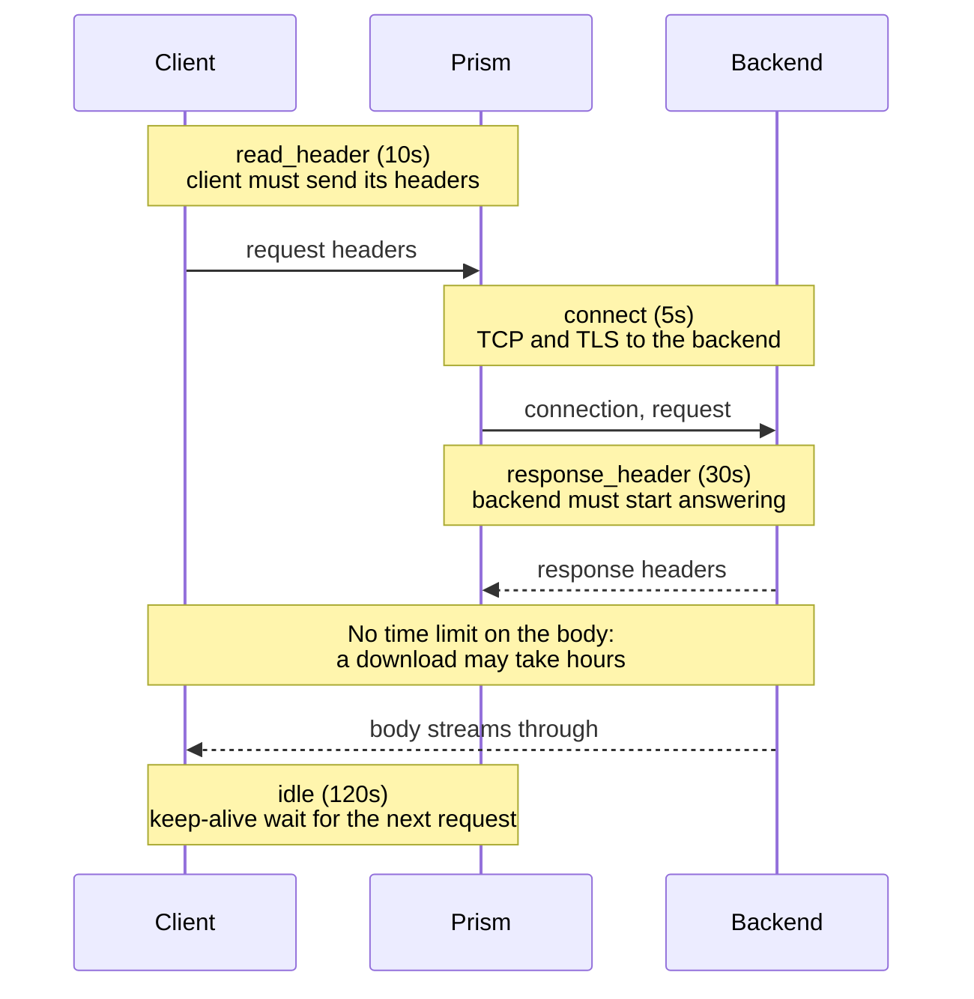
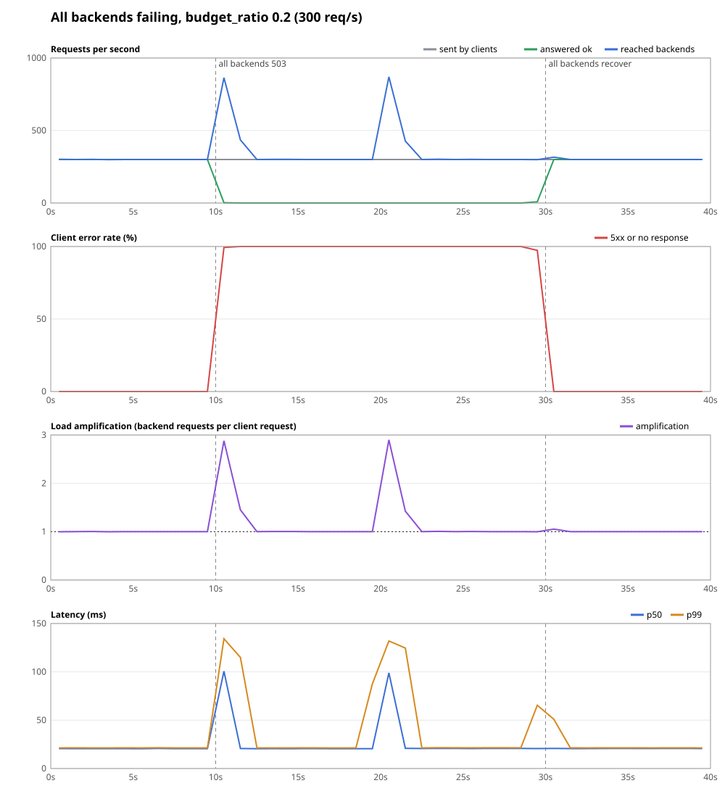

# Timeouts and retries

## The problem

Networks and servers fail in the most awkward way: slowly, and only sometimes. Two questions come up on every request.

- **How long do we wait?** Wait forever, and a stuck backend holds your connections and slots until you run out. Give up too early, and you fail requests that would have worked.
- **When it fails, do we try again?** Many failures are brief, and a second attempt on another backend hides them from the user. But a careless retry can double-charge a customer, or turn a small outage into a total one.

## Timeouts

### The naive fix

Set one timeout for the whole request, say 30 seconds. That fails on both ends:

- It kills long uploads, downloads and live streams that are working perfectly.
- It waits 30 seconds to discover that a backend is refusing connections, which should take milliseconds to detect.

### The idea: time each phase

Different phases fail in different ways, so each gets its own timeout. Then the limits can be tight without affecting long transfers.



| setting | where | default | protects against |
| --- | --- | --- | --- |
| `listeners[].timeouts.read_header` | client side | 10s | clients that open a connection and send headers very slowly (slowloris) |
| `listeners[].timeouts.idle` | client side | 120s | idle keep-alive connections piling up |
| `upstreams.*.timeouts.connect` | backend side | 5s | hosts that are down or unreachable |
| `upstreams.*.timeouts.response_header` | backend side | 30s | backends that accept a request, and then hang |
| `upstreams.*.timeouts.idle_conn` | backend side | 90s | pooled connections going stale |

Prism deliberately has **no whole-request timeout**, on either side. See `ListenerTimeouts` in `internal/config/config.go`. A stream of live events is healthy for as long as it runs. The body isn't entirely unguarded, though: clients that disconnect are noticed, and TCP keep-alive probes find dead backend connections.

A timeout on the backend side becomes a `504`, whether it hit while connecting or while waiting for headers. `classify` in `internal/proxy/errors.go` makes that decision.

## Retries

### The naive fix

"If it fails, try again, three times." Here's what that does in an outage, with every backend failing:


The backends were struggling at 1,000 requests a second, and now they get three times that. Recovery becomes impossible. This is a **retry storm**, and it's a common way for a brief problem to become a long outage. It multiplies across layers too: if each of three services in a chain retries 3 times, the last one sees 27 times the load.

### The idea: retry carefully, on a budget

Prism retries only when all of these hold. This is the flowchart from [Life of a request](../learn/05-life-of-a-request.md#stage-7-sending-and-retrying), and here's why each rule exists.

**1. The failure is one you asked to retry.** `retry.on` lists `connect_error`, `timeout`, or specific 5xx codes. Nothing retries by default. `attempts` counts retries *after* the first try, so `attempts: 1` means up to two tries.

**2. It's safe for this method.**

| failure | what the backend saw | retried for |
| --- | --- | --- |
| `connect_error` | nothing, no connection was made | any method |
| `timeout` | it may have done the work | idempotent methods only |
| a 5xx status | it may have done the work | idempotent methods only |

This is `Retry.Retryable` in `internal/resilience/retry.go`.

**3. The body can be sent again.** A body already streamed to a backend is gone. So on a route with retries, `newRequestBody` (`internal/proxy/body.go`) reads a body of known length up to 64 KB into memory, where it can be replayed. Larger bodies, and those of unknown length, are streamed, and can only be retried if not a byte has been read yet. Reading ahead on an unknown-length body could even deadlock a streaming client that's waiting for a response before it sends more.

**4. The budget has room.** See below.

**5. An untried backend exists.** A retry goes to a different backend, tracked in `Choice.Tried`. If a backend just failed you, it's the worst choice to try next. When the pool runs out, the last result goes to the client as it is.

### Backoff with jitter

Retrying instantly hits a struggling system at its worst moment, so Prism waits first. The wait grows with each retry, and that's **exponential backoff**. But if a thousand requests fail at once and all wait exactly 25 ms, they all come back at once.

So the wait is random, between zero and the ceiling. This is called **full jitter**:

```text
wait for retry n = random in [0, min(max, base * 2^n))
```

The defaults are `base: 25ms` and `max: 250ms`. See `Retry.Delay`. Prism keeps the request's concurrency slot while waiting, so a route that's retrying a lot takes on less new work.

### The retry budget

Limiting attempts per request isn't enough, since that's exactly what multiplied the load earlier. A **retry budget** limits retries across the whole route:

```text
retries allowed in the last 10s = budget_ratio * requests + budget_min_per_sec * 10
```

With the defaults (`0.2` and `10`) and 300 requests a second, that's `0.2 * 3,000 + 100 = 700` retries per 10 seconds, against 3,000 requests. So a total outage adds at most about 23% to the load, instead of 200%. On a healthy system with occasional failures, the budget is never reached, and retries work as normal. The floor lets a quiet route still retry.

`Budget` is in `internal/resilience/budget.go`, and the idea comes from Finagle, Twitter's RPC library. It counts in a sliding window (`window.go`), made of 10 buckets with a running sum.

When a retry is refused for this reason, the access log says `retry_budget_exhausted=true`, and the attempt's own failure goes to the client.

`make chaos` measures this: three backends all answer 503 for 20 seconds, with 2 retries allowed per request. During the outage, the budget held amplification at 1.23, against 2.99 with no budget. The graph shows one such run.



## Try it

Start the backends and the lab, where `response_header` is 500 ms:

```sh
scripts/lab-backends.sh
```

```sh
./bin/prism -config examples/labs/retries.yaml
```

```sh
who() { curl -si "$@" | grep -iE '^(HTTP|x-backend)' | tr -d '\r' | tr '\n' ' '; echo; }
```

### Retrying a 503

Make backend `a` answer 503 to everything. Without retries, clients see those failures:

```console
$ curl -s '127.0.0.1:9101/_fault?error_rate=1' >/dev/null
$ for i in 1 2 3 4; do who 127.0.0.1:8080/noretry/x; done
HTTP/1.1 503 Service Unavailable X-Backend: a
HTTP/1.1 200 OK X-Backend: b
HTTP/1.1 503 Service Unavailable X-Backend: a
HTTP/1.1 200 OK X-Backend: b
```

With retries, they don't:

```console
$ for i in 1 2 3 4; do who 127.0.0.1:8080/retry/x; done
HTTP/1.1 200 OK X-Backend: b
HTTP/1.1 200 OK X-Backend: b
HTTP/1.1 200 OK X-Backend: b
HTTP/1.1 200 OK X-Backend: b
```

### POST is not retried

Same route and same failure, but a `POST` isn't idempotent, and a 503 means the backend might have acted on it:

```console
$ for i in 1 2; do who -X POST 127.0.0.1:8080/retry/x; done
HTTP/1.1 503 Service Unavailable X-Backend: a
HTTP/1.1 200 OK X-Backend: b
```

### A timeout

Reset `a`, and make it hang for 2 seconds, longer than the 500 ms limit:

```console
$ curl -s '127.0.0.1:9101/_fault?error_rate=0&latency=2s' >/dev/null
$ for i in 1 2; do curl -s -o /dev/null -w "%{http_code} after %{time_total}s\n" 127.0.0.1:8080/noretry/x; done
504 after 0.502377s
200 after 0.001230s
$ for i in 1 2; do curl -s -o /dev/null -w "%{http_code} after %{time_total}s\n" 127.0.0.1:8080/retry/x; done
200 after 0.520493s
200 after 0.512522s
```

Without retries, the request sent to `a` fails with a 504 at 500 ms. With retries, it succeeds, but the user waited 500 ms for the failed attempt first. A retry hides the error, not the time it cost. This is why `response_header` shouldn't be much longer than your slowest healthy response.

Reset the backend with `curl -s '127.0.0.1:9101/_fault?latency=0s'`.

## Tradeoffs

- **Retries add latency before they add success.** Each timed-out attempt spends a full timeout. Hedged requests, which send a second copy before the first has failed, would be quicker but cost more load. Prism doesn't do that.
- **The budget comes back in bursts.** It counts over a 10-second window, so once spent, retries return in a lump as old requests age out. A token bucket would smooth that out, but a windowed count is simpler to reason about.
- **Only one layer should retry.** If clients, Prism and your services all retry, they multiply. Pick one.
- **nginx's `proxy_next_upstream`** gives you similar per-failure rules, but has no budget. Envoy has retry budgets too.

## Check yourself

1. Why is it safe to retry a `POST` after `connect_error`, but not after a timeout?
2. A route has `attempts: 3`, but its upstream has two backends. How many tries can a request get at most?
3. Without jitter, what happens when a thousand requests fail at the same moment?
4. Traffic is 100 requests a second with `budget_ratio: 0.2` and `budget_min_per_sec: 10`. How many retries are allowed in 10 seconds?
5. A 2 MB upload fails with a 503 on a route set up to retry 503s. Is it retried? Why?

Next: [Detecting failure](detecting-failure.md).
