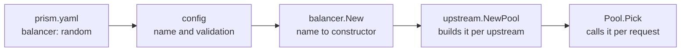

# Add a feature

This guide adds a new load balancer to Prism, start to finish: the code, the config, the tests, and the docs. It's a small feature, which makes it a good way to learn the path every feature takes through the codebase.

Read the [codebase tour](../learn/04-codebase-tour.md) and [Load balancing](../concepts/load-balancing.md) first.

Everything shown here was run for real, on a scratch copy of the repository. The `random` balancer isn't part of Prism: [Load balancing](../concepts/load-balancing.md#the-naive-fix) explains why random choice is the naive approach. It's used here because it's short enough that the steps around it stay visible.

## The plan

The feature is `balancer: random`, which picks a backend at random, in proportion to its weight. Before writing code, list where a balancer touches the system:



`upstream.NewPool` and `Pool.Pick` don't need changing: they only know the `Balancer` interface. So the work is a new type in `internal/balancer`, a name in `internal/config`, and one line in `balancer.New`. That's typical. Prism's layers mean most features touch config, one package, and `runtime.Build` to wire them up.

## 1. Read the contract

The interface is in `internal/upstream/upstream.go`:

```go
type Balancer interface {
	// Pick must skip every backend that c.Usable rejects and return
	// ErrNoBackend if none is left. It is called concurrently.
	Pick(c Choice) (*Backend, error)
}
```

Three rules come out of that comment, and each one needs a test:

1. **Skip what `c.Usable` rejects.** That covers backends that are down, ejected, or behind an open breaker, and also ones this request already tried. A balancer that ignores `Usable` breaks health checks, circuit breakers and retries all at once.
2. **Return `ErrNoBackend` when nothing is left.** `classify` turns that into a `503`.
3. **Be safe for concurrent use.** Every request calls `Pick`, from its own goroutine.

There's an unwritten fourth rule, from the [hot path](../concepts/performance.md#hot-path-patterns-in-prism): `Pick` runs on every request, so it shouldn't allocate.

## 2. Write the balancer

`internal/balancer/random.go`:

```go
package balancer

import (
	"math/rand/v2"

	"github.com/MuditGarg007/prism/internal/upstream"
)

// Random picks a usable backend at random, in proportion to its weight. It
// keeps no state between picks, so concurrent picks never contend.
//
// One pass is enough: the i-th usable backend replaces the pick so far with
// probability weight/total, where total is the weight seen up to and
// including it. Each backend ends up picked with probability weight over the
// total weight of all usable backends.
type Random struct {
	bs   []*upstream.Backend
	intN func(n int) int // random int in [0, n); swapped in tests
}

// NewRandom returns a weighted random balancer over bs.
func NewRandom(bs []*upstream.Backend) upstream.Balancer {
	return &Random{bs: bs, intN: rand.IntN}
}

func (r *Random) Pick(c upstream.Choice) (*upstream.Backend, error) {
	var pick *upstream.Backend
	total := 0
	for _, b := range r.bs {
		if !c.Usable(b) {
			continue
		}
		w := weight(b)
		total += w
		if r.intN(total) < w {
			pick = b
		}
	}
	if pick == nil {
		return nil, upstream.ErrNoBackend
	}
	return pick, nil
}
```

A few choices worth pointing out, since they follow patterns used across Prism:

- **One pass over the backends.** The obvious version collects the usable backends into a slice, then picks from it. That allocates on every request. The single pass, a form of reservoir sampling, needs no slice. `LeastConn.pickUsable` uses the same trick.
- **`weight(b)`, not `b.Weight`.** The helper in `balancer.go` treats a zero weight as 1, which tests rely on when they build backends without one.
- **`intN` is a field.** Tests replace it with a seeded generator, so results are the same on every run. `LeastConn` does the same. It's the random-number version of the injected clocks the codebase tour mentions.
- **`math/rand/v2`'s `rand.IntN` is safe for concurrent use**, with no lock to contend on. That's the one real advantage `random` has over `round_robin`, whose shared counter every request has to update.
- **The comment says why**, not what. Someone reading `Pick` can check the probability argument against the code.

## 3. Test it

`internal/balancer/random_test.go` has one test per rule, reusing the helpers the other balancer tests already have (`backends`, `withWeights`, `indexOf`):

```go
func seededRandom(bs []*upstream.Backend) *Random {
	r := NewRandom(bs).(*Random)
	r.intN = rand.New(rand.NewPCG(1, 2)).IntN
	return r
}

// TestRandomShares checks that picks follow the weights, and that a backend
// that cannot be used gets none.
func TestRandomShares(t *testing.T) {
	for _, tt := range []struct {
		name    string
		weights []int
		down    []int
		want    []float64
	}{
		{"equal", []int{1, 1, 1, 1}, nil, []float64{0.25, 0.25, 0.25, 0.25}},
		{"weighted", []int{5, 1, 1}, nil, []float64{5.0 / 7, 1.0 / 7, 1.0 / 7}},
		{"one down", []int{2, 1, 1}, []int{0}, []float64{0, 0.5, 0.5}},
	} {
		t.Run(tt.name, func(t *testing.T) {
			bs := withWeights(tt.weights...)
			for _, i := range tt.down {
				bs[i].SetHealthy(false)
			}
			r := seededRandom(bs)
			const picks = 70000
			counts := make([]int, len(bs))
			for range picks {
				b, err := r.Pick(upstream.Choice{})
				if err != nil {
					t.Fatal(err)
				}
				counts[indexOf(bs, b)]++
			}
			for i, want := range tt.want {
				got := float64(counts[i]) / picks
				if d := got - want; d < -0.01 || d > 0.01 {
					t.Errorf("backend %d got %.3f of picks, want %.3f ± 0.01", i, got, want)
				}
			}
		})
	}
}
```

The rest follow the same shape as `leastconn_test.go`:

| test | rule it checks |
| --- | --- |
| `TestRandomShares` | weights are followed, and a backend that's down gets nothing |
| `TestRandomNoBackend` | `ErrNoBackend` for an empty pool, all down, and all tried |
| `TestRandomSkipsTried` | a retry never goes back to a backend in `Choice.Tried` |
| `TestRandomConcurrent` | eight goroutines picking at once, for the race detector |
| `TestRandomNoAllocs` | `testing.AllocsPerRun` reports 0 |
| `BenchmarkRandom` | the cost of a pick, next to the other balancers |

```console
$ go test -race -run Random -v ./internal/balancer
=== RUN   TestRandomShares
=== RUN   TestRandomShares/equal
=== RUN   TestRandomShares/weighted
=== RUN   TestRandomShares/one_down
--- PASS: TestRandomShares (0.22s)
    --- PASS: TestRandomShares/equal (0.10s)
    --- PASS: TestRandomShares/weighted (0.06s)
    --- PASS: TestRandomShares/one_down (0.05s)
=== RUN   TestRandomNoBackend
--- PASS: TestRandomNoBackend (0.00s)
=== RUN   TestRandomSkipsTried
--- PASS: TestRandomSkipsTried (0.00s)
=== RUN   TestRandomConcurrent
--- PASS: TestRandomConcurrent (0.01s)
=== RUN   TestRandomNoAllocs
--- PASS: TestRandomNoAllocs (0.00s)
PASS
ok  	github.com/MuditGarg007/prism/internal/balancer	1.244s
```

Testing the type directly, before any config exists, keeps each test fast and exact. The end-to-end check comes later.

## 4. Add it to the config

Now try it from a config file:

```yaml
listeners: [{ addr: "127.0.0.1:8080" }]
admin: { listen: "127.0.0.1:9901" }
upstreams:
  app:
    balancer: random
    backends:
      - { url: "http://127.0.0.1:9101", weight: 3 }
      - { url: "http://127.0.0.1:9102" }
routes:
  - { match: { path_prefix: / }, upstream: app }
```

```console
$ ./bin/prism -config random.yaml -validate
prism: random.yaml: invalid config:
  upstreams.app.balancer: unknown balancer "random" (want one of round_robin, weighted, least_conn, ip_hash)
```

Validation knows the names. Add a constant in `internal/config/config.go`, next to the others:

```go
	BalancerIPHash     = "ip_hash"
	BalancerRandom     = "random"
```

and add it to the list in `internal/config/validate.go`:

```go
var balancers = []string{BalancerRoundRobin, BalancerWeighted, BalancerLeastConn, BalancerIPHash, BalancerRandom}
```

The config now validates. With `scripts/lab-backends.sh` running, start Prism and send 400 requests. The test backends name themselves in an `X-Backend` header:

```console
$ ./bin/prism -config random.yaml -validate
configuration random.yaml is valid
$ for i in $(seq 400); do curl -s -o /dev/null -w '%header{x-backend}\n' 127.0.0.1:8080/x; done | sort | uniq -c
    200 a
    200 b
$ curl -s 127.0.0.1:9901/upstreams | jq -r '.upstreams[0].balancer'
random
```

The admin API says `random`, but a 3:1 weighting gave an exact 200/200 split. That's round robin.

## 5. The bug the config step hides

`balancer.New` maps a config name to a constructor, and its `default` case is round robin:

```go
func New(kind string) upstream.NewBalancer {
	switch kind {
	case config.BalancerWeighted:
		return NewWeighted
	case config.BalancerLeastConn:
		return NewLeastConn
	case config.BalancerIPHash:
		return NewIPHash
	default:
		return NewRoundRobin
	}
}
```

The fallback is reasonable, because validation has already refused unknown names. But it means a name that validation accepts and `New` doesn't know quietly gets the wrong balancer. Nothing fails: the unit tests pass, the config loads, and requests succeed.

Write the test that would have caught it first, and watch it fail:

```go
// TestNewRandom checks that the config name reaches this balancer. New
// falls back to round robin, so a missing case would pass validation and
// then quietly balance the wrong way.
func TestNewRandom(t *testing.T) {
	if _, ok := New(config.BalancerRandom)(backends(2)).(*Random); !ok {
		t.Errorf("New(%q) does not build a *Random", config.BalancerRandom)
	}
}
```

```console
$ go test -run TestNewRandom ./internal/balancer
--- FAIL: TestNewRandom (0.00s)
    random_test.go:128: New("random") does not build a *Random
FAIL
FAIL	github.com/MuditGarg007/prism/internal/balancer	0.005s
FAIL
```

Then add the case:

```go
	case config.BalancerIPHash:
		return NewIPHash
	case config.BalancerRandom:
		return NewRandom
```

and run the same 400 requests again:

```console
$ for i in $(seq 400); do curl -s -o /dev/null -w '%header{x-backend}\n' 127.0.0.1:8080/x; done | sort | uniq -c
    301 a
     99 b
```

3:1, as the weights say.

The lesson applies beyond balancers: when a value passes through a `switch` with a default, test that each value reaches its own case.

## 6. Run everything

Start with the two packages you changed:

```console
$ go test -race ./internal/balancer ./internal/config
ok  	github.com/MuditGarg007/prism/internal/balancer	5.713s
--- FAIL: TestParseErrors (0.06s)
    --- FAIL: TestParseErrors/unknown_balancer (0.00s)
        config_test.go:219: got no error, want one containing "unknown balancer \"random\""
FAIL
FAIL	github.com/MuditGarg007/prism/internal/config	0.183s
FAIL
```

An existing test used `random` as its example of a balancer that doesn't exist. Now it does. The fix is to pick another unknown name, in `internal/config/config_test.go`:

```go
{"unknown balancer", "    backends:", "    balancer: fastest\n    backends:", `unknown balancer "fastest"`},
```

This is why you run the whole suite, not just the tests you wrote. Then lint and test everything:

```console
$ make lint
go vet ./...
go tool staticcheck ./...
$ make test
go test -race ./...
...
ok  	github.com/MuditGarg007/prism/internal/balancer	5.741s
ok  	github.com/MuditGarg007/prism/internal/config	1.245s
...
ok  	github.com/MuditGarg007/prism/test/e2e	47.510s
```

All 21 packages with tests passed. See [Testing](testing.md) for what each kind of test covers.

### Benchmark it

```console
$ go test -run='^$' -bench='Random|LeastConn|RoundRobin' -benchmem ./internal/balancer
BenchmarkRoundRobin-16    	 8184357	       156.3 ns/op	       0 B/op	       0 allocs/op
BenchmarkLeastConn-16     	31981243	        32.37 ns/op	       0 B/op	       0 allocs/op
BenchmarkRandom-16        	36293703	        59.45 ns/op	       0 B/op	       0 allocs/op
```

These run in parallel on 16 threads. Round robin is the slowest, because every pick updates one shared counter, and the CPU cores fight over the cache line that holds it. `LeastConn` reads two random backends, and `Random` reads all eight but writes nothing shared. Next to a network round trip of tens of microseconds, all three are noise. Measure before claiming a balancer is "faster".

## 7. Update the docs

A feature isn't done until someone can find it. For a balancer:

| file | change |
| --- | --- |
| `examples/prism.yaml` | add `random` to the comment listing the balancers |
| [`docs/reference/config.md`](../reference/config.md#upstreams) | add it to the `balancer` row |
| [`docs/concepts/load-balancing.md`](../concepts/load-balancing.md) | a section on when to use it, and the "Choosing" table |

`make validate` checks that the example config still loads.

## The checklist

The same steps apply to most features:

1. **Find the seam.** Which interface or function does the feature plug into? Read its contract.
2. **Write the code** in the package that owns the idea, with comments that say why.
3. **Unit test each rule** of the contract, with injected randomness or clocks so results don't vary.
4. **Add config:** the type in `config.go`, a default in `defaults.go`, the rules in `validate.go`. Validation should reject every value the code can't handle.
5. **Wire it up** in `runtime.Build`, or a constructor it calls. If the feature has state, decide whether a [reload](../concepts/hot-reload-and-shutdown.md#the-catch-state-has-to-survive) keeps it.
6. **Test the wiring:** that the config value reaches the code. An e2e test in `test/e2e` runs the real stack from YAML.
7. **Observe it:** an error kind, a metric or an admin API field, if an operator would need one.
8. **Run `make lint test`**, and `make validate`.
9. **Document it** in the reference, and in a concept page if it introduces an idea.

## Check yourself

1. Why would a balancer that ignored `Choice.Usable` break retries, as well as health checks?
2. Why does `Random` keep `intN` as a field instead of calling `rand.IntN` directly?
3. What would have gone wrong in production if `TestNewRandom` didn't exist?
4. Why is round robin slower than `Random` in a parallel benchmark, though it does less work?
5. Your feature has a per-route limiter. What should happen to its state on a reload that doesn't change its settings?

Next: [Testing](testing.md).
