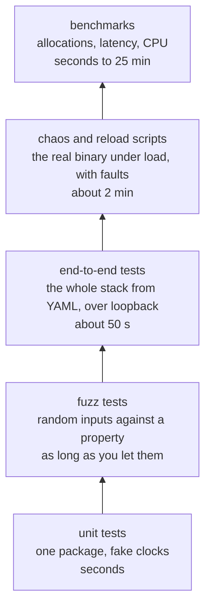

# Testing

A proxy sits in front of everything else, so its bugs are everyone's outage. Prism is tested at five levels, each catching what the one below can't:



| level | command | time on the dev machine | in CI |
| --- | --- | --- | --- |
| unit and e2e | `make test` | about 50 s | yes |
| e2e without the 2 GB test | `go test -short ./test/e2e` | 12 s | no |
| lint | `make lint` | a few seconds | yes |
| fuzz | `make fuzz` | 9 targets × 30 s | no |
| chaos | `make chaos` | 87 s | no |
| reload under load | `make reload` | 23 s | no |
| micro-benchmarks | `make bench` | not timed here | no |
| nginx comparison | `make bench-compare` | about 25 min | no |

CI (`.github/workflows/ci.yml`) runs gofmt, vet, staticcheck, `go test -race ./...` and validates `examples/prism.yaml`. At the time of writing, GitHub Actions can't run on this repository because of an account billing problem, so run `make lint test` yourself before pushing.

## Unit tests

Each package tests itself, in `_test.go` files next to the code. They're plain `testing` code with table-driven cases and no assertion library.

```console
$ make test
go test -race ./...
ok  	github.com/MuditGarg007/prism/bench/report	1.026s
ok  	github.com/MuditGarg007/prism/cmd/prism	1.453s
ok  	github.com/MuditGarg007/prism/internal/admin	1.570s
ok  	github.com/MuditGarg007/prism/internal/balancer	5.741s
ok  	github.com/MuditGarg007/prism/internal/cache	1.467s
ok  	github.com/MuditGarg007/prism/internal/config	1.245s
ok  	github.com/MuditGarg007/prism/internal/health	1.248s
ok  	github.com/MuditGarg007/prism/internal/limits	1.074s
ok  	github.com/MuditGarg007/prism/internal/observability	1.169s
ok  	github.com/MuditGarg007/prism/internal/proxy	6.056s
ok  	github.com/MuditGarg007/prism/internal/ratelimit	3.142s
ok  	github.com/MuditGarg007/prism/internal/resilience	1.638s
ok  	github.com/MuditGarg007/prism/internal/router	1.031s
ok  	github.com/MuditGarg007/prism/internal/runtime	1.487s
ok  	github.com/MuditGarg007/prism/internal/security	1.487s
ok  	github.com/MuditGarg007/prism/internal/server	1.525s
ok  	github.com/MuditGarg007/prism/internal/upstream	1.453s
ok  	github.com/MuditGarg007/prism/test/chaosplot	1.021s
ok  	github.com/MuditGarg007/prism/test/e2e	47.510s
ok  	github.com/MuditGarg007/prism/test/faultserver	1.050s
ok  	github.com/MuditGarg007/prism/test/loadgen	1.016s
```

That run included the `random` balancer from [Add a feature](add-a-feature.md). Go caches results for packages that haven't changed, and prints `(cached)` for them. `go clean -testcache` or `-count=1` forces a fresh run.

### Always with the race detector

`make test` passes `-race`. Prism is shared state touched from thousands of goroutines: counters, limiters, the cache, pointers swapped by reloads. The race detector finds unsynchronized access while the tests run, which ordinary assertions never would. It makes tests several times slower, which is why some tests use smaller numbers than you'd expect.

Code that's meant to be concurrent gets a test that hammers it from several goroutines, even when it asserts little. `TestLeastConnConcurrent` is one. Its main job is to give the race detector something to look at.

### Fake clocks

Rate limits, breakers, budgets and caches all depend on time. Sleeping in tests makes them slow and flaky, so time-based code takes its clock as a field:

```go
// internal/resilience/budget_test.go
b.now = func() time.Time { return now }
```

A test moves `now` forward by an hour in no time at all, and the result is exact. Look for `now` fields in `ratelimit`, `resilience`, `security`, `cache` and `runtime`. Randomness works the same way: `LeastConn` has an `intN` field, which tests swap for a seeded generator.

### Allocation tests

The hot path is meant not to allocate, and that's easy to break without noticing. Tests such as `TestLeastConnNoAllocs` use `testing.AllocsPerRun`, so an accidental allocation fails `make test`, not a benchmark someone has to remember to run. See [Performance](../concepts/performance.md#hot-path-patterns-in-prism).

## Fuzz tests

A unit test checks the cases you thought of. A fuzz test generates inputs, keeps the ones that reach new code, and checks a property against each. It's the right tool for parsers and for anything that handles input from the network.

The best fuzz tests compare the code against a simpler implementation of the same thing. `FuzzValidPath` checks Prism's fast, allocation-free path check against `path.Clean` from the standard library:

```go
f.Fuzz(func(t *testing.T, p string) {
	c := path.Clean(p)
	want := strings.HasPrefix(p, "/") && (c == p || (p != "//" && c+"/" == p))
	if got := validPath(p); got != want {
		t.Fatalf("validPath(%q) = %v, want %v (Clean gives %q)", p, got, want, c)
	}
})
```

`FuzzGCRA` does the same for the rate limiter. GCRA stores a token bucket as one timestamp, so the test runs a plain token bucket next to it and requires the same decision and the same wait for every request.

```console
$ go test -run='^$' -fuzz=FuzzValidPath -fuzztime=10s ./internal/proxy
fuzz: elapsed: 3s, execs: 25626 (8540/sec), new interesting: 0 (total: 99)
fuzz: elapsed: 6s, execs: 110588 (28321/sec), new interesting: 0 (total: 99)
fuzz: elapsed: 9s, execs: 202114 (30507/sec), new interesting: 0 (total: 99)
fuzz: elapsed: 10s, execs: 229903 (22559/sec), new interesting: 0 (total: 99)
PASS
ok  	github.com/MuditGarg007/prism/internal/proxy	10.248s
```

The nine targets, all run by `make fuzz`:

| target | package | property |
| --- | --- | --- |
| `FuzzParse` | `config` | any input gives a config or an error, never a panic or a nil config without an error |
| `FuzzMatch` | `router` | agrees with a simple reference matcher |
| `FuzzClientIP` | `proxy` | agrees with a reference implementation of the trust rules, and never keeps a forged `X-Forwarded-For` from an untrusted peer |
| `FuzzValidPath` | `proxy` | agrees with `path.Clean` |
| `FuzzTraceparent` | `proxy` | agrees with a regexp of the spec's rules, and a parsed value formats back to itself |
| `FuzzGCRA` | `ratelimit` | agrees with a token bucket |
| `FuzzWindow` | `resilience` | the breaker's sliding window agrees with a plain list of events |
| `FuzzBudget` | `resilience` | the retry budget agrees with a plain list of requests and retries |
| `FuzzCacheControl` | `cache` | never panics, gives durations in range, and what it formats parses back the same |

When a fuzz run finds a failure, Go writes the input to `testdata/fuzz/<target>/` in the package. Commit that file: from then on, plain `go test` runs it as a regular test case. `internal/proxy/testdata/fuzz/FuzzClientIP/` holds one saved input, kept as a regression case since M1. Each line after the header is one argument of the fuzz function:

```text
go test fuzz v1
string("::")
string("\v")
bool(true)
```

## End-to-end tests

`test/e2e` runs the whole proxy the way `main` does: YAML config, `runtime.Build`, real listeners, and real backends over loopback. There are 35 tests, grouped by the milestone that added them (`m2_test.go` to `m8_test.go`). Each asserts on what the client got and also on what the backend saw, since a proxy can return the right status while sending the backend the wrong thing.

The helpers make each test short. `startBackend` starts an `httptest` server, and `startProxyYAML` starts Prism with a config and shuts it down when the test ends:

```go
func TestRateLimit(t *testing.T) {
	var hits atomic.Int64
	backend := startBackend(t, func(w http.ResponseWriter, r *http.Request) {
		hits.Add(1)
	})
	// One request a minute with a burst of 2: the third request in a row
	// must wait a full interval.
	base := startProxyYAML(t, fmt.Sprintf(`trusted_proxies: ["127.0.0.1"]
upstreams:
  app: { backends: [{ url: %q }] }
routes:
  - match: { path_prefix: / }
    upstream: app
    rate_limit: { per_ip: "1/m", burst: 2 }
`, backend.URL))
	client := newClient(t)

	for i := range 2 {
		if resp, _ := send(t, client, http.MethodGet, base+"/", "1.2.3.4", nil); resp.StatusCode != http.StatusOK {
			t.Fatalf("request %d: status %d, want 200", i, resp.StatusCode)
		}
	}
	resp, _ := send(t, client, http.MethodGet, base+"/", "1.2.3.4", nil)
	if resp.StatusCode != http.StatusTooManyRequests {
		t.Fatalf("third request: status %d, want 429", resp.StatusCode)
	}
	if got := resp.Header.Get("Retry-After"); got != "60" {
		t.Errorf("Retry-After %q, want 60", got)
	}
	if n := hits.Load(); n != 2 {
		t.Errorf("backend saw %d requests, want 2", n)
	}
	// ...
}
```

`TestStreamLargeBodies` moves 2 GB through the proxy and checks the heap doesn't grow with it. It's most of the 47 s, and `-short` skips it:

```console
$ go test -count=1 -short ./test/e2e
ok  	github.com/MuditGarg007/prism/test/e2e	11.826s
```

To run one test while you work on it:

```sh
go test -race -run TestRateLimit -v ./test/e2e
```

## Chaos and reload scripts

Unit and e2e tests check behavior one request at a time. Some properties only show up under steady load, over time: whether a dying backend causes errors, whether retries multiply load in an outage, whether a reload drops requests. The scripts in `scripts/` check those against the real binary.

They use three tools from `test/`:

- **`faultserver`**, a backend that can be told to be slow, fail, or cut responses off, live, through `GET /_fault?...`.
- **`loadgen`**, which sends requests at a fixed rate (open loop, so a slow proxy can't slow it down) and writes one CSV row per second.
- **`chaosplot`**, which draws the CSV and the events as `graph.svg`.

Each run leaves `load.csv`, `events.tsv`, `prism.log` and `graph.svg` under `bin/chaos/<scenario>/`.

### make chaos

Two scenarios at 300 requests a second. A real run, trimmed:

```text
== Killing one of three backends
sent 12001, ok 12001, errors 0 (0.00%)
backend requests 11993, amplification 0.999 overall, 1.007 at worst
events (seconds from the start of the load):
10    inject  kill b3
10.4  prism   19103 circuit breaker state changed -> open
11.7  prism   19103 backend marked unhealthy
25    inject  restart b3
26.3  prism   19103 backend marked healthy
26.3  prism   19103 circuit breaker state changed -> half_open
26.3  prism   19103 circuit breaker state changed -> closed

== All backends failing, budget_ratio 0.2
sent 12001, ok 6014, errors 5987 (49.89%)
backend requests 13437, amplification 1.120 overall, 2.857 at worst
events (seconds from the start of the load):
10  inject  all backends 503
30  inject  all backends recover
```

How to read them:

- **Killing a backend** (`scripts/chaos/kill-backend.sh`): no client saw an error. Requests that hit the dead backend were retried elsewhere, the breaker opened 0.4 s after the kill, and health checks marked it down 1.3 s later. After the restart, it was marked healthy again and its breaker closed.
- **An outage** (`scripts/chaos/outage.sh`): every backend answers `503` for 20 s, and each request may retry twice. Without a budget, backends would get 3 requests for each one sent. With `budget_ratio: 0.2`, the whole run's amplification was 1.120. The worst single second reached 2.857, because the budget is measured over 10 seconds: retries come back as a burst when old ones leave the window. The script's header explains this, and [Timeouts and retries](../concepts/timeouts-and-retries.md) covers the budget.

`BUDGET_RATIO=1 scripts/chaos/outage.sh` runs the outage with a looser budget, for comparison.

### make reload

`scripts/reload-under-load.sh` sends `SIGHUP` every 0.25 s for 16 s, cycling through a weight change, a backend added and removed, and a changed header. It fails unless every request succeeded and every reload was applied:

```text
== Reloading every 0.25s
sent 6001, ok 6001, errors 0 (0.00%)
backend requests 6001, amplification 1.000 overall, 1.003 at worst
...
prism_config_reloads_total{result="failure"} 0
prism_config_reloads_total{result="success"} 64
signals sent 64, reloads applied 64, failed 0, request errors 0
PASS
```

These scripts use fixed loopback ports (19090 for Prism, 19101 to 19103 for backends), so don't run two at once.

## Benchmarks

There are two kinds, with different jobs.

**Micro-benchmarks** (`make bench`) are `Benchmark` functions next to the code. They're for comparing a change against what came before. `BenchmarkPipeline` in `internal/server` runs a request through the whole handler stack against an in-process backend, and its allocation count is the number to watch. [Performance](../concepts/performance.md#try-it) shows how to compare two versions with `benchstat`, which says whether a difference is real or noise.

**The nginx comparison** (`make bench-compare`, `bench/run.sh`) runs a backend directly, through nginx in Docker, and through Prism, with vegeta as the load generator, each pinned to its own CPU cores. It takes about 25 minutes, needs Docker, and gives steady numbers only on AC power with the `performance` CPU governor. Results go to `bin/bench/`. `QUICK=1` does a short trial run. The published results are in [`docs/bench/results.md`](../bench/results.md), and they date from before M8, so rerun them before quoting numbers.

## What to run when

| you changed | run |
| --- | --- |
| anything | `make lint test` |
| a parser, or code that reads client input | `make fuzz`, or the one target for as long as you can spare |
| retries, breakers, health checks or the budget | `make chaos` |
| reloads, or anything a `Runtime` holds | `make reload` |
| the hot path | `make bench` against the previous version, with `benchstat` |
| performance claims for the README | `make bench-compare` |
| `examples/prism.yaml` or config parsing | `make validate` |

## Check yourself

1. Why does Prism run every test with `-race`, when it makes them slower?
2. What makes a property for a fuzz test strong? Why is "doesn't panic" weak by comparison?
3. Why does an e2e test check what the backend saw, not just the response?
4. The outage scenario's worst second reached 2.857 amplification despite a 0.2 budget. Is that a bug?
5. Why is `loadgen` open loop? What would a closed-loop generator hide?

Next: [Operating Prism](operating-prism.md).
