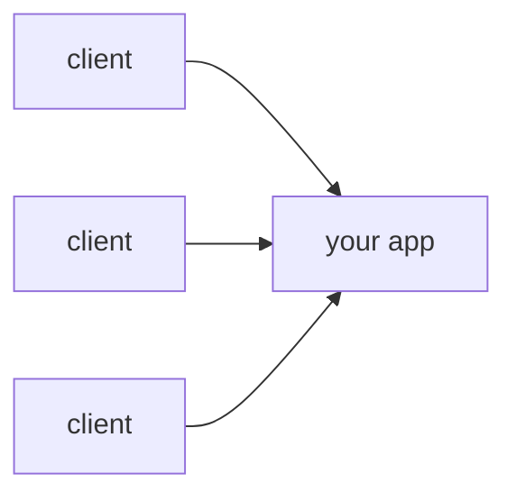
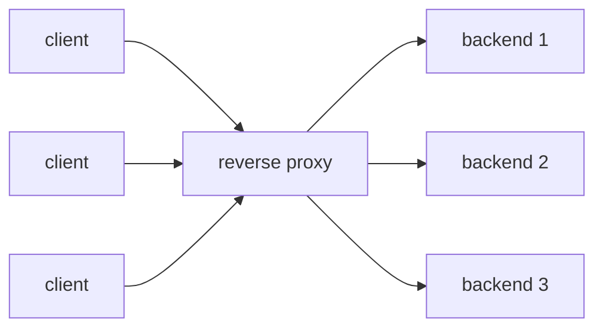
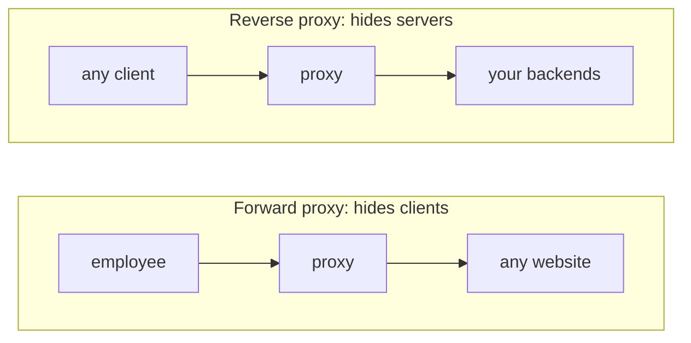
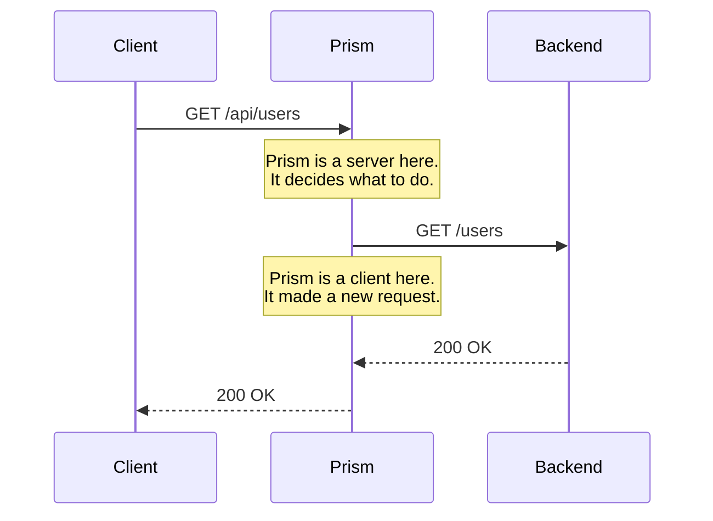
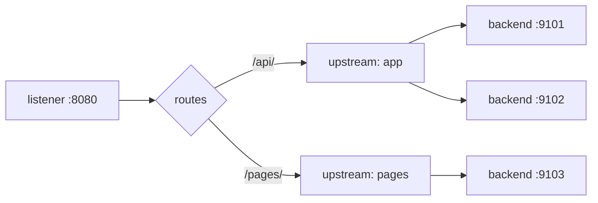
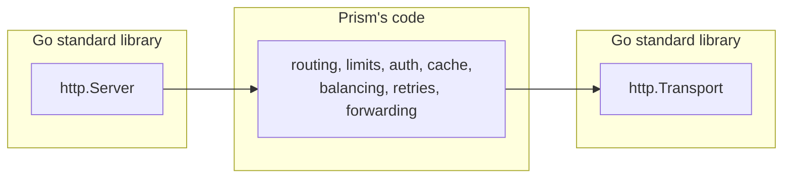

# What is a reverse proxy?

## The problem

Say you've built a web API. It runs as one process on one server, and clients talk to it directly.



This works until the app gets popular. Then, one by one, these show up:

- **One process can't keep up.** You start three copies. Which one should each client connect to, and who decides?
- **A copy crashes.** Clients connected to it get errors, even though two healthy copies are running.
- **You deploy a new version.** You have to stop the app, and everyone sees errors while it restarts.
- **A misbehaving client** sends 10,000 requests a second and slows everyone else down.
- **The same expensive page** gets computed thousands of times a minute, with the same result each time.
- **Every service** you run needs its own TLS certificates, its own logs and its own password checks.

You could solve all of this inside your app. But then you'd solve it again in every service you own, in every language you use.

The better answer is to put one specialized program in front of everything.

## The idea

A **reverse proxy** is a server that accepts requests from clients and passes them on to other servers, called **backends**. Clients only ever talk to the proxy. They don't know how many backends there are, or where they are.



Because every request passes through this one point, it's the natural place to handle everything from the list above:

| problem | what the proxy does | Prism feature |
| --- | --- | --- |
| one process isn't enough | spreads requests over backends | load balancing |
| a backend crashes | notices, and stops sending it traffic | health checks, circuit breakers |
| a request hits a bad backend | tries another one | retries |
| a client floods you | refuses the excess requests | rate limiting |
| too much traffic overall | refuses early, instead of falling over | concurrency limits |
| the same answer computed repeatedly | remembers the response | caching |
| TLS and passwords everywhere | handles them once, at the edge | TLS, auth |
| you want to test a new version | sends it a small share of traffic | canary, shadow |
| you need to know what's going on | sees every request | logs, metrics |

nginx, HAProxy, Envoy, Caddy and Traefik are all reverse proxies. Prism does the same job and borrows many of their ideas, but it's small enough to read in full: about 11,000 lines of Go, not counting tests.

### Why "reverse"?

A plain (forward) proxy works for the *client*. An office might route all its employees' traffic through one, to reach the internet. The websites they visit see the proxy, not the employees.

A reverse proxy works for the *server*. Clients see the proxy, not the backends.



## The key insight: two conversations

The most useful thing to understand about a proxy is that it doesn't "pass traffic through" like a pipe. It holds **two separate HTTP conversations**: it acts as a server to the client, and as a client to the backend.



Each side has its own TCP connection, its own timeouts and its own failures. Almost everything interesting in Prism follows from this:

- The request Prism sends isn't the one it received. It builds a new one, and has to decide which headers to copy, which to change and which to drop.
- The two connections can fail independently. If the backend dies, the client is still connected and needs an answer. If the client leaves, Prism should stop bothering the backend.
- The two sides can even speak different HTTP versions. Clients can use HTTP/2, while Prism always reaches backends over HTTP/1.1.

## Prism's vocabulary

Prism's config uses these words throughout the code and docs.

| Prism | meaning | nginx equivalent |
| --- | --- | --- |
| **listener** | an address Prism accepts connections on, such as `:8080` | `listen` |
| **route** | a rule that matches requests by host and path, and says what to do with them | `location` |
| **upstream** | a named group of backends that do the same job | `upstream` |
| **backend** | one server in an upstream | `server` inside `upstream` |
| **pool** | an upstream as it exists in memory while running | |
| **balancer** | the strategy that picks a backend from a pool | `least_conn`, `ip_hash` |

Here's how they fit together:



And here's the same picture as config, which is a shortened version of [`examples/quickstart.yaml`](../../examples/quickstart.yaml):

```yaml
listeners:
  - addr: "127.0.0.1:8080"

upstreams:
  app:
    balancer: round_robin
    backends:
      - { url: "http://127.0.0.1:9101" }
      - { url: "http://127.0.0.1:9102" }
  pages:
    backends:
      - { url: "http://127.0.0.1:9103" }

routes:
  - match: { path_prefix: "/api/" }
    upstream: app
  - match: { path_prefix: "/pages/" }
    upstream: pages
```

## What Prism writes itself

Prism doesn't parse HTTP by hand. Go's `net/http` package does that on both sides:

- `http.Server` accepts connections, handles TLS, and parses requests.
- `http.Transport` connects to backends, pools connections, and parses responses.

Everything between those two is Prism's own code. Go has a ready-made reverse proxy, `httputil.ReverseProxy`, and Prism deliberately doesn't use it, because the forwarding layer is exactly where the interesting decisions live.



## Check yourself

1. A client sends a request and the backend crashes while answering it. Which of the two connections broke, and who still needs an answer?
2. Why is it better to handle TLS in the proxy than in each backend? What's one thing you give up?
3. An upstream and a route are both named things in the config. What's the difference between them?

Next: [HTTP for proxies](02-http-for-proxies.md).
