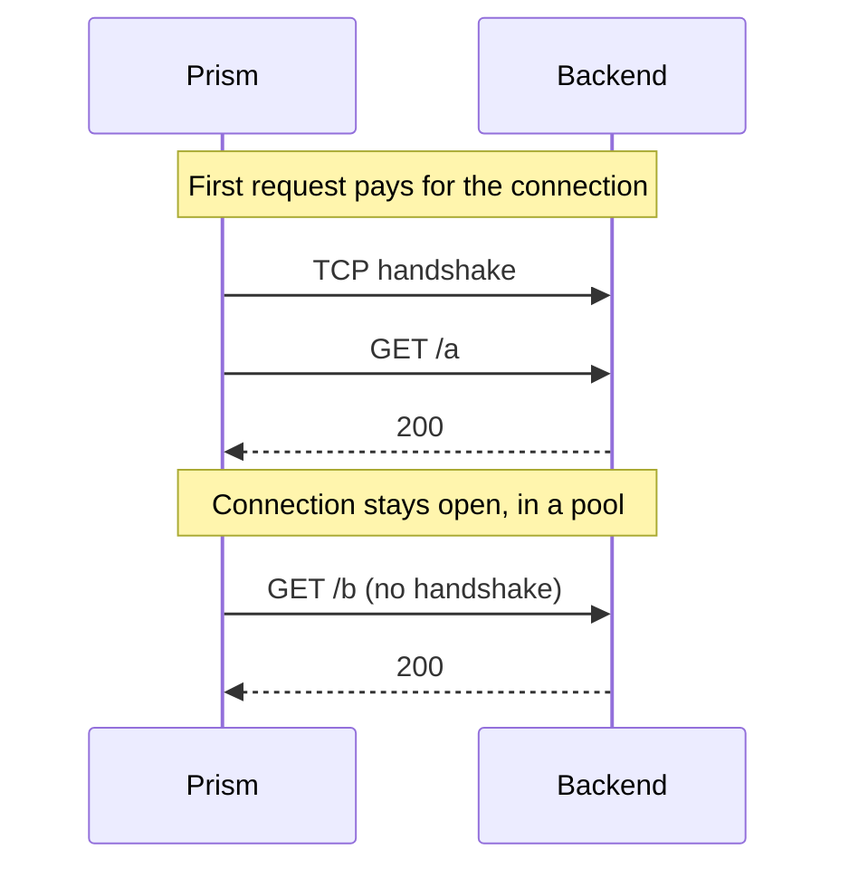
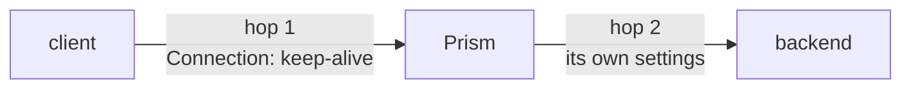
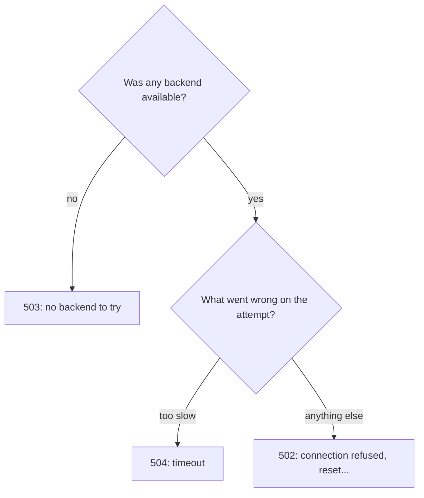

# HTTP for proxies

You've probably used HTTP through a framework, which hides most of it. A proxy can't hide it, so this page covers the parts that matter when you sit in the middle.

## A request is just text on a connection

HTTP/1.1 is a text protocol over a TCP connection. The client opens a connection and writes this:

```http
GET /api/users?limit=10 HTTP/1.1
Host: api.example.com
Accept: application/json
User-Agent: curl/8.23.0

```

The first line has the **method**, **path** and protocol version. Then come **headers**, then a blank line, then an optional **body**. The server replies in the same shape:

```http
HTTP/1.1 200 OK
Content-Type: application/json
Content-Length: 27

{"users":["ada","grace"]}
```

The first line now has a **status code**. You can see the real thing with `curl -v http://example.com`.

## Connections cost time, so reuse them

Before any HTTP is sent, the two machines do a TCP handshake, which takes one network round trip. With TLS, there are more round trips on top. Between distant machines that can take longer than the request itself.

So HTTP/1.1 keeps connections open after a response and sends the next request on the same one. This is called **keep-alive**.



A proxy benefits greatly here. It keeps a **connection pool** of open connections to each backend, and each new client request borrows one. In Prism's benchmarks this effect is large enough that at 20,000 requests per second, going through Prism has a *lower* median latency than going direct: Prism's pooled connections to the backend do better at that rate than the load generator's own. See [the results](../bench/results.md).

Prism gets its pool from `http.Transport`, with one transport for each backend.

## Hop-by-hop headers

Most headers are meant for the final recipient. Some only describe one connection, and they must not be forwarded by a proxy. Those are **hop-by-hop headers**.



`Connection: keep-alive` says what the client wants for *its* connection to Prism. That means nothing to the backend, because Prism's connection to the backend is a different connection.

The fixed list is `Connection`, `Keep-Alive`, `Proxy-Authenticate`, `Proxy-Authorization`, `Proxy-Connection`, `TE`, `Trailer`, `Transfer-Encoding` and `Upgrade`. A sender can also add to the list for one message, by naming extra headers in `Connection`:

```http
Connection: keep-alive, X-Secret
X-Secret: only-for-the-next-hop
```

A proxy must strip `X-Secret` here too. Prism does this in `removeHopByHop` (`internal/proxy/headers.go`). You'll see it work in [Run it](03-run-it.md).

## Who is the client, really?

A backend behind a proxy has a problem: every TCP connection it receives comes from the proxy. Its logs would show one IP address for all users, and per-user rate limits would be useless.

Proxies solve this by adding headers that describe the original request:

| header | what it says |
| --- | --- |
| `X-Forwarded-For` | the client's IP, followed by each proxy it passed through |
| `X-Forwarded-Proto` | whether the client used `http` or `https` |
| `X-Forwarded-Host` | the `Host` the client asked for |
| `Forwarded` | all of the above in one standard header (RFC 7239) |

**Here's the trap.** These are just headers, so a client can send them too. If an attacker sends `X-Forwarded-For: 10.0.0.1` and you believe it, they can dodge rate limits, or pass an allow-list meant for internal addresses.

The fix is a list of **trusted proxies**. Prism believes these headers only when the direct peer, meaning the machine actually on the other end of the TCP connection, is on that list. A client's made-up value is replaced.

Sometimes there's a chain of proxies. Each appends the address it saw, so the rightmost entries were written by your own infrastructure, and the leftmost could be anything. Prism walks the list from the right, skipping trusted hops, and takes the first address that isn't trusted:

```text
X-Forwarded-For: 6.6.6.6, 203.0.113.9, 10.0.0.5        peer: 10.0.0.7
                 ▲        ▲            ▲                     ▲
                 forged   real client  trusted LB            trusted LB
                          (stop here)
```

This is `Forwarding.ClientIP` in `internal/proxy/forwarded.go`.

## The Host header

One server can host many sites, so HTTP/1.1 requires a `Host` header saying which site you want. Prism uses it for routing: `api.example.com` and `www.example.com` can go to different upstreams.

Then a choice comes up. When forwarding, should `Host` stay `api.example.com`, or change to the backend's own address? Prism changes it to the backend's address by default. A route can set `preserve_host: true` to keep the client's value, and `X-Forwarded-Host` carries the original either way.

## Bodies are streams

A body can be huge, or even endless (think of a live event feed), so a proxy shouldn't read it all into memory. It reads a chunk and writes a chunk, and repeats. This is **streaming**, and Prism does it in both directions.

The receiver needs to know where a body ends. There are two ways to say so:

- `Content-Length: 1234` declares the size up front.
- `Transfer-Encoding: chunked` sends pieces, each with its own size, and an empty piece at the end. It's used when the sender doesn't know the size yet.

Streaming has a consequence for error handling. Once a response's headers are sent, **the status code can't change**. If the backend dies halfway through a body, Prism can't turn the `200` into a `502`. All it can do is cut the connection, so the client at least sees that the response is incomplete rather than mistaking it for a full one.

It also makes retries harder. A request body that has been streamed to a backend is gone, so sending it to a second backend requires having saved a copy. You'll see how Prism handles that in [Life of a request](05-life-of-a-request.md).

## Status codes a proxy produces

Some errors come from the backend, and Prism passes those through unchanged. Others come from Prism itself. These are worth learning, since they tell you where to look when something goes wrong.

| status | meaning | in Prism, this means |
| --- | --- | --- |
| `400` | bad request | an unsafe path such as `/a/../b`, or a broken request body |
| `401` | who are you? | credentials are missing or wrong |
| `403` | not allowed | blocked by an IP rule |
| `404` | not found | no route matches |
| `413` | too large | the request body passed the route's `max_body` |
| `429` | too many requests | a rate limit was hit; `Retry-After` says when to come back |
| `502` | bad gateway | Prism reached for a backend and it failed |
| `503` | unavailable | no backend is available, or the route is overloaded |
| `504` | gateway timeout | a backend took too long |
| `499` | client closed | not a real status: the client left, so nothing was sent, and only the log shows it (an nginx convention) |

The difference between 502, 503 and 504 matters when you're debugging:



## Safe to repeat? Idempotent methods

If a request fails partway, can Prism send it again? It depends on what repeating it would do.

An **idempotent** method has the same effect whether it runs once or several times. `GET`, `HEAD`, `OPTIONS`, `TRACE`, `PUT` and `DELETE` are idempotent by definition. `POST` isn't: repeating "charge this card" charges it twice.

The dangerous case is a timeout. If a `POST` times out, the backend might have finished the work and only the response was lost. So:

- If the connection never opened, the backend never saw the request, and retrying is safe for any method.
- If the request was sent and then failed, retrying is safe only for idempotent methods.

Prism follows exactly these rules. The details are in `Retry.Retryable` (`internal/resilience/retry.go`).

## HTTP/1.1, HTTP/2 and TLS in brief

**HTTP/1.1** runs one request at a time on a connection. **HTTP/2** carries many requests at once over one connection, as binary frames. `net/http` handles the differences, and your handler sees the same `http.Request` either way. Prism accepts both from clients, and uses HTTP/1.1 to reach backends.

**TLS** encrypts a connection, and the server proves its identity with a certificate. When one IP serves many sites, the server needs to know which certificate to show before any HTTP has been sent. So the client names the site inside the TLS handshake, in a field called **SNI** (Server Name Indication). Prism uses that to pick the certificate, in `internal/server/certs.go`.

Ending TLS at the proxy is called **TLS termination**. The connection from the proxy to the backend can then be plain HTTP on a private network, or use TLS of its own.

## Check yourself

1. Why would forwarding `Transfer-Encoding: chunked` from the client straight to the backend be a bug?
2. Prism sits behind a load balancer at `10.0.0.5`, which isn't in `trusted_proxies`. What IP does every request appear to come from? What does that do to per-IP rate limits?
3. A `POST` fails with "connection refused". Can it be retried? What about a `POST` that timed out waiting for a response?
4. A backend dies after sending the headers and half the body. Why can't the client get a `502`?

Next: [Run it](03-run-it.md).
