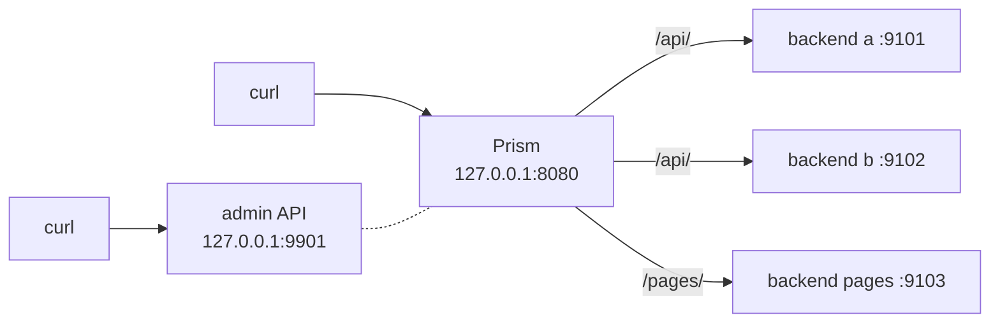

# Run it

In this page you'll start Prism with three test backends, send it requests, and then break things to see how it reacts. It takes about 15 minutes, and everything runs on your own machine. The outputs below come from real runs, so yours should look the same apart from IDs and timestamps.

You need Go 1.27, `curl` and `python3`.

## What you're building



The backends are [`test/faultserver`](../../test/faultserver), a small server built for testing Prism. It answers every path with `x`s, names itself in an `X-Backend` header, and can be told to misbehave.

The config is [`examples/quickstart.yaml`](../../examples/quickstart.yaml). Read it now: it's short, and it describes everything below.

## Start everything

From the repository root:

```sh
make build
go build -o bin/faultserver ./test/faultserver
```

Check the config. This is like `nginx -t`: it builds everything Prism would run, and exits without listening.

```console
$ ./bin/prism -config examples/quickstart.yaml -validate
configuration examples/quickstart.yaml is valid
```

Start the backends, each in its own terminal. Separate terminals make it easy to stop one later.

```sh
./bin/faultserver -addr 127.0.0.1:9101 -name a
```

```sh
./bin/faultserver -addr 127.0.0.1:9102 -name b
```

```sh
./bin/faultserver -addr 127.0.0.1:9103 -name pages -cache-control "max-age=30"
```

The third one marks its responses as cacheable for 30 seconds. Now start Prism in a fourth terminal, and keep it visible, because its log is half the fun:

```sh
./bin/prism -config examples/quickstart.yaml
```

Use a fifth terminal for the commands below.

## 1. Send a request

```console
$ curl -i 127.0.0.1:8080/api/users
HTTP/1.1 200 OK
Content-Length: 64
Content-Type: text/plain; charset=utf-8
Date: Sat, 07 Nov 2026 19:08:40 GMT
X-Backend: a
X-Request-Id: 019e3dec32108d3fbcda04cad8461283

xxxxxxxxxxxxxxxxxxxxxxxxxxxxxxxxxxxxxxxxxxxxxxxxxxxxxxxxxxxxxxxx
```

Backend `a` answered, and it received the path `/users`, because the route has `strip_prefix: true`.

`X-Request-Id` was added by Prism. The Prism terminal shows one log line for this request, with the same ID. When a user reports a problem, that ID is how you find their request.

## 2. Load balancing

```console
$ for i in 1 2 3 4; do curl -si 127.0.0.1:8080/api/users | grep -i '^x-backend'; done
X-Backend: b
X-Backend: a
X-Backend: b
X-Backend: a
```

The `app` upstream uses `round_robin`, so backends take turns.

## 3. Requests Prism refuses by itself

No route matches this path, so no backend is involved:

```console
$ curl -si 127.0.0.1:8080/nope | head -1
HTTP/1.1 404 Not Found
```

This path tries to climb out of `/api/`. `--path-as-is` stops curl from cleaning it up first:

```console
$ curl -si --path-as-is 127.0.0.1:8080/api/../admin | head -1
HTTP/1.1 400 Bad Request
```

Why refuse instead of cleaning it? Prism matches routes on the path as written, while a backend might normalize it. `/public/../admin` would match a public route, and then be served as `/admin`. Rejecting such paths closes that gap.

## 4. Caching

```console
$ for i in 1 2; do curl -si 127.0.0.1:8080/pages/home | grep -iE '^(HTTP|x-cache|age)'; done
HTTP/1.1 200 OK
X-Cache: MISS
HTTP/1.1 200 OK
Age: 0
X-Cache: HIT
```

The first request went to the backend, and Prism stored the response. The second never left Prism. Ask the backend how many requests it saw:

```console
$ curl -s 127.0.0.1:9103/_stats
{"name":"pages","requests":1}
```

Two client requests, one backend request. Wait 31 seconds and try again: the entry has expired, and you'll see `MISS` again.

## 5. Rate limiting

The `/api/` route allows each client IP 5 requests per second, with a burst of 5. Send 12 at once:

```console
$ for i in $(seq 1 12); do curl -s -o /dev/null -w '%{http_code} ' 127.0.0.1:8080/api/x; done; echo
200 200 200 200 200 429 429 429 429 429 429 429
$ curl -si 127.0.0.1:8080/api/x | grep -iE '^(HTTP|retry-after)'
HTTP/1.1 429 Too Many Requests
Retry-After: 1
```

The exact split depends on how fast your loop runs. The `Retry-After` header tells well-behaved clients how long to wait. The refused requests never reached a backend, so a flood costs the backends nothing.

## 6. Kill a backend

Wait a few seconds for the rate limit to refill, then press Ctrl-C in backend `a`'s terminal. Straight away, send a few requests, slowly enough to stay under the rate limit:

```console
$ for i in 1 2 3 4; do curl -s -o /dev/null -D - 127.0.0.1:8080/api/x | grep -iE '^(HTTP|x-backend)' | tr -d '\r' | tr '\n' ' '; echo; sleep 0.25; done
HTTP/1.1 200 OK X-Backend: b
HTTP/1.1 200 OK X-Backend: b
HTTP/1.1 200 OK X-Backend: b
HTTP/1.1 200 OK X-Backend: b
```

Every request succeeded, even though one of the two backends is dead. Two separate mechanisms did this, and the log shows both.

First, **retries**. A request that was sent to `a` failed to connect, and Prism retried it on `b`. The client never knew:

```text
level=WARN msg="upstream attempt failed, retrying" ... backend=http://127.0.0.1:9101 kind=connect error="dial tcp 127.0.0.1:9101: ...
level=INFO msg=request ... status=200 ... backend=http://127.0.0.1:9102 attempts=2
```

Then, **health checks**. Prism checks `/healthz` on each backend every second, and after two failures in a row, it stops using `a` altogether:

```text
level=WARN msg="backend marked unhealthy" upstream=app backend=http://127.0.0.1:9101 checks=2 error="dial tcp 127.0.0.1:9101: connect: connection refused"
```

From then on, requests don't even try `a`, and no retries are needed.

Look at the live state through the admin API:

```console
$ curl -s 127.0.0.1:9901/upstreams | python3 -m json.tool
{
    "upstreams": [
        {
            "name": "app",
            "balancer": "round_robin",
            "available": 1,
            "backends": [
                {
                    "url": "http://127.0.0.1:9101",
                    "weight": 1,
                    "inflight": 0,
                    "healthy": false,
                    "ejected": false,
                    "available": false
                },
...
```

Restart backend `a`. Two passing checks later, the log says it's healthy again, and it goes back into rotation. Nobody had to do anything.

## 7. Metrics

Prism exports counters in the format that Prometheus, the common monitoring system, reads:

```console
$ curl -s 127.0.0.1:9901/metrics | grep -E '^prism_backend_healthy'
prism_backend_healthy{backend="http://127.0.0.1:9101",upstream="app"} 1
prism_backend_healthy{backend="http://127.0.0.1:9102",upstream="app"} 1
prism_backend_healthy{backend="http://127.0.0.1:9103",upstream="pages"} 1
```

Run `curl -s 127.0.0.1:9901/metrics | grep '^prism_'` to see everything. The admin API has its own listener, so these endpoints are never reachable through client traffic.

## 8. See what a backend actually receives

Remember that Prism builds a new request rather than passing one along. This shows the result.

Stop the `pages` backend with Ctrl-C, and run this in its terminal instead. It's a fake backend that prints the raw bytes of one request, answers it, and exits:

```sh
python3 -c "
import socket
s = socket.create_server(('127.0.0.1', 9103))
c, _ = s.accept()
print(c.recv(4096).decode())
c.sendall(b'HTTP/1.1 200 OK\r\nContent-Length: 0\r\nConnection: close\r\n\r\n')
"
```

Now send a request with a forged client address, and a hop-by-hop header:

```sh
curl -si -H 'X-Forwarded-For: 1.2.3.4' \
     -H 'Connection: keep-alive, X-Secret' -H 'X-Secret: hop' \
     127.0.0.1:8080/pages/other
```

The fake backend prints:

```http
GET /pages/other HTTP/1.1
Host: 127.0.0.1:9103
User-Agent: curl/8.23.0
Accept: */*
Traceparent: 00-742d271086d84ac5a57475b317cd9d51-e859aaf479ca34c8-01
X-Forwarded-For: 127.0.0.1
X-Forwarded-Host: 127.0.0.1:8080
X-Forwarded-Proto: http
X-Request-Id: e9f7c187c2d032972c6955cd02f2d325
```

Compare it with what curl sent:

- **`X-Forwarded-For`** is `127.0.0.1`, not `1.2.3.4`. The forged value was replaced, because curl isn't a trusted proxy.
- **`Connection` and `X-Secret` are gone.** They were hop-by-hop.
- **`Host`** is now the backend's address, and the original moved to `X-Forwarded-Host`.
- **`Traceparent` and `X-Request-Id`** were added, so logs on the backend can be tied to Prism's.

Afterwards, restart the `pages` backend with its original command.

## 9. Reload the config without downtime

Open `examples/quickstart.yaml`, change the rate limit to `per_ip: "50/s"`, and save. Then send Prism the `HUP` signal. (Admin API users can `curl -X POST 127.0.0.1:9901/reload` instead.)

```sh
pkill -HUP -x prism
```

```text
level=INFO msg=reloading signal=hangup path=examples/quickstart.yaml
level=INFO msg="config reloaded" path=examples/quickstart.yaml upstreams=2 routes=2 took=1.000467ms
```

The new config is live about a millisecond later, and no connection was dropped. Now put a typo in the file, such as `upstream: appp`, and reload again:

```text
level=ERROR msg="reload failed, the previous config keeps serving" path=examples/quickstart.yaml error="examples/quickstart.yaml: invalid config:\n  routes[0].upstream: unknown upstream \"appp\""
```

Prism **keeps serving the old config**, so a bad config never takes down a running proxy.

Undo your edits when you're done.

## 10. Shut down

Press Ctrl-C in Prism's terminal, or send `SIGTERM`. Prism stops accepting connections and gives requests in flight time to finish. A second signal skips the wait. Then stop the backends.

## What you just saw

| you did | Prism used | learn more in |
| --- | --- | --- |
| sent a request | routing, header rewriting, forwarding | [Life of a request](05-life-of-a-request.md) |
| repeated requests | round robin | [Load balancing](../concepts/load-balancing.md) |
| asked for a page twice | response cache | concepts: HTTP caching |
| sent too many requests | rate limiter | [Rate limits and overload](../concepts/rate-limits-and-overload.md) |
| killed a backend | retries, health checks | [Timeouts and retries](../concepts/timeouts-and-retries.md), [Detecting failure](../concepts/detecting-failure.md) |
| edited the config | atomic snapshot swap | concepts: hot reload |

Next: [Codebase tour](04-codebase-tour.md).
