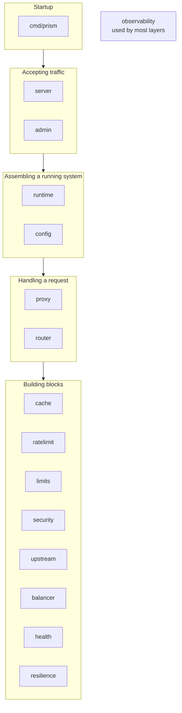
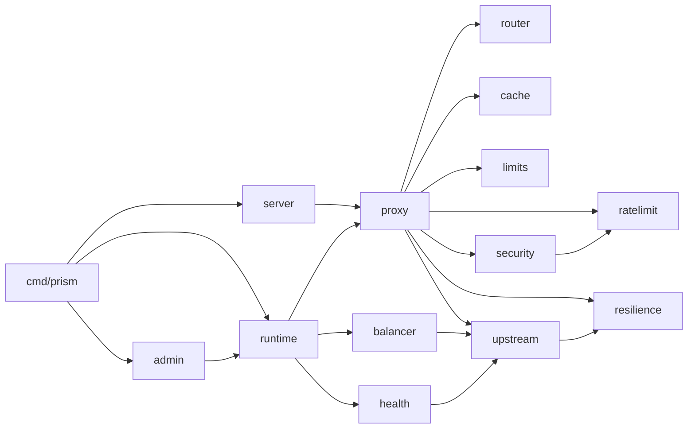
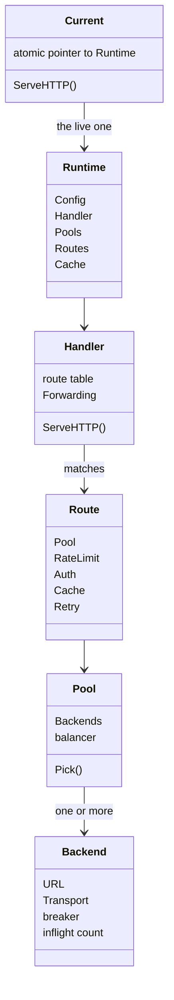
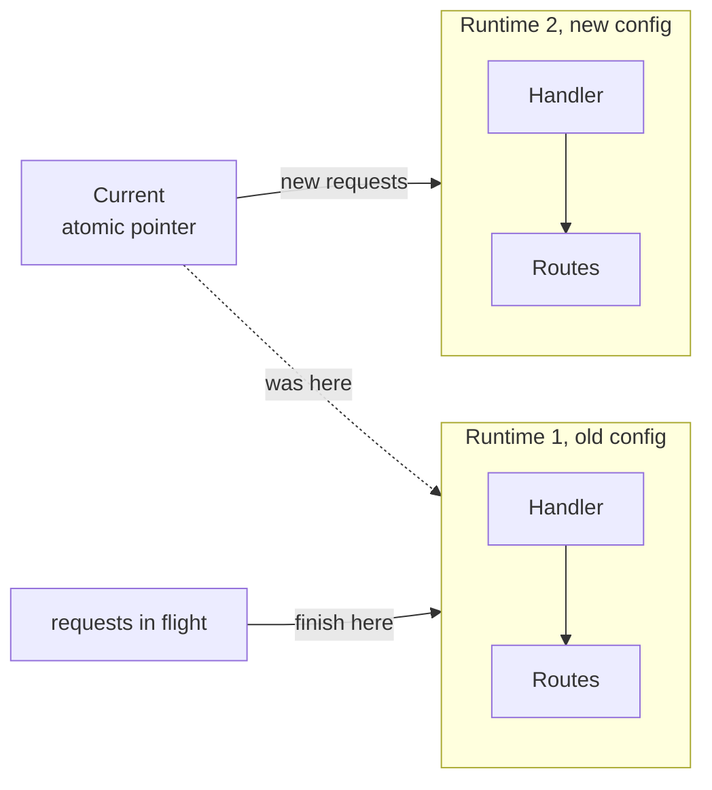
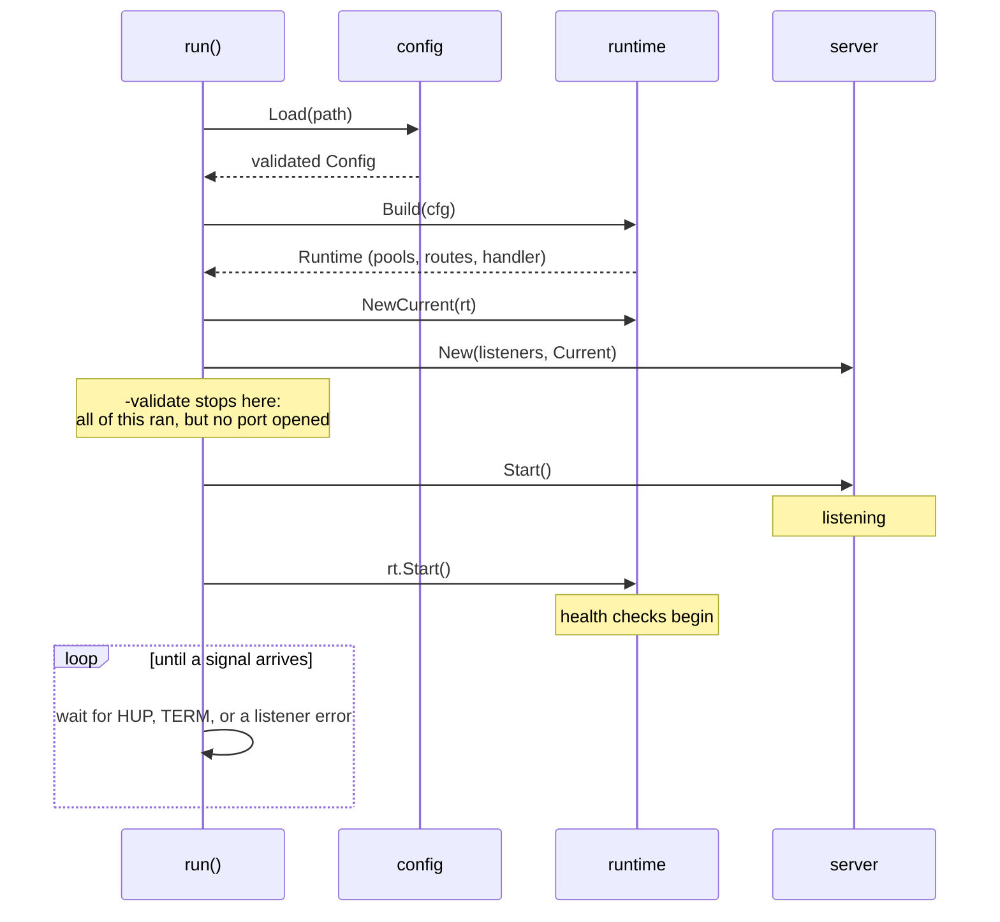

# Codebase tour

This page gives you a map, so that when you open a file, you know where you are.

## The repository

```text
prism/
├── cmd/prism/        main: flags, signals, wiring everything together
├── internal/         all of Prism's code (see below)
├── examples/         quickstart.yaml to run locally; prism.yaml shows every setting
├── test/
│   ├── e2e/          end-to-end tests: real Prism, real backends, built from YAML
│   ├── faultserver/  a test backend that can be slow, flaky, or cut off mid-body
│   ├── loadgen/      sends load at a fixed rate and records what happened
│   └── chaosplot/    draws a chaos run as a graph
├── scripts/          chaos scenarios and the reload-under-load test
├── bench/            the nginx comparison
└── docs/             you are here
```

Unit tests sit next to the code they test, in `_test.go` files. There's more test code than product code: about 16,000 lines against 11,000.

## The packages, in layers

Everything in `internal/` falls into a few layers. Knowing the layer tells you most of what a package is about.



| package | in one sentence |
| --- | --- |
| `config` | Reads the YAML, refuses unknown keys, fills in defaults, and validates. |
| `runtime` | Turns a config into live objects, and swaps them atomically on reload. |
| `server` | Owns the listeners, TLS, the access log and graceful shutdown. |
| `admin` | Serves the admin API: state, metrics, reload and cache purge. |
| `proxy` | The heart of Prism: the request pipeline, forwarding, retries and the cache flow. |
| `router` | Matches a host and path to a route. Generic, and knows nothing about proxying. |
| `upstream` | Defines `Backend` and `Pool`, and one `http.Transport` per backend. |
| `balancer` | Four strategies for picking a backend. |
| `health` | Polls each backend in the background and marks it up or down. |
| `resilience` | Circuit breaker, outlier detection, retry rules, retry budget, backoff. |
| `ratelimit` | Per-client rate limiting with the GCRA algorithm. |
| `limits` | A semaphore with a bounded queue, to cap concurrent requests. |
| `cache` | The cache's pure logic: `Cache-Control` parsing, freshness math, LRU store, request coalescing. |
| `security` | IP allow and deny lists, Basic auth, API keys. |
| `observability` | Logger and Prometheus metrics. |

Note the split between `cache` and `proxy/cache.go`. The `cache` package knows HTTP caching rules, but nothing about forwarding. `proxy/cache.go` drives it during a request. The same pattern repeats: small, independently testable parts in their own packages, with `proxy` tying them together.

### Who imports whom

This graph comes from `go list`, simplified. Two things stand out. `runtime` imports nearly everything, since its job is assembly, though only its main imports are drawn here. And the building blocks import almost nothing, which is what makes them easy to test.



`config` and `observability` are left out to keep the picture readable. Notice that `proxy` doesn't import `config`: it receives ready-built objects, and never sees YAML. Go forbids import cycles, so this direction is enforced. For example, the `upstream.Balancer` interface lives in `upstream`, while the implementations live in `balancer`, because `balancer` needs `upstream.Backend`.

## The core types

Five types carry most of the system. When you can picture these, you can read any file.



- **`runtime.Current`** (`internal/runtime/runtime.go`) is a single atomic pointer to the live `Runtime`. It's the `http.Handler` that the server calls.
- **`runtime.Runtime`** is everything built from one config. It's never modified after it's built.
- **`proxy.Handler`** (`internal/proxy/proxy.go`) is the request pipeline. Its `ServeHTTP` is the most important function in the codebase.
- **`proxy.Route`** is a matched route with all its policies, already built. A `nil` field means that feature is off, so the pipeline is a series of `if rt.X != nil` checks.
- **`upstream.Pool` and `upstream.Backend`** (`internal/upstream/upstream.go`) are a group of servers and one server. A backend carries its own connection pool and circuit breaker.

## The big design idea: immutable snapshots

If you remember one thing from this page, make it this.

A proxy is highly concurrent, with thousands of requests running at once, and it has to allow config changes while running. The obvious design is a shared config guarded by a lock. Then every request takes the lock, and a change midway through a request could leave it seeing half of the old config and half of the new.

Prism does something else. **A running config is never edited.** A reload builds a complete new `Runtime` off to the side, then swaps one atomic pointer.



Each request loads the pointer **once**, so it sees one consistent config from start to finish. There's no lock on the hot path, and if building the new `Runtime` fails, nothing has changed. The old `Runtime` stays in memory until its last request finishes, when the garbage collector takes it.

This shows up in small ways everywhere: "read-only once built" comments, and fields set once in a constructor. The one exception is state that has to survive a reload, such as a backend's health or a route's rate-limit counters. `runtime.Build` carries those objects over from the old `Runtime` whenever their settings haven't changed. That's covered in the hot reload concept page.

## What happens at startup

`main` calls `run` in `cmd/prism/main.go`. The order is deliberate: everything that can fail happens before Prism opens a port.



Step by step:

1. **`config.Load`** parses the YAML strictly, so a typo in a key is an error, rather than a setting that silently does nothing. Then it applies defaults, and `validate` collects every problem at once, so you can fix them in one go.
2. **`runtime.Build`** creates a `Pool` for each upstream, a `Route` for each route, and the `Handler`. It catches what validation can't see, like a CA file with no certificates in it.
3. **`server.New`** prepares one `http.Server` per listener and loads certificates. Nothing listens yet.
4. **`-validate`** exits at this point. Since it has run everything but the listening, it's a very strong check.
5. **`srv.Start`** binds all the ports first, then starts serving on each one, so a port conflict fails cleanly.
6. **`rt.Start`** starts the health checkers.
7. **The main loop** waits. `SIGHUP` triggers a reload, and `SIGINT` or `SIGTERM` starts a graceful shutdown.

## Where do I look for...?

| I want to understand... | start at |
| --- | --- |
| what happens to a request | `Handler.ServeHTTP` in `internal/proxy/proxy.go` |
| how a request reaches a backend | `Handler.fetch` and `Handler.outgoing`, same file |
| which headers change | `internal/proxy/headers.go`, `forwarded.go` |
| which error status a failure gets | `classify` in `internal/proxy/errors.go` |
| how a config key is parsed and checked | `internal/config/config.go`, `validate.go`, `defaults.go` |
| how config becomes objects | `Build` in `internal/runtime/runtime.go` |
| how a reload works | `Reloader.reload` in `internal/runtime/reloader.go` |
| how the cache decides | `Handler.serveCache` and `fill` in `internal/proxy/cache.go` |
| what gets logged per request | `logRequest` in `internal/server/accesslog.go` |
| how shutdown works | `shutdown` in `cmd/prism/main.go`, `Server.Shutdown` in `internal/server/server.go` |

## Conventions you'll notice

- **Comments explain why.** The code says what it does, and the comment says why it has to be that way. They're worth reading, especially in `proxy`.
- **Injected clocks.** Time-based code takes a `now` function, so tests can use a fake clock instead of sleeping.
- **`nil` means off.** Optional policies are pointers, and each is checked once.
- **Work is done at build time.** Headers are canonicalized and metric handles are looked up when the `Runtime` is built, not per request.
- **Few dependencies.** Prism needs only a YAML parser, the Prometheus client and bcrypt. Everything else is the standard library.

## Check yourself

1. Why can't `proxy` import `runtime`?
2. A reload fails halfway through `Build`. What are requests running on in the meantime?
3. You want to add a new balancing strategy. Which package does it go in, and which interface does it implement?

Next: [Life of a request](05-life-of-a-request.md).
