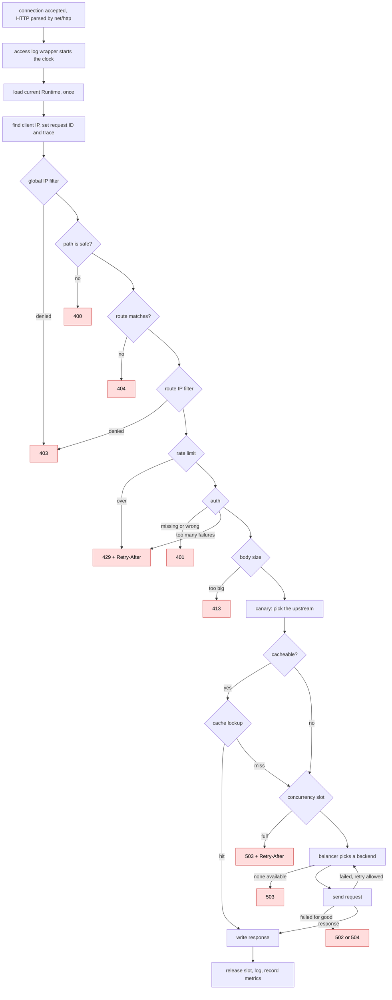
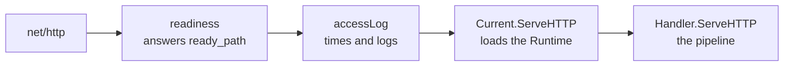
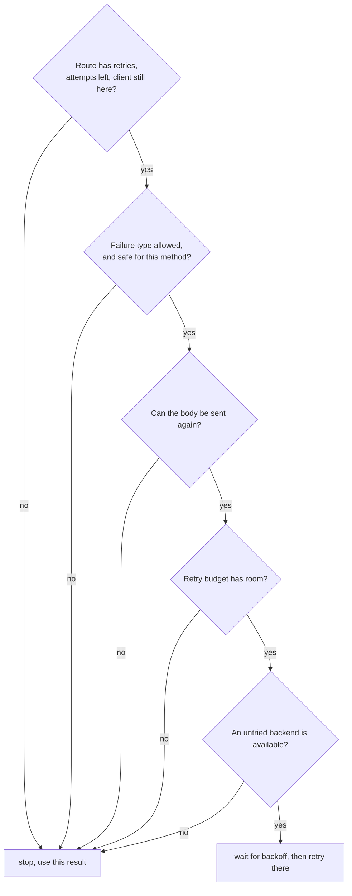
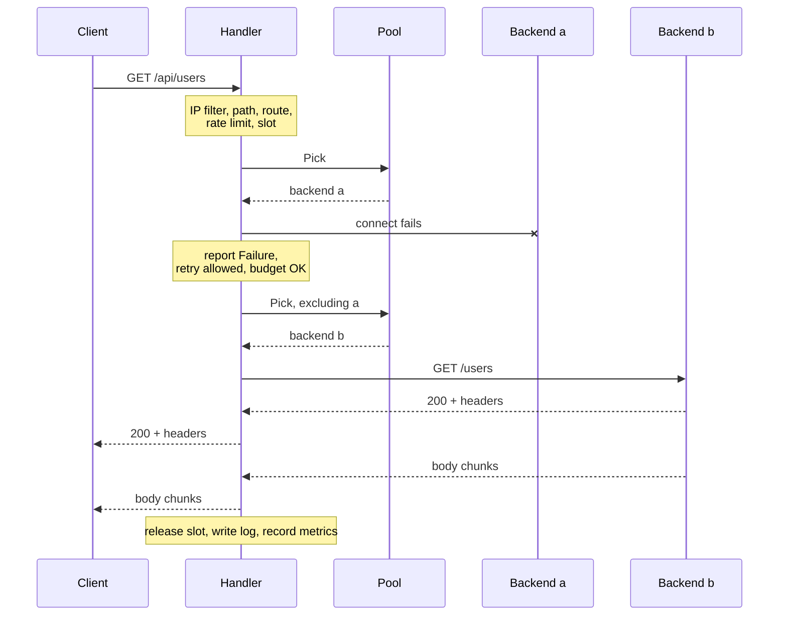

# Life of a request

This page follows one request through the code, from the moment it arrives to the moment the response finishes. Open `internal/proxy/proxy.go` alongside it. After this page, you'll be able to place any feature in Prism on the map.

We'll use the setup from [Run it](03-run-it.md), and this request:

```sh
curl 127.0.0.1:8080/api/users
```

## The whole journey

Every box below is a check a request has to pass. Most features in Prism are one box. The red exits are all the ways Prism can answer without reaching a backend.



## Why this order?

The order is the most carefully chosen thing in the pipeline. The rule of thumb: **do cheap checks first, and don't let refused requests cost you anything.**

- **The IP filter comes first** because it's nearly free, and blocked clients shouldn't get any further.
- **The path check comes before routing**, so that a path like `/public/../admin` can't match the wrong route.
- **The rate limit comes before auth**, because password checking with bcrypt is slow on purpose. If auth ran first, an attacker could burn your CPU with bad passwords, and a rate limit wouldn't help.
- **The cache comes before the concurrency slot.** A cache hit puts no load on a backend, so it shouldn't use up one of a limited number of slots. Otherwise, hundreds of cheap hits could lock out real work.
- **The body size check comes before forwarding**, so a client that announces a 10 GB upload is refused before it sends a single byte.

## Stage 1: arriving at Prism

`net/http` accepts the TCP connection, handles TLS if there is any, parses the request, and calls your handler in its own goroutine. So every request runs on its own goroutine, and most code in `proxy` reads as straight-line blocking code, with no callbacks.

The handler isn't called directly, though. It's wrapped, layer by layer:



- **`Server.readiness`** answers load-balancer probes such as `/readyz`, if configured. It's the outermost layer, so no route can shadow it, and probes stay out of the access log.
- **`accessLog`** (`internal/server/accesslog.go`) wraps the `ResponseWriter` to capture the status and byte count, and starts a timer. Its `defer` writes the log line and records metrics when the request ends, however it ends, even in a panic.
- **`Current.ServeHTTP`** loads the atomic pointer and calls that `Runtime`'s handler. This single load is what gives the request one consistent view of the config, as described in the [codebase tour](04-codebase-tour.md).

How does the proxy tell the access log what happened, like which backend it picked? `logWriter` implements the `Annotated` interface. The proxy fills in an `Annotations` struct as it goes, and the log reads it at the end. That's why you'll see `an.` throughout `proxy.go`.

## Stage 2: who is this?

Now we're in `Handler.ServeHTTP`:

```go
peer := PeerAddr(r.RemoteAddr)
an.ClientIP = h.fwd.ClientIP(r.Header, peer)
an.RequestID = h.requestID(r.Header, peer)
w.Header()[RequestIDHeader] = []string{an.RequestID}
an.Trace = newTrace(r.Header)
```

- `peer` is the machine on the other end of the TCP connection, which can't be forged.
- `ClientIP` is the real client, worked out using the trusted-proxy rules from [HTTP for proxies](02-http-for-proxies.md). All per-client decisions from here on use this.
- The request ID goes on the response right away, so that even a refused request can be found in the logs.
- `newTrace` joins the caller's distributed trace if there's a `traceparent` header, or starts a new one.

## Stage 3: checks and routing

These are the diamonds on the flowchart, in order, and each is a few lines long. The notable part is how little work a refusal does: `reject` writes the status, and adds `Retry-After` if there is one. It deliberately doesn't log a line of its own. The access log already covers the request, and an extra log line per refusal would turn a flood of requests into a flood of logs too.

**`validPath`** refuses paths with `.`, `..` or empty segments. Since `r.URL.Path` is already decoded, `%2e%2e` is caught as well.

**`h.routes.Match(r.Host, r.URL.Path)`** finds the route (`internal/router/router.go`). It picks a host group first, with exact hosts beating wildcards, then the longest matching path prefix. In our example, `/api/users` matches the `/api/` route.

```text
routes:   /          /api/        /api/admin/
request:  /api/users
                      ▲ longest prefix that matches
```

Prefixes are plain strings, as in nginx, so `/api` also matches `/apiv2`. End a prefix with `/` to match whole path segments.

**`rt.RateLimit.Allow`**, **`a.Check`** and the body checks follow. Our route has a rate limit, which we pass, and no auth.

**Canary.** If the route has a canary, `rt.Canary.pick` decides whether this client should go to the new version's upstream. We don't have one, so `an.Pool` stays `rt.Pool`.

## Stage 4: the fork

```go
if c := rt.Cache; c != nil && !canary && !an.WebSocket && cacheable(r) {
    h.serveCache(w, r, rt, c, an)
    return
}
if !h.acquire(w, r, rt, an) {
    return
}
defer release(rt)
h.forward(w, r, rt, an)
```

This is the fork in the road. Our `/api/` route has no cache, so we go straight to `acquire`, which takes a concurrency slot if the route has a limit. A cacheable request goes through `serveCache` instead, and only takes a slot if it actually needs a backend.

Note where the slot gets released: `defer`, after `forward` returns. That's after the *whole response body* has been copied. A slow download is still load on a backend, so it keeps its slot for the full duration.

## Stage 5: picking a backend

`forward` calls `fetch`, which does the real work and never touches the client. That separation is what lets the cache reuse it: `fetch` gets a response, and the caller decides what to do with it.

```go
choice := upstream.Choice{ClientIP: an.ClientIP}
b, adm, err := pick(an.Pool, &choice)
```

Picking has two layers:

1. **`Pool.Pick`** asks the balancer, which skips any backend that isn't `Available()`. Available means healthy, not ejected, and with no open circuit breaker. All of those are atomic reads, so this is cheap enough to run on every request.
2. **`Backend.Admit`** then asks the circuit breaker for permission. A half-open breaker lets only a few probe requests through, so it can refuse here, and the loop moves on to the next backend.

If nothing is available, the result is `ErrNoBackend`, which becomes a `503`.

## Stage 6: building the outgoing request

`outgoing` builds the new request. This is the "second conversation" from [the first page](01-what-is-a-reverse-proxy.md), and each line of the function maps to a change you saw in [step 8 of Run it](03-run-it.md):

| step | code | effect |
| --- | --- | --- |
| copy headers | `r.Header.Clone()` | the original stays intact for retries |
| drop hop-by-hop | `cleanRequestHeaders` | `Connection` and friends are removed |
| forwarding headers | `h.fwd.Apply` | sets `X-Forwarded-For`, `-Proto`, `-Host` |
| IDs | request ID, `traceparent` | ties logs together across services |
| auth | `rt.Auth.Prepare` | removes checked credentials, adds identity |
| route rules | `rt.Request.Apply` | your `headers:` config |
| host | `b.URL.Host`, or `r.Host` with `preserve_host` | sets `Host` |
| URL | `targetURL` | applies `strip_prefix`: `/api/users` becomes `/users` |
| context | `out.WithContext(r.Context())` | see below |

That last row is small and important. The outgoing request shares the client's context, so **if the client disconnects, the backend request gets canceled automatically**. No one spends time computing a response that nobody will read.

## Stage 7: sending, and retrying

Here's the core loop in `fetch`, simplified:

```go
for {
    an.Attempts++
    b.Acquire()                                        // inflight count +1
    resp, err = b.Transport.RoundTrip(h.outgoing(...)) // the actual network call
    out = outcome(r, &body, resp, err)                 // what did this tell us?
    b.Report(adm, out)                                 // tell breaker and outlier detection
    next, nextAdm := h.retryTarget(...)                // should we go again?
    if next == nil {
        break
    }
    b.Release()
    b, adm = next, nextAdm
    sleep(backoff)
}
```

`RoundTrip` is used directly rather than `http.Client`, because `Client` follows redirects, and a proxy must pass a redirect back to the client instead.

**`outcome`** classifies the attempt. Pay attention to the first case:

```go
switch {
case r.Context().Err() != nil || body.clientFailed():
    return resilience.Neutral
case err != nil || resp.StatusCode >= 500:
    return resilience.Failure
}
return resilience.Success
```

If the *client* caused the failure, by leaving or sending a broken body, then it says nothing about the backend. Without this rule, a client could get healthy backends thrown out just by disconnecting.

**`retryTarget`** decides whether to go again. All of these must hold:



Two of those deserve a closer look:

- **The body.** `newRequestBody` (`internal/proxy/body.go`) decides up front. On a route with retries, a body of up to 64 KB with a known length is read into memory, so it can be sent any number of times. Larger bodies are streamed, and can only be retried if none of the body has been read yet.
- **The budget.** Picture all backends failing at once. If every request retries twice, you've tripled the load on servers that are already struggling, and turned a blip into an outage. A retry budget limits retries to a fraction of normal traffic, so that can't happen.

## Stage 8: the response comes back

Back in `fetch`, the hop-by-hop headers are stripped from the response too, and any `X-Request-Id` the backend sent is dropped, so the client gets the ID Prism assigned.

`write` then streams it to the client:

1. Apply the route's response header rules.
2. Copy the headers to the `ResponseWriter`.
3. `w.WriteHeader(status)`. From this line on, the status can't change.
4. Copy the body with `copyBody`, using a pooled 32 KB buffer, so memory use stays flat no matter how big the response is.

Streams need one more thing. `net/http` buffers writes, which would hold up a live event feed. So when the response has no known length, or is `text/event-stream`, Prism flushes after every write.

`copyBody` deliberately reports read and write errors separately, because they mean different things:

- **The write to the client failed.** The client left. It's no one's fault, so just stop.
- **The read from the backend failed.** The backend broke mid-body. The headers already counted as a success, so `Overturn` corrects that record. Then `abort` panics with `http.ErrAbortHandler`, which is how you tell `net/http` to cut the connection. The client sees a broken response, instead of a short one that looks complete.

## Stage 9: cleaning up

The deferred functions run, in reverse order:

1. `f.release()` closes the response body, which returns the connection to the pool, and decrements the backend's inflight count.
2. `release(rt)` gives back the concurrency slot.
3. Back in `accessLog`, the log line is written and metrics are recorded.

For our request, the log line looks like this (wrapped here to fit):

```text
level=INFO msg=request request_id=976439f65bbf503ab87a4acf11773aff trace_id=33e7877977d9af725f33875e2191f506
span_id=7c02218d79b92d3f method=GET host=127.0.0.1:8080 path=/api/users proto=HTTP/1.1 status=200 bytes=64
duration=943.823µs client=127.0.0.1 route=/api/ upstream=app backend=http://127.0.0.1:9101 attempts=1
```

Everything in it came from the `Annotations` struct filled in along the way.

## The whole thing as a timeline

Here's the same happy path in one picture, with a failed first attempt to show a retry.



## When things go wrong

| what happened | status | log `error=` | decided in |
| --- | --- | --- | --- |
| IP blocked | 403 | `forbidden` | `Handler.ServeHTTP` |
| bad path | 400 | | `validPath` |
| no route | 404 | | `Handler.ServeHTTP` |
| rate limited | 429 | `rate_limited` | `Handler.ServeHTTP` |
| missing or wrong credentials | 401 | `unauthorized` | `Handler.ServeHTTP` |
| too many wrong credentials | 429 | `auth_limited` | `security.Authenticator` |
| body too large | 413 | `body_too_large` | `Handler.ServeHTTP`, `classify` |
| no slot in time | 503 | `overloaded` | `Handler.acquire` |
| no backend available | 503 | `no_backend` | `classify` |
| timeout | 504 | `timeout` | `classify` |
| connection refused | 502 | `connect` | `classify` |
| other backend failure | 502 | `upstream` | `classify` |
| client's body broke | 400 | `client_body` | `clientBodyFailed` |
| client left | 499, log only | `client_closed` | `classify` |
| backend died mid-body | connection cut | `upstream` | `Handler.abort` |

## Check yourself

1. Why is the concurrency slot released after the body is copied, rather than when the headers arrive?
2. A client disconnects while Prism is waiting for a backend. Walk through what happens: to the backend request, to the circuit breaker, and to the log line.
3. What would go wrong if `outcome` treated a client disconnect as a `Failure`?
4. Why does `fetch` write nothing to the client?
5. Find the line that makes one `Runtime` serve a request from beginning to end, even if a reload happens halfway through.

## Where to go next

You now have the whole map. The [concept pages](../README.md#concepts) each zoom into one box on the flowchart, and you can read them in any order. A good first pick is [Load balancing](../concepts/load-balancing.md) or [Detecting failure](../concepts/detecting-failure.md).
